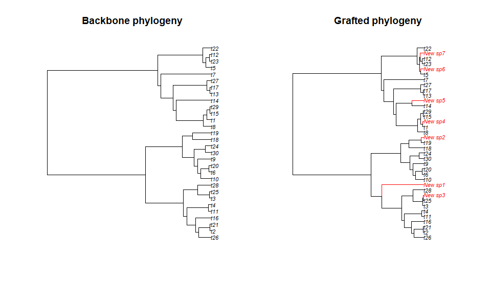
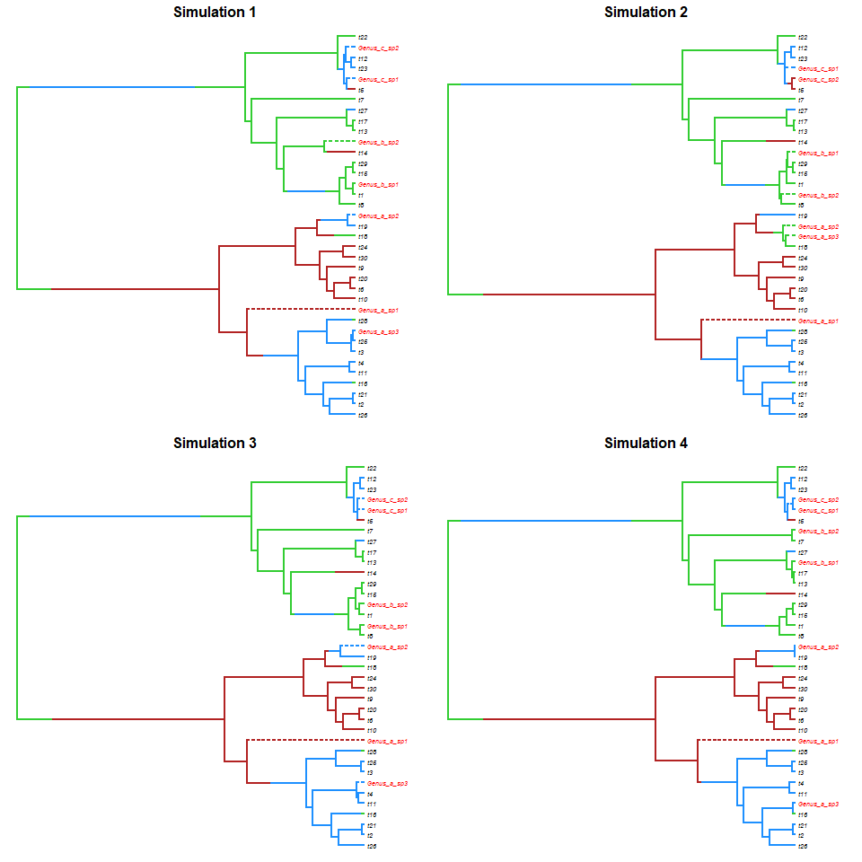

<!-- README.md is generated from README.Rmd. Please edit that file -->

# phylograftR

<!-- badges: start -->

<!-- 
usethis::use_cran_badge() reports the current version of your package on CRAN.
usethis::use_coverage() reports test coverage.
use_github_actions()  reports the R CMD check status of your development package. 
&#10;# Check badges in mFD package.
&#10;# Examples to adjust
&#10;[](https://cran.r-project.org/package=phylograftR) 
[](https://opensource.org/licenses/MIT)
[](https://cran.r-project.org/package=phylograftR) # Total (looks better)
[](https://r-pkg.org:443/pkg/phylograftR) # Per month
[](https://zenodo.org/doi/TBA)
&#10;-->

<!-- badges: end -->

## :dart: Summary

The goal of **phylograftR** is to graft missing lineages on
time-calibrated phylogenies using available taxonomic, evolutionary, and
biological information. It combines taxonomic assignments, which define
the target clades where each missing taxon must be grafted and the
excluded subclades where it must not, with diversification modeling to
infer the divergence times of the imputed branches. Critically, it can
also use species attributes, such as categorical traits, discretized
continuous traits, or biogeographic ranges, to further refine the
sections of the backbone phylogeny where each missing lineage can be
grafted.

### Why use phylograftR?

Most time-calibrated phylogenies are incomplete: genetic data are
missing for many described species, so a large part of the taxa of a
group is absent from the tree. Yet many analyses need every taxon to be
a tip of the tree, or are sensitive to the missing ones such as maps of
phylogenetic diversity, inferences of rates of trait evolution, state-
and range-dependent diversification models, or historical biogeographic
reconstructions. The taxa missing from the tree are not unknown, though:
they usually belong to named groups (genera, families, or other clades)
that are in the tree, and often come with informative attributes on
their traits or ranges. The task is thus to **graft the missing
lineages** at plausible positions on the tree, using all information
available, while accounting for the fact that these positions are
uncertain.

### What novelties does phylograftR bring?

**phylograftR** builds on the **TACT framework** (Taxonomic Addition for
Complete Trees; *Chang et al., 2019*), a stochastic polytomy resolver
that uses the taxonomy to place missing taxa within their target
taxonomic groups, with divergence times drawn from birth-death models
fitted locally on each target group, so that diversification rates can
vary across the tree.

**phylograftR** brings this approach to R and extends it in three ways:

- **Excluded subclades.** Taxonomic assignments can also tell where a
  taxon does *NOT* belong: subclades of the target clade can be excluded
  from grafting. For instance, if a missing lineage from the Neotropics
  is to be grafted within its target Genus, you may wish to prevent it
  within a subclade that occur exclusively in Afrotropics.
- **Species attributes.** Grafting can be restricted to the parts of the
  target clade branches whose state is compatible with the known
  attributes of the missing taxon to graft. This is equivalent to using
  **excluded subclades** to restrict grafting within a target group, but
  while explicitly accounting for the species attributes used for such
  restrictions. States can be categorical traits, discretized continuous
  traits, or biogeographic ranges.
- **Missing clades.** Besides single taxa, entire missing clades can be
  grafted as a unit, sister to a clade of the backbone phylogeny, with
  their internal diversification process simulated under the same
  birth-death model than their sister-clade. Both types of missing
  lineages (taxa and clades) can be grafted in one unique run with
  `graft_missing_taxa_and_clades()`.

Grafting is stochastic, so **phylograftR** is designed to produce *sets*
of grafted phylogenies (several simulations, and optionally several
stochastic maps of the species attributes used as constraints), so that
the uncertainty in the position of imputed taxa can be propagated to
downstream analyses.

### When to use phylograftR?

Grafting is most useful when:

- the backbone phylogeny is moderately to strongly incomplete;
- you have reliable taxonomic information to place the missing taxa;
- your downstream analysis requires them as tips of the tree.

Analyses that can directly use **sampling fractions**, or that run on a
well-sampled phylogeny, may not benefit from the additional complexity.

When the phylogeny is extremely sparse, or when the taxonomy is the main
information available, methods based on higher clades (i.e.,
family-level) may be more appropriate to limit uncertainty. When
molecular data are available for the missing taxa, it is recommended to
use **phylogenetic inference** methods designed for this purpose, rather
than impute the missing taxa without accounting for the available
phylogenetic information.

## :gear: The phylograftR workflow

**1. Input.** The user provides a backbone phylogeny (rooted, binary,
ultrametric) and a `missing_taxa_list` describing the taxa to graft.
Each taxon is assigned to a target clade (or, for missing clades, to a
sister clade) defined by the tips of the backbone that enclose it, i.e.,
a pair of tips whose most recent common ancestor (MRCA) is the target
clade, or a single tip for a terminal branch. The list can optionally
include, per taxon, tips to define excluded subclades, and the states of
a trait where the taxon can be grafted (i.e., allowed states).

`missing_taxa_list` can be imported from external tables with
`import_missing_taxa_list()`, or built from a data.frame object within R
with `build_missing_taxa_list()`. The `missing_taxa_list` can also cover
missing clades (see step 4).

**2. Available branches and Attribute-based grafting.** For each taxon,
the branches of the backbone available for grafting are those of its
target clade (and, optionally, its stem branch), minus the excluded
subclades.

If a stochastic map (i.e., `simmap`) is provided, a taxon is only
grafted on branch pieces in its allowed states, and the grafted lineages
inherits the state of the graft point. Several traits can be used
jointly, and a set of stochastic maps (`multiSimmap`) can be used to
account for the uncertainty in the evolution of the trait: the grafting
is then repeated with each map.

Biogeographic ranges can be treated as sets of areas, so that a taxon
known to occur in area “A” can be grafted on branches whose range is
“A”, “AB” or “ABC”. Continuous traits can also be used to constrain
grafting after being discretized into categorical states.

Prior to any run, the validity of the grafting plan can be assessed with
`check_grafting_plan()` to detects the taxa with no or little branch
available given the constraints.

**3. Nested grafting under a diversification model.** Target clades are
processed from the smallest to the largest, so that taxa of larger
clades are grafted on a tree that already includes the taxa of the
clades nested within, and can attach to their branches.

Two methods are available in `graft_missing_taxa()` for drawing where
taxa are grafted:

- `"BD_clades"` (default, recommended): a birth-death model is fitted on
  each target clade (or on the smallest enclosing clade with enough
  tips, if the clade is too small), with a sampling fraction that
  accounts for the missing taxa and, optionally, for unsampled species
  (total richness of clades). The divergence times of all the missing
  taxa of the clade are then jointly drawn under the fitted model,
  conditioned on the clade age, and each taxon is attached to a branch
  of the current tree that crosses its divergence time on an available
  (and allowed) branch piece.
- `"uniform"`: a faster alternative, in which the grafting occurs
  randomly along all available branch pieces within the target clade,
  once excluded subclades and allowed states are accounted for, based on
  a uniform draw. It ignores diversification dynamics, and is mostly
  useful for quick explorations.

**4. Missing clades.** `graft_missing_clades()` follows the same logic,
but is used to graft set of missing taxa forming a monophyletic group
(i.e., missing clades). Those taxa are grafted together, as one missing
clade attached to the stem branch of their designated sister clade. The
divergence time of the missing clade is drawn under the birth-death
model fitted on its sister clade, and the clade is grown under the same
model, conditioned on its number of taxa and its stem age.

Both types of missing lineages (taxa and clades) can be grafted in one
run with `graft_missing_taxa_and_clades()` using a single set of
arguments and a unique seed.

**5. Outputs and checks.** The outputs are grafted phylogenies (a single
one, a set of simulations, or a list of sets, one per stochastic map
used as constraints) that record which tips and branches were grafted,
and, if a `simmap` was provided, an updated simmap that includes the
states of the grafted branches.

The grafting can be verified a posteriori against all constraints
(`check_grafting_constraints()`), summarized into graft ages, divergence
ages, parent clades, and inherited states (`extract_grafting_info()`),
and plotted with the grafted elements highlighted (`plot_grafted()`).

See the [reference
page](https://maeldore.github.io/phylograftR/reference/index.html) of
the website for the complete list of **available functions** and
**datasets**, with their documentation and examples.

Please consult the
[vignettes](https://maeldore.github.io/phylograftR/articles/phylograftR.html)
for guidance on how to prepare the input data, choose among the
available grafting options, and produce visual outputs.

## :factory: Applications

**phylograftR** is meant to build sets of comprehensive phylogenies, for
macroevolutionary and biogeographic analyses that require all the known
species, or that are sensitive to incomplete taxon sampling.

Here is a non-exhaustive list of the most common applications:

- Mapping **phylogenetic diversity** and phylogenetic endemism, or any
  other phylogeny-based metric of community composition.
- Estimating **rates of morphological or ecological evolution**, and
  testing the phylogenetic signal of traits, on all the known taxa.
- Fitting **state-dependent and range-dependent diversification
  models**\* on comprehensive phylogenies.
- Reconstructing **ancestral states and ranges**, and accounting for
  transition/biogeographic events across all branches.

Ideally, a set of grafted phylogenies should be used to **account for
uncertainty** in the position of imputed taxa: each downstream analysis
is run on the whole set, and the results are summarized across
phylogenies.

## :rotating_light: Limits and cautions for interpretation

**Imputed branches are hypotheses, not data.** Grafted taxa have no
sequence information: they are placed at random, within the constraints,
under a diversification model. The set of grafted phylogenies describes
the uncertainty of this placement given the constraints, but is not a
substitute for molecular data. A single grafted phylogeny should not be
interpreted at the level of individual taxa. The placement is only as
good as the constraints it relies on: target clades and excluded
subclades are taken as ground-truth information, and a taxonomy that is
not monophyletic, or a target clade poorly sampled in the backbone, will
lead to mislocated taxa.

**Attribute states are fixed, not modeled.** A grafted taxon takes the
state of its graft point, not a state predicted by its known attribute
or by a model of trait evolution. Such approach does not account for
potential shifts in states or ranges in the evolutionary history of the
grafted lineages.

**Risk of circularity in downstream analyses of trait evolution.**
Random placement of the missing taxa ignores the phylogenetic
conservatism of traits. As a result, grafted phylogenies can erase the
true phylogenetic signal of traits and inflate the estimated rates of
trait evolution (see *Rabosky, 2015*).

On the contrary, constraining the grafting with the states of a trait
forces grafted taxa to inherit the states/ranges of their grafted point.
This forces a correlation between the attribute and the phylogeny, which
is expected to inflate its phylogenetic signal and the support for
state-dependent models.

When analyzing phylogenetic signal and/or state-dependent
diversity-dynamics, consider using a different trait as constraint, or
running the grafting without attribute-based constraints and compare
results.

**Alternative approach for continuous trait**. For continuous traits, an
alternative method exists to identify the optimal placement of missing
taxa based on ML inference of the grafted tree conditioned to the
backbone tree and trait values (e.g., `phytools::locate.yeti()`, *Revell
et al. 2015*). However, such method typically requires multiple trait
data sampled comprehensively across the clade of interest to perform
optimally, and it can only graft one missing taxa at a time.

### :crystal_ball: Perspectives

**Temporal variation of diversification rates.** The current
implementation of **phylograftR** accounts for variation in
diversification dynamics among clades, but it does not allow to account
for temporal variation of diversification rates within target clades. A
potential future implementation may consider fitting time-varying
birth-death models as a possible extension.

**Fossil and extinct taxa.** The phylogeny backbone used as input for
**phylograftR** must be ultrametric, with all the tips at the present,
so fossils cannot be grafted at the moment. The backbone must also be
rooted and binary: polytomies must be resolved beforehand (e.g., with
`ape::multi2di()`).

### :link: References

For the **TACT framework**:

> Chang, J., Rabosky, D. L., & Alfaro, M. E. (2019). Estimating
> diversification rates on incompletely-sampled phylogenies: theoretical
> concerns and practical solutions. *Systematic Biology*.
> <https://doi.org/10.1093/sysbio/syz081>

On the limits of using grated phylogenies in downstream comparative
analyses:

> Rabosky, D. L. No substitute for real data: A cautionary note on the
> use of phylogenies from birth-death polytomy resolvers for downstream
> comparative analyses. *Evolution*. 69, 3207–3216 (2015).
> <https://doi.org/10.1111/evo.12817>

Alternative grafting method based on continuous traits:

> Revell, L. J., Mahler, D. L., Reynolds, R. G. , Slater, G. J. Placing
> cryptic, recently extinct, or hypothesized taxa into an ultrametric
> phylogeny using continuous character data: A case study with the
> lizard Anolis roosevelti. Evolution (N. Y). 69, 1027–1035 (2015).
> <https://doi.org/10.1111/evo.12628>

## :envelope_with_arrow: Installation

phylograftR works on R version 4.6 or more. Be sure to have an R version
that is compatible. <br> See <https://CRAN.R-project.org/>.

From **CRAN**, for the latest release:

``` r
install.packages("phylograftR")
```

From **GitHub**, for the current development version:

``` r
# Install the installer package first
install.packages("pak")

# For a light installation (fast, no vignettes), run:
pak::pak("MaelDore/phylograftR")
# You will not have access to the vignettes/tutorials within R, but can still access them through this website.
# See the dedicated Sections below.

# For a full installation (with vignettes/tutorials available in R), run:
options(pkg.build_vignettes = TRUE)
pak::pak("MaelDore/phylograftR")
```

## :desktop_computer: Website

A companion website is available to browse interactively the different
tutorials and functions of **phylograftR** at this URL:
<https://maeldore.github.io/phylograftR/>.

An overview of all functions and datasets is available
[here](https://maeldore.github.io/phylograftR/reference/index.html).
<br>

## :joystick: Quick-to-run example

This example grafts seven missing taxa on a toy backbone phylogeny of 30
tips, using the datasets shipped with the package.

``` r
## Prepare data

# The backbone phylogeny is a time-calibrated phylogeny, and the stochastic character map (simmap) describes
# the evolution of a trait with three states (`"blue"`, `"green"`, and `"red"`) along its branches.

library(phylograftR)

data(toy_backbone)
data(toy_simmap)

# The taxonomy of the tips of the backbone is provided in a table, with one row per tip:
# the first column (`Taxa`) holds the tip labels, and the other columns are taxonomic levels
# (here, `Family`, `Subfamily`, `Tribe`, and `Genus`).
data(toy_backbone_taxonomic_table)
head(toy_backbone_taxonomic_table)
#>   Taxa   Family Subfamily     Tribe Genus
#> 1  t26 Family_A Subfam_A2 Tribe_A2a  <NA>
#> 2   t2 Family_A Subfam_A2 Tribe_A2a  <NA>
#> 3  t21 Family_A Subfam_A2 Tribe_A2a  <NA>
#> 4  t16 Family_A Subfam_A2 Tribe_A2a  <NA>
#> 5  t11 Family_A Subfam_A2 Tribe_A2a  <NA>
#> 6   t4 Family_A Subfam_A2 Tribe_A2a  <NA>

# The missing taxa are described in a second table, with one row per taxon.
data(toy_missing_taxa_taxonomic_table)
head(toy_missing_taxa_taxonomic_table)
#>      Taxa Type   Family Subfamily    Tribe Genus Target_clade Sister_clade
#> 1 New_sp1 taxa Family_A      <NA>     <NA>  <NA>       Family         <NA>
#> 2 New_sp2 taxa Family_A      <NA>     <NA>  <NA>       Family         <NA>
#> 3 New_sp3 taxa Family_A      <NA>     <NA>  <NA>       Family         <NA>
#> 4 New_sp4 taxa Family_B      <NA>     <NA>  <NA>     Family_B         <NA>
#> 5 New_sp5 taxa Family_B Subfam_B1     <NA>  <NA>    Subfamily         <NA>
#> 6 New_sp6 taxa Family_B Subfam_B2 Tribe_B2  <NA>        Gen_2         <NA>
#>    Excluded_subclades include_target_clade_stem exclude_subclades_stem
#> 1 Subfam_A1;Tribe_A2a                      TRUE             TRUE;FALSE
#> 2     Tribe_A2a;Gen_3                      TRUE             FALSE;TRUE
#> 3                <NA>                     FALSE                   <NA>
#> 4                <NA>                        NA                   <NA>
#> 5               Gen_1                      TRUE                   <NA>
#> 6                <NA>                        NA                   <NA>

# `Type` states how the taxon is grafted: within a target clade (`"taxa"`), or as the sister of a clade (`"clades"`).
# For the example, keep only the missing taxa to graft within a target clade (`"taxa"`)
# and remove the ones to graft as blocks of missing clades (`"clades"`).
toy_missing_taxa_taxonomic_table <- toy_missing_taxa_taxonomic_table[toy_missing_taxa_taxonomic_table$Type == "taxa", ]

# Clades are written with taxonomic names (e.g., `"Family_B"`), or with the name of a taxonomic level
# (e.g., `"Family"`, meaning the family of the taxon, as given in the column of the same name).
# Target clades (`Target_clade`), where the taxa is known to belong,
# and excluded subclades (`Excluded_subclades`), where taxa are known NOT to belong,
# are retrieved from the taxonomy of the backbone.

# The inclusion of the stem branch as a valid placement for grafting can be fine-tuned
# for target clades (`include_target_clade_stem`) and excluded subclades (`exclude_subclades_stem`).

# Some taxa may also have `allowed_states`: the states of the branches on which they can be grafted.
toy_missing_taxa_taxonomic_table$allowed_states <- c("red", NA, NA, "blue, green", "green", NA, "blue, red")
```

| Taxa | Type | Family | Subfamily | Tribe | Genus | Target_clade | Sister_clade | Excluded_subclades | include_target_clade_stem | exclude_subclades_stem | allowed_states |
|:---|:---|:---|:---|:---|:---|:---|:---|:---|:---|:---|:---|
| New_sp1 | taxa | Family_A | NA | NA | NA | Family | NA | Subfam_A1;Tribe_A2a | TRUE | TRUE;FALSE | red |
| New_sp2 | taxa | Family_A | NA | NA | NA | Family | NA | Tribe_A2a;Gen_3 | TRUE | FALSE;TRUE | NA |
| New_sp3 | taxa | Family_A | NA | NA | NA | Family | NA | NA | FALSE | NA | NA |
| New_sp4 | taxa | Family_B | NA | NA | NA | Family_B | NA | NA | NA | NA | blue, green |
| New_sp5 | taxa | Family_B | Subfam_B1 | NA | NA | Subfamily | NA | Gen_1 | TRUE | NA | green |
| New_sp6 | taxa | Family_B | Subfam_B2 | Tribe_B2 | NA | Gen_2 | NA | NA | NA | NA | NA |
| New_sp7 | taxa | Family_B | Subfam_B2 | Tribe_B2 | NA | Tribe | NA | NA | FALSE | NA | blue, red |

``` r
## Build the list of missing taxa from the taxonomic tables

# The taxonomic names are converted into clades of the backbone phylogeny, 
# and the tables are checked against the backbone phylogeny.
missing_taxa_list <- build_missing_taxa_list_from_taxonomy(
  backbone_taxonomic_table = toy_backbone_taxonomic_table,
  missing_taxa_taxonomic_table = toy_missing_taxa_taxonomic_table,
  phy = toy_backbone, verbose = FALSE)

# Alternatively, it is possible to build directly the missing_taxa_list object and
# fine-tune which clades to use as a Target_calde, Sister_clade, or excluded_subclades
# based on its node_ID or MRCA_tips, without the need of an explicit taxonomic classification.
# Please refer to 'vignette("format_inputs")' for a dedicated tutorial.
```

``` r
## Graft the missing taxa

# The taxa are grafted with the default options 
# (diversification modeling with birth-death models fitted on the target clades).
# Taxa with their own `allowed_states` follow them,
# and the others are restricted to the global argument: here, the states `"blue"` and `"green"`.

# To graft both the missing taxa and the missing clades of the table in one run,
# use `graft_missing_taxa_and_clades()`: see 'vignette("combine_missing_taxa_and_clades")' for a dedicated tutorial.

grafted_phy <- graft_missing_taxa(phy = toy_backbone,
                                  missing_taxa_list = missing_taxa_list,
                                  simmap = toy_simmap, allowed_states = c("blue", "green"),
                                  seed = 1234, verbose = FALSE)
```

``` r
## Vizualize the grafted phylogeny

# The grafted taxa can be directly compared with the backbone phylogeny:
# the grafted tips and branches are colored in red.

par(mfrow = c(1, 2))
plot(toy_backbone, cex = 0.7, main = "Backbone phylogeny")
plot_grafted(grafted_phy, use_simmap = FALSE, cex = 0.7, main = "Grafted phylogeny")
par(mfrow = c(1, 1))
```



``` r
## Account for the uncertainty with several simulations

# Grafting is stochastic, so a single grafted phylogeny is only one of the possible outcomes.
# Downstream analyses should ideally be run on a set of grafted phylogenies:
# Here, we use 10 simulations for a quick example.

grafted_phys <- graft_missing_taxa(phy = toy_backbone,
                                   missing_taxa_list = missing_taxa_list,
                                   simmap = toy_simmap, allowed_states = c("blue", "green"),
                                   nb_simulations = 10, seed = 1234, verbose = FALSE)
```

``` r
## Vizualize updated stochastic maps

# Below we plot four of the simulations with their updated simmap. 
# The states of the trait are kept along grafted branches
# The grafted branches appear as dashed lines, and the labels of the grafted taxa are in red.

par(mfrow = c(2, 2))
for (i in 1:4)
{
  plot_grafted(grafted_phys, index = i, fsize = 0.5, ftype = "i",
               simmap_colors = c("blue" = "dodgerblue", "green" = "limegreen", "red" = "firebrick"),
               main = paste("Simulation", i))
}
par(mfrow = c(1, 1))
```



## :scroll: Advanced uses / tutorials

Tutorials are available to explore **all usages** of phylograftR.

They are listed below, in the [companion
website](https://maeldore.github.io/phylograftR/articles/phylograftR.html),
and in this vignette: `vignette("phylograftR")`.

**1/ Inputs**

- [Format **inputs** prior to
  grafting](https://maeldore.github.io/phylograftR/articles/format_inputs.html):
  `vignette("format_inputs")`.
- [Prepare **trait data** and build **stochastic maps** with
  deepSTRAPP](https://maeldore.github.io/phylograftR/articles/prepare_stochastic_maps.html):
  `vignette("prepare_stochastic_maps")`.

**2/ Main workflow**

- [Full **grafting workflow**, from the data to the grafted
  phylogenies](https://maeldore.github.io/phylograftR/articles/main_workflow.html):
  `vignette("main_workflow")`.

**3/ Grafting options**

- [Explore options to graft **missing
  taxa**](https://maeldore.github.io/phylograftR/articles/graft_missing_taxa.html):
  `vignette("graft_missing_taxa")`.
- [Explore options to graft **missing
  clades**](https://maeldore.github.io/phylograftR/articles/graft_missing_clades.html):
  `vignette("graft_missing_clades")`.
- [Graft **both missing taxa and missing clades** in one
  run](https://maeldore.github.io/phylograftR/articles/combine_missing_taxa_and_clades.html):
  `vignette("combine_missing_taxa_and_clades")`.

**4/ Checks**

- [Check the **grafting plan** and the **grafted
  phylogenies**](https://maeldore.github.io/phylograftR/articles/check_grafting.html):
  `vignette("check_grafting")`.

**5/ Data types**

- [Use **biogeographic ranges** as
  constraints](https://maeldore.github.io/phylograftR/articles/biogeographic_data.html):
  `vignette("biogeographic_data")`.
- [Combine **several traits** as
  constraints](https://maeldore.github.io/phylograftR/articles/multiple_traits.html):
  `vignette("multiple_traits")`.
- [Use a **continuous trait** as
  constraint](https://maeldore.github.io/phylograftR/articles/continuous_data.html):
  `vignette("continuous_data")`.

**6/ Uncertainty, reproducibility, and scaling**

- [Handle **uncertainty** and ensure
  **reproducibility**](https://maeldore.github.io/phylograftR/articles/handle_uncertainty.html):
  `vignette("handle_uncertainty")`.
- [Run grafting in
  **parallel**](https://maeldore.github.io/phylograftR/articles/parallel_grafting.html):
  `vignette("parallel_grafting")`.
- [**Resume** a crashed or interrupted
  run](https://maeldore.github.io/phylograftR/articles/resume_run.html):
  `vignette("resume_run")`.

Alternatively, if you prefer to view the vignettes in R, you can install
the package with `build_vignettes = TRUE`.

``` r
remotes::install_github(repo = "MaelDore/phylograftR",
                        dependencies = TRUE, 
                        upgrade = "ask",
                        build_vignettes = TRUE) 

# Access vignettes within R
vignette("phylograftR")

# You can also use this to open access to all local vignettes in an HTML Brower
utils::browseVignettes(package = "phylograftR")
```

## :bug: Found a bug?

Thank you for finding it! Head over to the [GitHub Issues
tab](https://github.com/MaelDore/phylograftR/issues) and let me know
about it. <br> You can also [send me an
e-mail](mailto:mael.dore@gmail.com). <br>

## :black_nib: How to cite phylograftR

For any use of **phylograftR**:

> Doré, M. phylograftR: Grafting missing taxa on time-calibrated
> phylogenies combining diversification modeling, taxonomic assignments,
> and species attributes. (DOI TBA)

**phylograftR** extends the **TACT framework** to enable the
identification of exclusive subclades where NOT to graft missing species
based on taxonomic assignments and/or species attributes. Please cite
the TACT paper as a foundation work for the development of
**phylograftR**:

> Chang, J., Rabosky, D. L., & Alfaro, M. E. (2019). Estimating
> diversification rates on incompletely-sampled phylogenies: theoretical
> concerns and practical solutions. *Systematic Biology*.
> <https://doi.org/10.1093/sysbio/syz081>

**TACT** is available as Python-based software at:
<https://tact.jonathanchang.org/>

As **phylograftR** relies strongly on functions designed for the
[phytools R package](https://blog.phytools.org/) and the [TreeSim R
package](https://CRAN.R-project.org/package=TreeSim), it is good
practice to also cite these packages:

> Revell, L. J. (2024) phytools 2.0: an updated R ecosystem for
> phylogenetic comparative methods (and other things). *PeerJ*, 12,
> e16505. <https://doi.org/10.7717/peerj.16505>.

> Stadler T (2019). TreeSim: Simulating Phylogenetic Trees. R package
> version 2.4, <https://CRAN.R-project.org/package=TreeSim>
