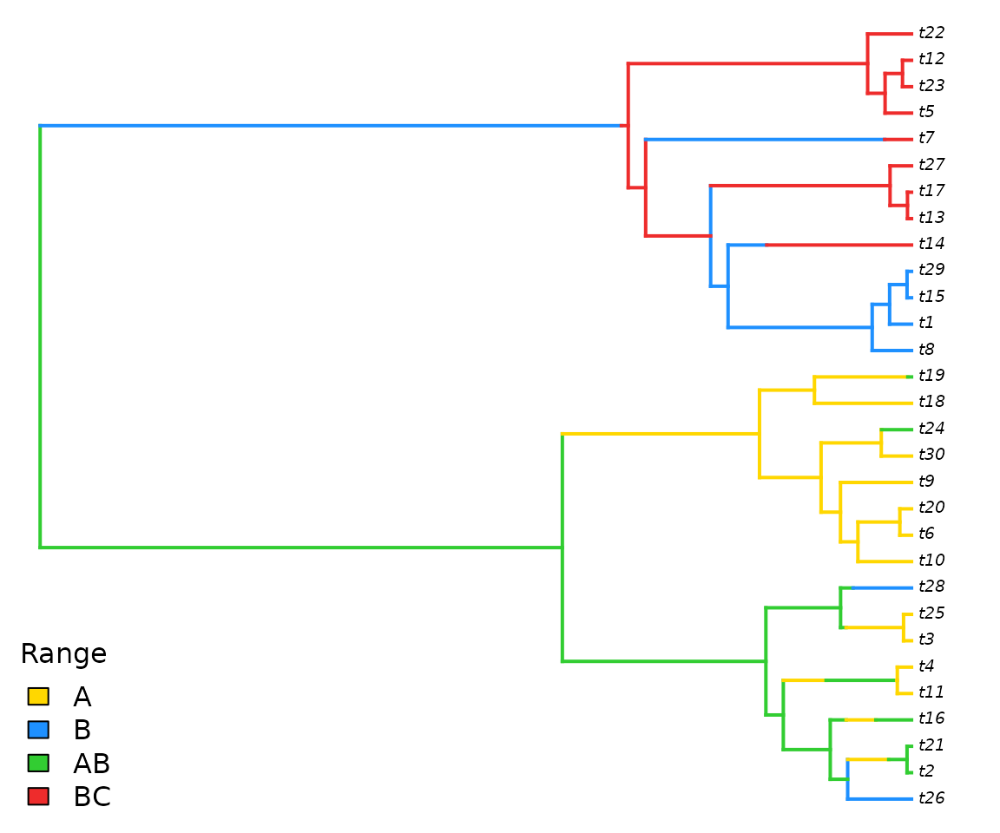
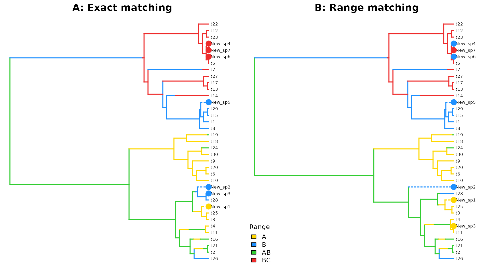

# Use biogeographic ranges as constraints

Grafting can be constrained by **species attributes** described by
**stochastic character maps** (`simmap`) of the backbone phylogeny. This
tutorial explains how to use **biogeographic ranges** as attributes,
i.e., **geographically-informed grafting**: a missing taxon is only
grafted on the branches where its lineage could have lived in **its
known range**. A range is a **set of areas** (e.g., `"A"`, `"AB"`), and
the stochastic map shows how the range of the lineages **evolved** along
the backbone (e.g., from a `BioGeoBEARS` analysis).

The key is the argument `treat_states_as_ranges`, which tells the
grafting functions **how to match the allowed ranges of a taxon with the
ranges of the map**:

1.  **Exact matching** (`treat_states_as_ranges = FALSE`, the default):
    ranges are unrelated states, like for categorical traits (e.g.,
    colors). A taxon allowed in `"A"` can only be grafted on branch
    pieces where the map is **exactly** in `"A"`.
2.  **Range matching** (`treat_states_as_ranges = TRUE`): a taxon
    allowed in `"A"` can be grafted wherever the lineage **includes the
    area `"A"`**: `"A"`, `"AB"`, `"ABC"`, etc.

We compare the two options **side by side**, with the **same data**, so
that the differences shown come from the **matching type** argument
(`treat_states_as_ranges`).

**Other types of data**

The principle of species attribute-based constraints is the same for all
the types of data. For examples addressing different data types, please
refer to:

- **categorical traits** (single trait):
  [`vignette("main_workflow")`](https://maeldore.github.io/phylograftR/articles/main_workflow.md),
  and the examples of
  [`vignette("graft_missing_taxa")`](https://maeldore.github.io/phylograftR/articles/graft_missing_taxa.md),
  [`vignette("graft_missing_clades")`](https://maeldore.github.io/phylograftR/articles/graft_missing_clades.md)
  and
  [`vignette("combine_missing_taxa_and_clades")`](https://maeldore.github.io/phylograftR/articles/combine_missing_taxa_and_clades.md);
- **several traits** at once (or a trait and ranges):
  [`vignette("multiple_traits")`](https://maeldore.github.io/phylograftR/articles/multiple_traits.md);
- **continuous traits**:
  [`vignette("continuous_data")`](https://maeldore.github.io/phylograftR/articles/continuous_data.md);
- **several stochastic maps** to account for the uncertainty in the
  evolutionary history:
  [`vignette("handle_uncertainty")`](https://maeldore.github.io/phylograftR/articles/handle_uncertainty.md).

To build stochastic maps of ranges from your own data, see
[`vignette("prepare_stochastic_maps")`](https://maeldore.github.io/phylograftR/articles/prepare_stochastic_maps.md).

## 0/ Data

We use the toy backbone, and the toy stochastic map of **four ranges**
built from **three areas** (`"A"`, `"B"`, `"C"`): `"A"`, `"B"`, `"AB"`
and `"BC"`.

``` r

# ------ Toy data ------ #

data(toy_backbone)
data(toy_simmap_ranges)
data(toy_missing_taxa_list_with_allowed_ranges)

# Plot the stochastic map of ranges
range_colors <- c(A = "gold", B = "dodgerblue", AB = "limegreen", BC = "firebrick2")
phytools::plotSimmap(toy_simmap_ranges, colors = range_colors, fsize = 0.6, ftype = "i", lwd = 2)
legend("bottomleft", legend = names(range_colors), fill = range_colors, title = "Range", bty = "n")
```



``` r


# Time spent in each range, summed on all the branches
round(colSums(toy_simmap_ranges$mapped.edge))
#> AB  B  A BC 
#> 62 72 60 49
```

**Ranges must be coded as in `BioGeoBEARS`**: one capital letter per
area, and the letters of a multi-area range in alphabetical order
(`"AB"`, not `"BA"`).

The list of missing taxa has the usual structure (see
[`vignette("format_inputs")`](https://maeldore.github.io/phylograftR/articles/format_inputs.md)),
with **allowed ranges** in the `allowed_states` item. Some taxa have
their own allowed ranges, the others have `NULL` and use the **global**
`allowed_states` argument of the grafting function:

``` r

# Load missing taxa list with the allowed ranges of the 7 missing taxa
taxa_ranges <- toy_missing_taxa_list_with_allowed_ranges

# Convert to a data.frame for printing neatly the information
data.frame(Taxon_name = taxa_ranges$Taxon_name,
           Target_clade_name = taxa_ranges$Target_clade_name,
           Allowed_ranges = sapply(taxa_ranges$allowed_states,
                                   function(x) if (is.null(x)) "NULL"
                                               else paste(x, collapse = ", ")),
           row.names = NULL)
#>   Taxon_name Target_clade_name Allowed_ranges
#> 1    New_sp1          Family_A              A
#> 2    New_sp2          Family_A           NULL
#> 3    New_sp3          Family_A           NULL
#> 4    New_sp4          Family_B          B, BC
#> 5    New_sp5         Subfam_B1              B
#> 6    New_sp6             Gen_2           NULL
#> 7    New_sp7          Tribe_B2          A, BC
```

Here, the global `allowed_states` will be `c("A", "B")`.

## 1/ Which mapped range match an allowed range?

The matching rule is the only difference between the two options. For
each range of the map, we list the allowed ranges that can be grafted on
it, under each **matching type** option:

``` r

# ------ Which allowed ranges match each range of the map? ------ #

map_ranges <- c("A", "B", "AB", "BC")
allowed <- c("A", "B", "AB", "BC")

# A range of the map matches an allowed range if it contains all of its areas
contains <- function(map_range, allowed_range)
  all(strsplit(allowed_range, "")[[1]] %in% strsplit(map_range, "")[[1]])

data.frame(Map_range = map_ranges,
           Exact_matching = map_ranges,
           Range_matching = sapply(map_ranges, function(r) 
              paste(allowed[sapply(allowed, contains, map_range = r)], collapse = ", ")),
           row.names = NULL)
#>   Map_range Exact_matching Range_matching
#> 1         A              A              A
#> 2         B              B              B
#> 3        AB             AB       A, B, AB
#> 4        BC             BC          B, BC
```

With **exact matching** (`treat_states_as_ranges = FALSE`), a branch in
`"AB"` is only available for taxa allowed in `"AB"`.

With **range matching** (`treat_states_as_ranges = TRUE`), it is also
available for taxa allowed in `"A"` or `"B"`, which is accounting for a
**subset sympatric speciation event**: a lineage that lived in `"AB"`
can produce a descendant that lives in `"A"` only such as
`(AB) -> (AB), (A)`. Conversely, a taxon allowed in `"AB"` **cannot** be
grafted on a branch in `"A"`.

When a taxon is grafted on a branch in a **larger range** than its own
range, it **inherits its own allowed range**, while the branch it is
grafted on continues in its range. If several allowed ranges match, the
inherited range is drawn at random among the allowed ranges **contained
in the range of the branch**. Ex: a taxon allowed in `"A"` or `"B"` is
grafted on branch in `"AB"`; it can inherit the range `"A"` or `"B"`,
but not both.

## 2/ Check the grafting plan

[`check_grafting_plan()`](https://maeldore.github.io/phylograftR/reference/check_grafting_plan.md)
shows the consequences of each option **before grafting** (see
[`vignette("check_grafting")`](https://maeldore.github.io/phylograftR/articles/check_grafting.md)):

``` r

# ------ Check the plan with the two options ------ #

# Exact matching, with the global allowed ranges "A" and "B"
plan_exact <- check_grafting_plan(phy = toy_backbone, missing_taxa_list = taxa_ranges,
                                  simmap = toy_simmap_ranges, allowed_states = c("A", "B"),
                                  treat_states_as_ranges = FALSE, verbose = FALSE)
plan_exact[, c("Taxon_name", "allowed_states", "states_available", "valid_fraction", "feasible", "cause")]
#>   Taxon_name allowed_states states_available valid_fraction feasible
#> 1    New_sp1              A         A, AB, B     0.07584307     TRUE
#> 2    New_sp2           A, B         A, AB, B     0.51498705     TRUE
#> 3    New_sp3           A, B         A, AB, B     0.67397536     TRUE
#> 4    New_sp4          B, BC            B, BC     1.00000000     TRUE
#> 5    New_sp5              B            B, BC     0.68175003     TRUE
#> 6    New_sp6           A, B               BC     0.00000000    FALSE
#> 7    New_sp7          A, BC               BC     1.00000000     TRUE
#>                cause
#> 1 low_valid_fraction
#> 2               none
#> 3               none
#> 4               none
#> 5               none
#> 6     allowed_states
#> 7               none

# Range matching, with the same global allowed ranges
plan_ranges <- check_grafting_plan(phy = toy_backbone, missing_taxa_list = taxa_ranges,
                                   simmap = toy_simmap_ranges, allowed_states = c("A", "B"),
                                   treat_states_as_ranges = TRUE, verbose = FALSE)
plan_ranges[, c("Taxon_name", "allowed_states", "states_available", "valid_fraction", "feasible", "cause")]
#>   Taxon_name allowed_states states_available valid_fraction feasible cause
#> 1    New_sp1          A, AB         A, AB, B      0.9396164     TRUE  none
#> 2    New_sp2   A, AB, B, BC         A, AB, B      1.0000000     TRUE  none
#> 3    New_sp3   A, AB, B, BC         A, AB, B      1.0000000     TRUE  none
#> 4    New_sp4      AB, B, BC            B, BC      1.0000000     TRUE  none
#> 5    New_sp5      AB, B, BC            B, BC      1.0000000     TRUE  none
#> 6    New_sp6   A, AB, B, BC               BC      1.0000000     TRUE  none
#> 7    New_sp7      A, AB, BC               BC      1.0000000     TRUE  none
```

With exact matching, the plan flags **two problems**:

- `New_sp6` **cannot be grafted** (`cause = "allowed_states"`): its
  target clade is only in `"BC"`, which matches neither `"A"` nor `"B"`
  exactly.
- `New_sp1`, allowed in `"A"` only, has a **low valid fraction**: only
  8% of the branches of its target clade are in `"A"`, so its grafting
  positions are concentrated on a few short branch pieces.

With range matching, `"B"` matches `"BC"` and `"A"` matches `"AB"`: all
the taxa can be grafted, on a much larger share of the branches of their
target clades.

## 3/ Graft with exact matching

We first graft with exact matching. The grafting stops, as `New_sp6` has
no branch available:

``` r

# ------ Exact matching: infeasible plan ------ #

grafted_error <- tryCatch(
  graft_missing_taxa(phy = toy_backbone, missing_taxa_list = taxa_ranges,
                     simmap = toy_simmap_ranges, allowed_states = c("A", "B"),
                     treat_states_as_ranges = FALSE, verbose = FALSE, seed = 1),
  error = function(e) cat(conditionMessage(e)))
#> 1 taxa have no branch available for grafting in their allowed states: none of the available branches of their target clade has a piece in these states.
#>   - New_sp6 (target clade tips: t5; allowed states: A, B)
#> Adjust 'allowed_states' (global or in missing_taxa_list), or the constraints on the branches ('include_target_clade_stem', 'Excluded_subclades', 'exclude_subclades_stem') for these taxa.
```

With exact matching, **every range** that can be used must be listed:
here, we add `"BC"` to the global `allowed_states`.

``` r

# ------ Exact matching: list all the ranges ------ #

grafted_exact <- graft_missing_taxa(phy = toy_backbone, missing_taxa_list = taxa_ranges,
                                    simmap = toy_simmap_ranges, allowed_states = c("A", "B", "BC"),
                                    treat_states_as_ranges = FALSE, verbose = FALSE, seed = 1)
```

## 4/ Graft with range matching

With range matching, the global `allowed_states = c("A", "B")` is
enough:

``` r

# ------ Range matching ------ #

grafted_ranges <- graft_missing_taxa(phy = toy_backbone, missing_taxa_list = taxa_ranges,
                                     simmap = toy_simmap_ranges, allowed_states = c("A", "B"),
                                     treat_states_as_ranges = TRUE, verbose = FALSE, seed = 1)
```

## 5/ Compare the results

We plot the **updated stochastic maps**, in which the grafted branches
are dashed, and the grafted tips are marked with a point in the color of
**the range they inherited**:

``` r

# ------ Compare the grafted phylogenies ------ #

# Helper: plot the updated simmap of a grafted phylogeny
plot_ranges <- function(phy_grafted, main)
{
  plot_grafted(phy_grafted, which = "edges", simmap_colors = range_colors, fsize = 0.55, main = main)
  grafted_tips <- which(phy_grafted$grafted_tips)
  tip_ranges <- phytools::getStates(phy_grafted$simmap, type = "tips")[phy_grafted$tip.label[grafted_tips]]
  ape::tiplabels(tip = grafted_tips, pch = 19, cex = 1.5, col = range_colors[tip_ranges])
}

par(mfrow = c(1, 2), mar = c(0.5, 0.5, 2, 0.5))
plot_ranges(grafted_exact, main = "A: Exact matching")
plot_ranges(grafted_ranges, main = "B: Range matching")
legend("bottomleft", legend = names(range_colors), fill = range_colors, title = "Range", bty = "n", cex = 0.8)
```



``` r

par(mfrow = c(1, 1), mar = c(5.1, 4.1, 4.1, 2.1))
```

Since the grafting process is stochastic, placement can vary, and final
states of taxa with multiple allowed states may vary too (e.g.,
`New_sp3` in `"A"` or `"B"`). The critical change between the two
matching type is the differences or not that are allowed between the
range of parental branch and the inherited range of the grafted taxa.

We summarize below the **range of the branch where each taxon was
grafted** (`parent_state`) and **the range it inherited** (`tip_state`)
with
[`extract_grafting_info()`](https://maeldore.github.io/phylograftR/reference/extract_grafting_info.md):

``` r

# ------ Ranges at grafting and inherited ranges ------ #

# Extract grafting information for the two matching types
info_exact <- extract_grafting_info(grafted_exact, missing_taxa_list = taxa_ranges)
info_ranges <- extract_grafting_info(grafted_ranges, missing_taxa_list = taxa_ranges)

# Summarize information in a data.frame
compare_ranges <- data.frame(Taxon_name = info_exact$Taxon_name,
                             Exact_parent = info_exact$parent_state, Exact_inherited = info_exact$tip_state,
                             Ranges_parent = info_ranges$parent_state, Ranges_inherited = info_ranges$tip_state)
# Identify subset sympatric speciation event: the taxon inherits a range smaller than the range of the branch
compare_ranges$Ranges_subset_sympatry <- compare_ranges$Ranges_parent != compare_ranges$Ranges_inherited
compare_ranges
#>   Taxon_name Exact_parent Exact_inherited Ranges_parent Ranges_inherited
#> 1    New_sp1            A               A             A                A
#> 2    New_sp2            B               B            AB                B
#> 3    New_sp3            B               B             A                A
#> 4    New_sp4           BC              BC            BC                B
#> 5    New_sp5            B               B             B                B
#> 6    New_sp6           BC              BC            BC                B
#> 7    New_sp7           BC              BC            BC               BC
#>   Ranges_subset_sympatry
#> 1                  FALSE
#> 2                   TRUE
#> 3                  FALSE
#> 4                   TRUE
#> 5                  FALSE
#> 6                   TRUE
#> 7                  FALSE
```

With **exact matching**, the range of the branch and the **inherited
range are always the same**.

With **range matching**, taxa can be grafted on **larger ranges** and
inherit a smaller one (subset sympatry), as for `New_sp2`, `New_sp4`,
and `New_sp6`. The diversity of available positions is also wider.

## 6/ Check the grafted phylogenies

The **a posteriori** check of
[`check_grafting_constraints()`](https://maeldore.github.io/phylograftR/reference/check_grafting_constraints.md)
must use the **same `treat_states_as_ranges`** as the grafting (see
[`vignette("check_grafting")`](https://maeldore.github.io/phylograftR/articles/check_grafting.md)):

``` r

# ------ A posteriori check ------ #

constraints <- check_grafting_constraints(phy_grafted = grafted_ranges, phy_backbone = toy_backbone,
                                          missing_taxa_list = taxa_ranges, allowed_states = c("A", "B"),
                                          treat_states_as_ranges = TRUE, use_excluded_subclades = FALSE,
                                          verbose = FALSE)
constraints[, c("Taxon_name", "in_tree", "target_ok", "states_ok", "ranges_ok")]
#>         Taxon_name in_tree target_ok states_ok ranges_ok
#> New_sp1    New_sp1    TRUE      TRUE      TRUE      TRUE
#> New_sp2    New_sp2    TRUE      TRUE      TRUE      TRUE
#> New_sp3    New_sp3    TRUE      TRUE      TRUE      TRUE
#> New_sp4    New_sp4    TRUE      TRUE      TRUE      TRUE
#> New_sp5    New_sp5    TRUE      TRUE      TRUE      TRUE
#> New_sp6    New_sp6    TRUE      TRUE      TRUE      TRUE
#> New_sp7    New_sp7    TRUE      TRUE      TRUE      TRUE
```

`states_ok` is `TRUE` when the range of the taxon is one of its allowed
ranges, and `ranges_ok` when it also respects the rule of **range
matching**: the branch it was grafted on contains the range it
inherited.

## Next steps

Now that you know how to use **biogeographic ranges** as constraints,
you may be interested in:

- combining **several traits** or a trait and ranges:
  [`vignette("multiple_traits")`](https://maeldore.github.io/phylograftR/articles/multiple_traits.md);
- exploring options to graft **missing taxa**, **missing clades**, or
  **both types**:
  [`vignette("graft_missing_taxa")`](https://maeldore.github.io/phylograftR/articles/graft_missing_taxa.md),
  [`vignette("graft_missing_clades")`](https://maeldore.github.io/phylograftR/articles/graft_missing_clades.md)
  and
  [`vignette("combine_missing_taxa_and_clades")`](https://maeldore.github.io/phylograftR/articles/combine_missing_taxa_and_clades.md);
- handling **uncertainty** with several simulations and stochastic maps,
  and ensuring the **reproducibility** of the runs with the seed system:
  [`vignette("handle_uncertainty")`](https://maeldore.github.io/phylograftR/articles/handle_uncertainty.md);
- speeding up your runs by using **parallel computation**:
  [`vignette("parallel_grafting")`](https://maeldore.github.io/phylograftR/articles/parallel_grafting.md).
