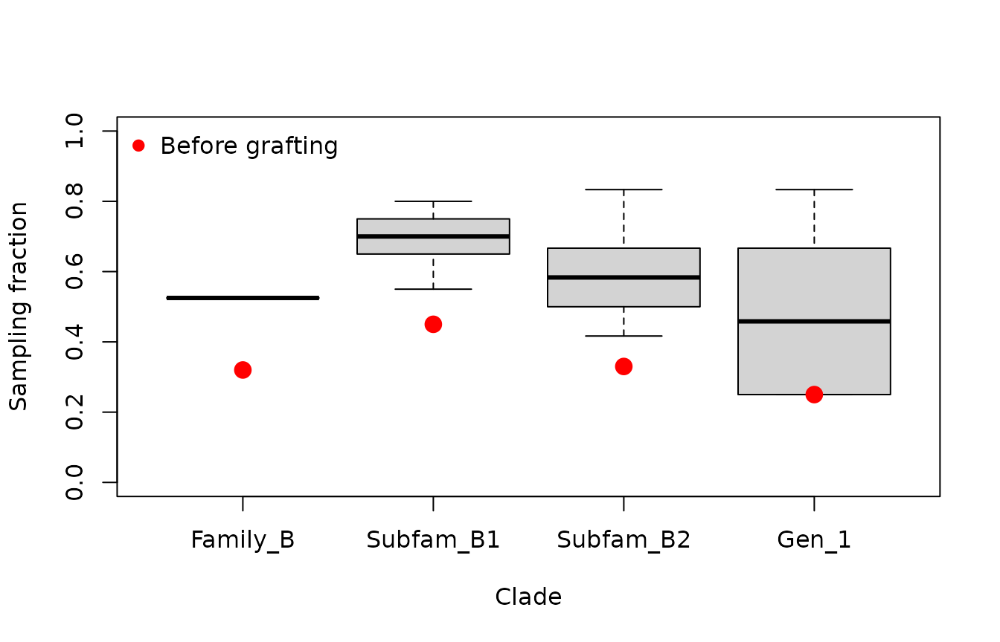

# Check the grafting plan and the grafted phylogenies

Grafting is **constrained** (target clades, allowed states, …) and
**stochastic** (divergence ages and positions are drawn from statistical
distributions): it is worth checking that your **grafting plan is
feasible before grafting**, that the **constraints were respected after
grafting**. In addition, you may wish to check whether the resulting
grafted phylogenies are consistent with what you expect in term of
**grafting positions, sampling fractions, and fit of diversification
models**.

This tutorial explains how to perform **a priori** and **a posterior**
checks of grafted phylogenies, and detail **how to read and interpret**
the outputs of the dedicated **checking functions** provided in the
phylograftR package:

| Function | When | What it tells you | Section |
|:---|:---|:---|:---|
| [`check_grafting_plan()`](https://maeldore.github.io/phylograftR/reference/check_grafting_plan.md) | before grafting | can each lineage be grafted with its constraints? | 1 |
| [`check_grafting_constraints()`](https://maeldore.github.io/phylograftR/reference/check_grafting_constraints.md) | after grafting | were all the constraints respected in each grafted phylogeny? | 2 |
| [`extract_grafting_info()`](https://maeldore.github.io/phylograftR/reference/extract_grafting_info.md) | after grafting | where and when was each lineage grafted? | 3 |
| [`extract_sampling_info()`](https://maeldore.github.io/phylograftR/reference/extract_sampling_info.md) | after grafting | what are the clade-specific sampling fractions after grafting? | 4 |
| [`extract_BD_model_summary()`](https://maeldore.github.io/phylograftR/reference/extract_BD_model_summary.md) | after grafting | which birth-death models were used to draw the ages? | 5 |

## 0/ Setup

We use the toy backbone with its toy stochastic map (**one map**), and
**5 stochastic maps** sampled from the tip data to illustrate the checks
with **many maps** (see
[`vignette("main_workflow")`](https://maeldore.github.io/phylograftR/articles/main_workflow.md)
and
[`vignette("prepare_stochastic_maps")`](https://maeldore.github.io/phylograftR/articles/prepare_stochastic_maps.md)).

**Helper functions** build the lists of missing taxa to graft.

``` r

data(toy_backbone)
data(toy_simmap)

# One map: toy_simmap (states: blue, green, red)

# Many maps: sample 5 stochastic maps from the tip data, with an equal-rates model of evolution
tip_data <- phytools::getStates(toy_simmap, type = "tips")
set.seed(1234)
simmaps <- phytools::make.simmap(tree = toy_backbone, x = tip_data[toy_backbone$tip.label],
                                 model = "ER", nsim = 5, message = FALSE)
class(simmaps)
#> [1] "multiSimmap" "multiPhylo"
```

``` r

# Helper 1: build a missing_taxa_list with n taxa to graft within a target clade defined by tips
make_taxa_list <- function(n, target_tips, prefix, allowed_states = NULL, start = 1)
{
  taxa <- paste0(prefix, seq(start, length.out = n))
  out <- list(Taxon_name = taxa, Target_clade = setNames(rep(list(target_tips), n), taxa))
  if (!is.null(allowed_states)) out$allowed_states <- setNames(rep(list(allowed_states), n), taxa)
  return(out)
}

# Helper 2: combine several lists of missing taxa
combine_lists <- function(...)
{
  lists <- list(...)
  out <- list(Taxon_name = unlist(lapply(lists, `[[`, "Taxon_name")),
              Target_clade = do.call(c, lapply(lists, `[[`, "Target_clade")))
  out$allowed_states <- do.call(c, lapply(lists, function(x)
  {
    if (is.null(x$allowed_states)) setNames(rep(list(NULL), length(x$Taxon_name)), x$Taxon_name) else x$allowed_states
  }))
  return(out)
}
```

## 1/ Before grafting: `check_grafting_plan()`

[`check_grafting_plan()`](https://maeldore.github.io/phylograftR/reference/check_grafting_plan.md)
verifies that **each lineage can be grafted** with its constraints,
**without grafting anything**. For each taxon, it identifies the
branches of its target clade available for grafting, after removing the
excluded subclades; it checks that there are branch pieces in the
**allowed states** in the stochastic map, and reports the proportion of
branch pieces that are available for grafting within the **time window**
of the target clade. It returns one row per taxon, and prints a summary.

The goal of this function is to **evaluate potential issues before
grafting** and **adjust the constraints** before running any potentially
time-consuming task that would be deem to failure.

### **Check the plan**

Here, as an illustration, We build a list of five taxa to graft
representing different situations:

- `Fam_blue1` and `Fam_blue2`: grafted within `Family_B`, in the state
  “blue”;
- `Small_sp1`: grafted within `Gen_1`, a **small clade** of 3 tips;
- `Narrow_sp1`: grafted within `Subfam_B2`, in the state “red”, which is
  **rare** in this clade;
- `Mistake_sp1`: grafted within `Gen_1`, in the state “red”: **a
  mistake**, as no branch of this target clade is red.

``` r

# ------ Check the plan with one stochastic map ------ #

# Build the list of missing taxa
taxa_blue <- make_taxa_list(n = 2, target_tips = c("t8", "t22"), prefix = "Fam_blue",
                            allowed_states = "blue")
taxa_small <- make_taxa_list(n = 1, target_tips = c("t13", "t27"), prefix = "Small_sp")
taxa_narrow <- make_taxa_list(n = 1, target_tips = c("t5", "t22"), prefix = "Narrow_sp",
                              allowed_states = "red")
taxa_mistake <- make_taxa_list(n = 1, target_tips = c("t13", "t27"), prefix = "Mistake_sp",
                               allowed_states = "red")
taxa_list <- combine_lists(taxa_blue, taxa_small, taxa_narrow, taxa_mistake)

# Check the plan with the toy stochastic map
plan_one <- check_grafting_plan(phy = toy_backbone, missing_taxa_list = taxa_list, simmap = toy_simmap)
#> Grafting plan: 5 taxa
#>   - Can be grafted: 4/5
#>   - Cannot be grafted (1):
#>       allowed_states              1
#>       e.g., Mistake_sp1
#>   - Share of the available branches in allowed states (feasible taxa): min 4.3%, median 30.8%
#>   - Share of the time window with grafting possible (feasible taxa): min 5.5%, median 65.3%
#>   - Below 'min_valid_fraction' = 0.1 (1): Narrow_sp1
#>   - Target clades smaller than 'min_tips' = 5 (birth-death model fitted on an enclosing clade): 3/5; enclosing clades of 8 to 13 tips in the backbone; in practice, the clade used can be nested within them, as previously grafted taxa count towards 'min_tips'
#>   => Some cannot be grafted with these constraints (see the table)

# The table has one row per taxon: the main columns are
plan_one[, c("Taxon_name", "target_n_tips", "allowed_states",
             "valid_fraction", "time_coverage", "feasible", "cause")]
#>    Taxon_name target_n_tips   allowed_states valid_fraction time_coverage
#> 1   Fam_blue1            13             blue     0.30765350     0.6528254
#> 2   Fam_blue2            13             blue     0.30765350     0.6528254
#> 3   Small_sp1             3 blue, green, red     1.00000000     1.0000000
#> 4  Narrow_sp1             4              red     0.04276293     0.0547333
#> 5 Mistake_sp1             3              red     0.00000000     0.0000000
#>   feasible              cause
#> 1     TRUE               none
#> 2     TRUE               none
#> 3     TRUE               none
#> 4     TRUE low_valid_fraction
#> 5    FALSE     allowed_states
```

The summary reads from top to bottom:

- **Can be grafted**: the number of taxa with at least one branch piece
  available in their allowed states. Here, `Mistake_sp1` **cannot** be
  grafted (`cause = "allowed_states"`): it needs red branches, and there
  are none in `Gen_1`. Grafting stops with an error for such a taxon, so
  it must be fixed first (see below).
- **Share of the available branches in allowed states**
  (`valid_fraction`) and **share of the time window with grafting
  possible** (`time_coverage`): how much room there is for grafting each
  taxon in average.
- When the room is **below `min_valid_fraction`** (10% by default), the
  taxon can be grafted but only in a **narrow place**: `Narrow_sp1`
  would always land in the same few branches
  (`cause = "low_valid_fraction"`). It is not a mistake, but this is
  reported here as you may wish to check that this is what you want, as
  this is a strong constraint on the placement of the missing taxon.
- **Target clades smaller than `min_tips`**: the birth-death model that
  draws the divergence ages is fitted on the target clade, or on **an
  enclosing clade** if it has fewer than `min_tips` tips (5 by default).
  This reports how many cases of such changes in clades used for fitting
  diversification dynamics occurred. See the section on `min_tips` of
  [`vignette("graft_missing_taxa")`](https://maeldore.github.io/phylograftR/articles/graft_missing_taxa.md)
  for more information on **enclosing clades**. See *Section 5* in this
  tutorial for how to use
  [`extract_BD_model_summary()`](https://maeldore.github.io/phylograftR/reference/extract_BD_model_summary.md)
  to explore a posteriori the parameters and results of all Birth-Death
  (BD) models used during the run.

The output table provides **causes** for which each grafted taxon may
lead to an error. The possible causes that make a taxon **unfeasible**
are `"allowed_states"` (no branch piece available in the allowed states)
and, when excluded subclades are used, `"excluded"`,
`"excluded_contains_target"` and `"excluded_identical"` (when the
excluded subclades leave no branch to graft on). The cause
`"low_valid_fraction"` is only a **warning**: the taxon is feasible, but
the stochastic process may fail to draw a divergence age compatible with
the available branch pieces.

``` r

# If you try to graft anyway, the grafting will stops with an informative error
# highlighting the taxon that could not be grafted
tryCatch(graft_missing_taxa(phy = toy_backbone, missing_taxa_list = taxa_list, simmap = toy_simmap,
                            seed = 1, verbose = FALSE),
         error = function(e) cat(conditionMessage(e)))
#> 1 taxa have no branch available for grafting in their allowed states: none of the available branches of their target clade has a piece in these states.
#>   - Mistake_sp1 (target clade tips: t13, t27; allowed states: red)
#> Adjust 'allowed_states' (global or in missing_taxa_list), or the constraints on the branches ('include_target_clade_stem', 'Excluded_subclades', 'exclude_subclades_stem') for these taxa.
```

### **Fix the plan**

Here, we fix our grating plan by adjusting constraints to cover all
potential issues:

- we correct the allowed states of the mistaken taxon;
- we widen the states of the narrow one;
- we use `min_tips = 3` to fit the model on the 3-tip clade `Gen_1`
  instead of an alternative enclosing clade.

``` r

# Fix the allowed states
taxa_narrow_fixed <- make_taxa_list(n = 1, target_tips = c("t5", "t22"), prefix = "Narrow_sp",
                                    allowed_states = c("red", "green")) # Use red AND green as allowed states
taxa_mistake_fixed <- make_taxa_list(n = 1, target_tips = c("t13", "t27"), prefix = "Mistake_sp",
                                     allowed_states = "green") # use green instead of red
taxa_list_fixed <- combine_lists(taxa_blue, taxa_small, taxa_narrow_fixed, taxa_mistake_fixed)

# Check the fixed plan, with min_tips = 3
# By using a lower min_tips value, we ensure that the BD models are fitted strictly on our target clades
# However, as a trade-off, we may have lower accuracy in our estimates of diversification rates as we used smaller clades for fitting models
plan_fixed <- check_grafting_plan(phy = toy_backbone, missing_taxa_list = taxa_list_fixed,
                                  simmap = toy_simmap, min_tips = 3)
#> Grafting plan: 5 taxa
#>   - Can be grafted: 5/5
#>   - Share of the available branches in allowed states (feasible taxa): min 30.8%, median 82.8%
#>   - Share of the time window with grafting possible (feasible taxa): min 65.3%, median 100.0%
#>   - Target clades smaller than 'min_tips' = 3 (birth-death model fitted on an enclosing clade): 0/5
#>   => All can be grafted with these constraints
```

### **Check plan with many maps**

The evolutionary history of a trait is uncertain. This uncertainty can
be accounted for by providing phylograftR with **multiple stochastic
maps** to constrain grafting using species-attributes (see
[`vignette("handle_uncertainty")`](https://maeldore.github.io/phylograftR/articles/handle_uncertainty.md)
for more details).

As a consequence, a taxon can be feasible on some maps but not on
others. With **many stochastic maps**,
[`check_grafting_plan()`](https://maeldore.github.io/phylograftR/reference/check_grafting_plan.md)
checks **each map**, and summarizes them: it reports the taxa that are
not feasible **in all the maps**, and the **range of the room for
grafting** across the maps (`valid_fraction_min`, `valid_fraction_mean`,
`valid_fraction_max`…), with the **worst map** being the one that limits
the plan.

``` r

# ------ Check the plan with many stochastic maps ------ #

# Check grafting plan for all simmaps
plan_many <- check_grafting_plan(phy = toy_backbone, missing_taxa_list = taxa_list, simmap = simmaps)
#> Grafting plan: 5 taxa, 5 maps
#>   - Can be grafted in all the maps: 4/5
#>   - Cannot be grafted (1):
#>       allowed_states              1
#>       e.g., Mistake_sp1
#>   - Share of the available branches in allowed states (worst map, feasible taxa): min 6.6%, median 7.5%
#>   - Share of the time window with grafting possible (worst map, feasible taxa): min 8.5%, median 13.8%
#>   - Below 'min_valid_fraction' = 0.1 (3): Narrow_sp1, Fam_blue1, Fam_blue2
#>   - Target clades smaller than 'min_tips' = 5 (birth-death model fitted on an enclosing clade): 3/5; enclosing clades of 8 to 13 tips in the backbone; in practice, the clade used can be nested within them, as previously grafted taxa count towards 'min_tips'
#>   => Some cannot be grafted with these constraints (see the table)

# One row per taxon, summarizing the maps
plan_many[, c("Taxon_name", "valid_fraction_min", "valid_fraction_mean", "valid_fraction_max", "n_maps_infeasible", "feasible", "cause")]
#>    Taxon_name valid_fraction_min valid_fraction_mean valid_fraction_max
#> 1   Fam_blue1         0.07490391          0.30912238          0.5309309
#> 2   Fam_blue2         0.07490391          0.30912238          0.5309309
#> 3   Small_sp1         1.00000000          1.00000000          1.0000000
#> 4  Narrow_sp1         0.06623615          0.38813997          0.7096280
#> 5 Mistake_sp1         0.00000000          0.03083723          0.1541861
#>   n_maps_infeasible feasible              cause
#> 1                 0     TRUE low_valid_fraction
#> 2                 0     TRUE low_valid_fraction
#> 3                 0     TRUE               none
#> 4                 0     TRUE low_valid_fraction
#> 5                 4    FALSE     allowed_states
```

The column `n_maps_infeasible` counts the maps in which the taxon
**cannot** be grafted. Here, `Mistake_sp1` is not feasible in 4 of the 5
maps (one map has red branches in the clade by chance), so it still must
be fixed.

Note that `Fam_blue1` and `Fam_blue2` were fine with `toy_simmap`, but
have **a narrow room for grafting in the worst map**.

When a taxon is **unfeasible in some maps only**, you can **extend its
allowed states**, **widen its target clade**, or **remove the maps**
that are not compatible with your constraints (only if you can justify
it, as it modifies the uncertainty in ancestral trait inferrence that
you want to propagate).

The details of **checks for each map** are in the attribute `per_map`:

``` r


# Extract checks per map
per_map <- attr(plan_many, "per_map")

# Inspect issues with "Narrow_sp1" across all maps
per_map[per_map$Taxon_name == "Narrow_sp1", c("map", "valid_fraction", "time_coverage", "feasible", "cause")]
#>      map valid_fraction time_coverage feasible              cause
#> 4  map_1     0.35333250    0.45223872     TRUE               none
#> 9  map_2     0.70962802    0.74116493     TRUE               none
#> 14 map_3     0.06623615    0.08477723     TRUE low_valid_fraction
#> 19 map_4     0.17351136    0.22208134     TRUE               none
#> 24 map_5     0.63799184    0.80316840     TRUE               none
```

The same list, fixed as above, is feasible in all the maps (the
`Fam_blue` taxa remain flagged as having a narrow room for grafting in
the worst map):

``` r

# Check grafting plan for all simmaps with the fixed list
plan_many_fixed <- check_grafting_plan(phy = toy_backbone, missing_taxa_list = taxa_list_fixed,
                                       simmap = simmaps, min_tips = 3)
#> Grafting plan: 5 taxa, 5 maps
#>   - Can be grafted in all the maps: 5/5
#>   - Share of the available branches in allowed states (worst map, feasible taxa): min 7.5%, median 14.5%
#>   - Share of the time window with grafting possible (worst map, feasible taxa): min 13.8%, median 14.3%
#>   - Below 'min_valid_fraction' = 0.1 (2): Fam_blue1, Fam_blue2
#>   - Target clades smaller than 'min_tips' = 3 (birth-death model fitted on an enclosing clade): 0/5
#>   => All can be grafted with these constraints
```

## 2/ After grafting: `check_grafting_constraints()`

Once the grafting is done,
[`check_grafting_constraints()`](https://maeldore.github.io/phylograftR/reference/check_grafting_constraints.md)
verifies **a posteriori** that **each lineage of each grafted
phylogeny** respects its constraints: it is in the tree, within its
target clade, outside of its excluded subclades, in its allowed states.
Globally, it also checks that the **backbone is preserved** (same
topology, branch lengths unchanged).

The constraints are read from the `missing_taxa_list`, and the states
from the `$simmap` carried by each grafted phylogeny. The function
accepts one grafted phylogeny, or the outputs of the grafting functions
with **many simulations and maps**.

### **Check constraints with one map**

Here, we graft the fixed list of missing taxa on the toy map with **10
simulations**, and check them after grafting:

``` r

# ------ Check the constraints with one stochastic map ------ #

# Graft the missing taxa with the fixed list
grafted_one <- graft_missing_taxa(phy = toy_backbone, missing_taxa_list = taxa_list_fixed,
                                  simmap = toy_simmap, min_tips = 3,
                                  nb_simulations = 10, seed = 1, verbose = FALSE)

# Check the constraints
constraints_one <- check_grafting_constraints(phy_grafted = grafted_one, phy_backbone = toy_backbone,
                                              missing_taxa_list = taxa_list_fixed,
                                              use_excluded_subclades = FALSE)
#> 10 phylogenies checked (1 map(s)), 5 taxa each
#>   - Phylogenies respecting all the constraints: 10/10
#>   Violations, over all the phylogenies (number of taxa x phylogenies):
#>   - Missing from the grafted tree: 0
#>   - Target clade violated:          0
#>   - Excluded subclade violated:     0
#>   - Allowed states violated:        0
#>   - Backbone: preserved in 10/10 phylogenies, branch lengths shifted by max 9.06e-11 of backbone depth (tolerance = 1e-06)
#>   => All constraints respected
```

The summary counts the **violations of constraints** over all the taxa
and all the grafted phylogenies, and report them in a **printed
summary**:

- taxa missing from the tree;
- taxa outside of their target clade;
- taxa in an excluded subclade;
- taxa **in a state that is not allowed**;
- whether the backbone was preserved or not, with an estimate of shift
  in branch length (attributed to rounding errors in floating-point
  numbers).

In addition to the printed summary, the function returns a table with
one row per taxon and per grafted phylogeny (columns `target_ok`,
`excluded_ok`, `states_ok` and `ok`) and, as attributes, the summary of
each phylogeny (`phylogenies`) and of the backbone preservation.

The grafting functions are designed to **always respect** the
constraints: this check is a **safety net** to run on the final outputs,
particularly when the inputs are complex (many maps, ranges, several
traits).

``` r

# Inspect table with checks per taxon per grafted phylogeny
head(constraints_one[, c("map", "simulation", "Taxon_name", "in_tree",
                         "target_ok", "excluded_ok", "states_ok", "ok")])
#>     map simulation  Taxon_name in_tree target_ok excluded_ok states_ok   ok
#> 1 map_1          1   Fam_blue1    TRUE      TRUE        TRUE      TRUE TRUE
#> 2 map_1          1   Fam_blue2    TRUE      TRUE        TRUE      TRUE TRUE
#> 3 map_1          1   Small_sp1    TRUE      TRUE        TRUE      TRUE TRUE
#> 4 map_1          1  Narrow_sp1    TRUE      TRUE        TRUE      TRUE TRUE
#> 5 map_1          1 Mistake_sp1    TRUE      TRUE        TRUE      TRUE TRUE
#> 6 map_1          2   Fam_blue1    TRUE      TRUE        TRUE      TRUE TRUE

# Inspect overall result
attr(constraints_one, "all_ok")
#> [1] TRUE

# Inspect the summary table of the checks per phylogeny
head(attr(constraints_one, "phylogenies"))
#>     map simulation       seed n_failed backbone_preserved all_ok
#> 1 map_1          1          1        0               TRUE   TRUE
#> 2 map_1          2 1140350788        0               TRUE   TRUE
#> 3 map_1          3  312928385        0               TRUE   TRUE
#> 4 map_1          4  866248189        0               TRUE   TRUE
#> 5 map_1          5 1909893419        0               TRUE   TRUE
#> 6 map_1          6  554504146        0               TRUE   TRUE
```

To see **what a constraint violation looks like**, we check the same
grafted phylogenies against a **stricter list**: we change the target
clade of `Fam_blue1` for its embedded subclade `Subfam_B2`, and the
allowed states of `Fam_blue2` from “blue” to “green”, which the grafting
process did not use as constraints:

``` r

# A stricter list: the constraints on two taxa are changed after grafting
taxa_list_strict <- taxa_list_fixed
taxa_list_strict$Target_clade[["Fam_blue1"]] <- c("t5", "t22")
taxa_list_strict$allowed_states[["Fam_blue2"]] <- "green"

# Check the constraints
constraints_strict <- check_grafting_constraints(phy_grafted = grafted_one, phy_backbone = toy_backbone,
                                                 missing_taxa_list = taxa_list_strict,
                                                 use_excluded_subclades = FALSE)
#> 10 phylogenies checked (1 map(s)), 5 taxa each
#>   - Phylogenies respecting all the constraints: 0/10
#>   Violations, over all the phylogenies (number of taxa x phylogenies):
#>   - Missing from the grafted tree: 0
#>   - Target clade violated:          1
#>   - Excluded subclade violated:     0
#>   - Allowed states violated:        10
#>   - Backbone: preserved in 10/10 phylogenies, branch lengths shifted by max 9.06e-11 of backbone depth (tolerance = 1e-06)
#>   Phylogenies with violations:
#>     - map map_1, simulation 1 (seed 1): 1 taxa failed
#>     - map map_1, simulation 2 (seed 1140350788): 1 taxa failed
#>     - map map_1, simulation 3 (seed 312928385): 1 taxa failed
#>     - map map_1, simulation 4 (seed 866248189): 1 taxa failed
#>     - map map_1, simulation 5 (seed 1909893419): 1 taxa failed
#>     - map map_1, simulation 6 (seed 554504146): 1 taxa failed
#>     - map map_1, simulation 7 (seed 884616499): 1 taxa failed
#>     - map map_1, simulation 8 (seed 803234389): 2 taxa failed
#>     - map map_1, simulation 9 (seed 1158971242): 1 taxa failed
#>     - map map_1, simulation 10 (seed 934673902): 1 taxa failed
#>   => Some constraints NOT respected (see returned data.frame(s) and attributes)

# We can use the output table to summarize the proportion of the grafted phylogenies
# in which each taxon respects each constraint
# Here, we focus on the target clade and allowed states constraints
aggregate(cbind(target_ok, states_ok, ok) ~ Taxon_name, data = constraints_strict, FUN = mean)
#>    Taxon_name target_ok states_ok  ok
#> 1   Fam_blue1       0.9         1 0.9
#> 2   Fam_blue2       1.0         0 0.0
#> 3 Mistake_sp1       1.0         1 1.0
#> 4  Narrow_sp1       1.0         1 1.0
#> 5   Small_sp1       1.0         1 1.0
```

`Fam_blue2` is in the state “blue” in all the phylogenies, so it always
violates the new constraint (`states_ok` is 0), whereas `Fam_blue1` is
outside of `Subfam_B2` in the two simulations in which it was grafted
elsewhere in `Family_B` (`target_ok`).

### **Check constraints with many maps**

For outputs with **many stochastic maps** (one element per map, each
with its simulations), the summary covers all the phylogenies, and the
function returns **one table per stochastic map**:

``` r

# ------ Check the constraints with many stochastic maps ------ #

# Graft with the 5 maps, and 4 simulations per map
grafted_many <- graft_missing_taxa(phy = toy_backbone, missing_taxa_list = taxa_list_fixed,
                                   simmap = simmaps, min_tips = 3,
                                   nb_simulations = 4, seed = 1, verbose = FALSE)

# Check the constraints
constraints_many <- check_grafting_constraints(phy_grafted = grafted_many, phy_backbone = toy_backbone,
                                               missing_taxa_list = taxa_list_fixed,
                                               use_excluded_subclades = FALSE)
#> 20 phylogenies checked (5 map(s)), 5 taxa each
#>   - Phylogenies respecting all the constraints: 20/20
#>   Violations, over all the phylogenies (number of taxa x phylogenies):
#>   - Missing from the grafted tree: 0
#>   - Target clade violated:          0
#>   - Excluded subclade violated:     0
#>   - Allowed states violated:        0
#>   - Backbone: preserved in 20/20 phylogenies, branch lengths shifted by max 1.7e-10 of backbone depth (tolerance = 1e-06)
#>   => All constraints respected

# One table per map
names(constraints_many)
#> [1] "map_1" "map_2" "map_3" "map_4" "map_5"
# Are all constraints respected in all the maps?
sapply(constraints_many, attr, "all_ok")
#> map_1 map_2 map_3 map_4 map_5 
#>  TRUE  TRUE  TRUE  TRUE  TRUE
```

## 3/ Where and when: `extract_grafting_info()`

[`extract_grafting_info()`](https://maeldore.github.io/phylograftR/reference/extract_grafting_info.md)
describes **where and when** each lineage was grafted in each grafted
phylogeny.

It reports:

- the **parent clade** (`parent_node` and `parent_tips`: the clade of
  the **backbone** on which the lineage was grafted);
- the **graft age** (when the lineage branched from the backbone);
- the **divergence age** (when it branched from its closest relative,
  which can be another grafted taxon);
- and the **state** of the lineage, when a stochastic map is available.

It returns **one row per taxon and per phylogeny**, with the `map`,
`simulation` and `seed` that produced it, so the outputs of **many
simulations and maps** can be summarized with
[`aggregate()`](https://rdrr.io/r/stats/aggregate.html), and each
phylogeny can be **reproduced alone** with its seed (see
[`vignette("handle_uncertainty")`](https://maeldore.github.io/phylograftR/articles/handle_uncertainty.md)).

``` r

# ------ Grafting information with one stochastic map ------ #

# Extract grafting information
info_one <- extract_grafting_info(phy_grafted = grafted_one, missing_taxa_list = taxa_list_fixed,
                                  phy_backbone = toy_backbone)
# Inspect the first rows describing the results for the first simulation (among 10)
head(info_one[, c("simulation", "Taxon_name", "parent_tips", "graft_age", "divergence_age", "tip_state")], 4)
#>   simulation Taxon_name parent_tips graft_age divergence_age tip_state
#> 1          1  Fam_blue1    t23, t12 1.2503493      1.2503493      blue
#> 2          1  Fam_blue2          t5 0.9880183      0.9880183      blue
#> 3          1  Small_sp1         t27 0.2125734      0.2125734      blue
#> 4          1 Narrow_sp1     t5, t22 6.5994546      6.5994546     green

# Summarize the ages of each taxon across the 10 simulations
aggregate(divergence_age ~ Taxon_name, data = info_one,
          FUN = function(x) round(c(mean = mean(x), min = min(x), max = max(x)), 2))
#>    Taxon_name divergence_age.mean divergence_age.min divergence_age.max
#> 1   Fam_blue1                0.68               0.00               2.11
#> 2   Fam_blue2                0.63               0.00               1.28
#> 3 Mistake_sp1                0.59               0.01               2.89
#> 4  Narrow_sp1                1.47               0.08               6.60
#> 5   Small_sp1                0.29               0.01               0.95
```

The **states** (`parent_state` and `tip_state`) show where the taxa
landed in the stochastic map. They allow checking that taxa with allowed
states are indeed grafted in these states, and **summarizing the
distribution of states** of each taxon, which may vary when multiple
`allowed_states` were provided:

``` r

# Summarize the number of simulations with each state, for each taxon
table(info_one$Taxon_name, info_one$tip_state)
#>              
#>               blue green red
#>   Fam_blue1     10     0   0
#>   Fam_blue2     10     0   0
#>   Mistake_sp1    0    10   0
#>   Narrow_sp1     0     8   2
#>   Small_sp1      4     6   0
```

With **many maps**, the output has one row per taxon, **per map and per
simulation**: the summaries then average over the two sources of
uncertainty (the **maps** and the **simulations**), and can be split by
map to see how much the differences in ancestral states between maps
matter:

``` r

# ------ Grafting information with many stochastic maps ------ #

info_many <- extract_grafting_info(phy_grafted = grafted_many, missing_taxa_list = taxa_list_fixed,
                                   phy_backbone = toy_backbone)

# We grafted 5 taxa over 5 stochastic maps, and 4 simulations per map
# Therefore, the table report 5 × 5 × 4 = 100 entries
dim(info_many)
#> [1] 100  11

# We can then aggregate information per taxon, per map
# to inspect the effect of each map on the graftong

# Ex: Mean divergence age of each taxon, in each map (4 simulations per map)
round(tapply(info_many$divergence_age, list(info_many$Taxon_name, info_many$map), mean), 2)
#>             map_1 map_2 map_3 map_4 map_5
#> Fam_blue1    1.95  0.74  0.57  0.45  0.63
#> Fam_blue2    1.57  0.73  0.64  1.41  0.82
#> Mistake_sp1  0.43  0.43  0.40  0.08  0.40
#> Narrow_sp1   5.56  5.56  0.74  0.53  2.08
#> Small_sp1    0.32  0.27  0.23  0.24  0.23
```

The same function also works for **missing clades** (one row per clade,
with its crown age) and for both types together (one table per type):
see
[`vignette("graft_missing_clades")`](https://maeldore.github.io/phylograftR/articles/graft_missing_clades.md)
and
[`vignette("combine_missing_taxa_and_clades")`](https://maeldore.github.io/phylograftR/articles/combine_missing_taxa_and_clades.md).

## 4/ Sampling fractions: `extract_sampling_info()`

When the **total richness** of some clades is known, it can be provided
as inputs (`total_richness_per_clades`) to account for **unsampled
species** (not in the backbone, nor listed to be grafted) when fitting
BD models to estimate divergence ages of taxa to be grafted: see
*Section 3* in
[`vignette("graft_missing_taxa")`](https://maeldore.github.io/phylograftR/articles/graft_missing_taxa.md)
for an illustration of the effect.

However, the grafted taxa **raise the sampling fraction** (i.e., the
proportion of species present in the grafted tree vs. all species) of
the clades in which they are grafted. Since the grafted taxa are placed
at random within their target clades, the effective sampling fraction of
**nested clades** varies among the simulations.
[`extract_sampling_info()`](https://maeldore.github.io/phylograftR/reference/extract_sampling_info.md)
returns, for each clade with a total richness provided, and **each
grafted phylogeny**:

- the number of backbone species;
- the number of grafted species;
- the number of unsampled species;
- and the **effective sampling fraction after grafting**.

This is the way to explore how much the grafting procedure may have
helped to **even sampling across clades**. Moreover, **clade-specific
sampling fractions** can be used as inputs in downstream analyses such
as diversification models (e.g., BAMM) to still account for the
unsampled species in later steps of the analytic pipeline.

Here, we graft 6 taxa within `Family_B`, in the state “blue” (they land
in `Subfam_B1`, `Subfam_B2` or elsewhere), and 2 taxa within `Gen_1`,
with the total richness of four clades. `Subfam_B1`, `Subfam_B2` and
`Gen_1` are nested within `Family_B`, and `Gen_1` within `Subfam_B1`.

We use 10 simulations to account for the uncertainty in the grafting
procedure (see
[`vignette("handle_uncertainty")`](https://maeldore.github.io/phylograftR/articles/handle_uncertainty.md)).

``` r

# ------ Sampling fractions with one stochastic map ------ #

# # Build the list of missing taxa
taxa_sampling <- combine_lists(make_taxa_list(n = 6, target_tips = c("t8", "t22"),
                                              prefix = "Fam_sp", allowed_states = "blue"),
                               make_taxa_list(n = 2, target_tips = c("t13", "t27"), prefix = "Gen_sp"))
taxa_sampling$Target_clade_name <- c(rep("Family_B", 6), rep("Gen_1", 2))

# Build the list informing on Total richness for four clades
richness_list <- list(Target_clade = list(c("t8", "t22"), c("t8", "t7"), c("t5", "t22"), c("t13", "t27")),
                 Target_clade_name = c("Family_B", "Subfam_B1", "Subfam_B2", "Gen_1"),
                 total_richness = c(40, 20, 12, 12))

# Graft 10 simulations, and return the birth-death model summaries for the next section
grafted_sampling <- graft_missing_taxa(phy = toy_backbone, missing_taxa_list = taxa_sampling,
                                       total_richness_per_clades = richness_list,
                                       simmap = toy_simmap,
                                       # Ask explicitly to retain BD model info
                                       # (useful in Section 5)
                                       return_BD_model_summary = TRUE, 
                                       nb_simulations = 10,
                                       seed = 1, verbose = FALSE)

# Extract sampling info across all 10 grafted phylogenies
sampling_one <- extract_sampling_info(phy_grafted = grafted_sampling,
                                      total_richness_per_clades = richness_list)

# Inspect the first rows describing the results for the first simulations (among 10)
head(sampling_one[, c("simulation", "Clade_name", "total_richness",
                      "nb_backbone_species", "nb_grafted_species", "nb_unsampled_species",
                      "sampling_fraction")])
#>   simulation Clade_name total_richness nb_backbone_species nb_grafted_species
#> 1          1   Family_B             40                  13                  8
#> 2          1  Subfam_B1             20                   9                  5
#> 3          1  Subfam_B2             12                   4                  3
#> 4          1      Gen_1             12                   3                  3
#> 5          2   Family_B             40                  13                  8
#> 6          2  Subfam_B1             20                   9                  4
#>   nb_unsampled_species sampling_fraction
#> 1                   19         0.5250000
#> 2                    6         0.7000000
#> 3                    5         0.5833333
#> 4                    6         0.5000000
#> 5                   19         0.5250000
#> 6                    7         0.6500000
```

The resulting table provides the **clade-specific sampling fractions**
to use in downstream analyses of diversification in order to account for
the remaining **unsampled species**.

### Compare clade-specific sampling fractions before grafting and after grafting

Here, we use the output of
[`extract_sampling_info()`](https://maeldore.github.io/phylograftR/reference/extract_sampling_info.md)
to explore how much the grafting procedure may have helped to **even
sampling across clades**. We directly compare the sampling fraction of
each clade before grafting, and after grafting.

``` r

# Compute pre-grafting sampling fraction based on backbone species only 
pre_grafting <- unique(sampling_one[, c("Clade_name", "total_richness", "nb_backbone_species")])
pre_grafting$pre_grafting <- round(pre_grafting$nb_backbone_species / pre_grafting$total_richness, 2)

# Compute mean effective sampling fractions (after grafting) across all 10 simulations
post_grafting <- aggregate(sampling_fraction ~ Clade_name, data = sampling_one,
                           FUN = function(x) round(c(mean = mean(x), min = min(x), max = max(x)), 2))
merge(pre_grafting[, c("Clade_name", "total_richness", "pre_grafting")], post_grafting, by = "Clade_name")
#>   Clade_name total_richness pre_grafting sampling_fraction.mean
#> 1   Family_B             40         0.32                   0.52
#> 2      Gen_1             12         0.25                   0.49
#> 3  Subfam_B1             20         0.45                   0.70
#> 4  Subfam_B2             12         0.33                   0.59
#>   sampling_fraction.min sampling_fraction.max
#> 1                  0.52                  0.52
#> 2                  0.25                  0.83
#> 3                  0.55                  0.80
#> 4                  0.42                  0.83

# Plot the distributions of the effective sampling fractions, with the pre-grafting values in red
sampling_one$Clade <- factor(sampling_one$Clade_name, levels = pre_grafting$Clade_name)
boxplot(sampling_fraction ~ Clade, data = sampling_one, ylab = "Sampling fraction", xlab = "Clade", ylim = c(0, 1))
points(seq_len(nrow(pre_grafting)), pre_grafting$pre_grafting, pch = 19, col = "red", cex = 1.5)
legend("topleft", legend = "Before grafting", pch = 19, col = "red", bty = "n")
```



The sampling fraction of `Family_B` is the same in all the simulations
(all the taxa are grafted within it), while the fractions of the
**nested clades** depend on where the taxa landed: some simulations
graft more species in `Subfam_B2` than others. The red points show the
sampling fractions **before grafting**: grafting increases them, and the
**spread of the boxes** is the uncertainty in the sampling of the nested
clades.

Note that the sampling fraction that the diversification models use to
draw the ages is the one of the clade **at the time of grafting**, shown
in the next *Section 5* below addressing diversification models, and not
the final effective sampling fractions that may be altered by taxa being
grafted in nested clades later in the process.

## 5/ Diversification models: `extract_BD_model_summary()`

The divergence ages of the grafted taxa are drawn from **birth-death
(BD) models** fitted on the clade they are grafted in (see
[`vignette("graft_missing_taxa")`](https://maeldore.github.io/phylograftR/articles/graft_missing_taxa.md)).

With
[`phylograftR::graft_missing_taxa()`](https://maeldore.github.io/phylograftR/reference/graft_missing_taxa.md),
**a model is fitted per target clade**, and used by all the taxa of the
target clade, whatever their stem availability or excluded subclades.
With
[`phylograftR::graft_missing_clades()`](https://maeldore.github.io/phylograftR/reference/graft_missing_clades.md),
**a model is fitted per missing clade**, i.e., per sister clade.

Each model is fitted **on the tree as it stands when its group of taxa
is processed**, not on the backbone: it includes the taxa **already
grafted** by earlier groups in the same simulation, and its sampling
fraction accounts for the taxa still waiting to be grafted in the clade.
As a consequence, the models are **not necessarily identical across
simulations and maps**:

- a model fitted **before any other grafting** in its clade (a single
  group of taxa, or the innermost of several nested groups) only depends
  on the backbone: it is **the same in all simulations and maps**. This
  is the case for the two taxa grafted in `Gen_1` in our example from
  *Section 4* above.
- a model fitted on a clade that **contains taxa grafted earlier**
  (e.g., a group grafted in `Family_B` after the taxa grafted in
  `Gen_1`) depends on **where and when** those taxa were grafted: it
  **varies across simulations**, and across stochastic maps.
- when taxa and clades are grafted successively with
  [`graft_missing_taxa_and_clades()`](https://maeldore.github.io/phylograftR/reference/graft_missing_taxa_and_clades.md),
  the models of the **second step** include the taxa grafted in the
  first one, so they vary across simulations.

With `return_BD_model_summary = TRUE`, the grafting functions record the
BD models, and
[`extract_BD_model_summary()`](https://maeldore.github.io/phylograftR/reference/extract_BD_model_summary.md)
returns **one row per fitted model**, for each simulation and map.

Here, we use the outputs of the previous section, with total richness,
to report on the BD model fits used during the grafting process for each
simulation:

``` r

# ------ Birth-death model summaries ------ #

# Export info on BD models
bd_one <- extract_BD_model_summary(grafted_sampling)

# Look at the first rows: one row per model, per simulation
head(bd_one[, c("simulation", "Clade_name", "initial_clade_n_tips", "fitted_clade_n_backbone_tips", "enclosing",
                "b", "d", "net_diversification", "rho")])
#>   simulation Clade_name initial_clade_n_tips fitted_clade_n_backbone_tips
#> 1          1   Family_B                   13                           13
#> 2          1      Gen_1                    3                            8
#> 3          2   Family_B                   13                           13
#> 4          2      Gen_1                    3                            8
#> 5          3   Family_B                   13                           13
#> 6          3      Gen_1                    3                            8
#>   enclosing        b         d net_diversification       rho
#> 1     FALSE 0.941576 0.9294762          0.01209977 0.3750000
#> 2      TRUE 1.077889 1.0671097          0.01077889 0.4705882
#> 3     FALSE 1.450617 1.4361105          0.01450617 0.3750000
#> 4      TRUE 1.077889 1.0671097          0.01077889 0.4705882
#> 5     FALSE 1.177080 1.1653095          0.01177080 0.3750000
#> 6      TRUE 1.077889 1.0671097          0.01077889 0.4705882

# Summarize the variation of each model across the 10 simulations
# Loop across 'Clade_name' to summarize the range of 'b', 'd', and 'rho'
bd_variation <- do.call(rbind, lapply(split(bd_one, bd_one$Clade_name), function(x) {
  data.frame(n_models = nrow(x),
             n_distinct_fits = nrow(unique(round(x[, c("b", "d")], 6))),
             b_range = paste(round(range(x$b), 3), collapse = " - "),
             d_range = paste(round(range(x$d), 3), collapse = " - "),
             rho_range = paste(round(range(x$rho), 2), collapse = " - "))
}))
bd_variation
#>          n_models n_distinct_fits       b_range       d_range   rho_range
#> Family_B       10              10 0.867 - 1.467 0.846 - 1.452 0.38 - 0.38
#> Gen_1          10               1 1.078 - 1.078 1.067 - 1.067 0.47 - 0.47
```

How to read the table:

- **Clade used**: `initial_clade_tips` is the target clade of the taxa,
  and `fitted_clade_tips` the clade on which the model was fitted. They
  differ (`enclosing = TRUE`) when the target clade has fewer tips than
  `min_tips`: here, the 3-tip `Gen_1` is replaced by an **enclosing
  clade** (see
  [`vignette("graft_missing_taxa")`](https://maeldore.github.io/phylograftR/articles/graft_missing_taxa.md)
  for how to tune `min_tips`).
- **Sampling fraction**: `rho` is the sampling fraction of the model:
  the species of the fitted clade over its total richness. `n_pending`
  is the number of taxa to graft within the clade (not counted as
  sampled) and `n_unsampled` the number of **unsampled** species that
  the total richness adds (see *Section 4* above).
- **Variation across simulations and maps**: the summary above shows
  that the model of the `Gen_1` taxa is the **same in the 10
  simulations** (1 distinct fit: it is fitted on the backbone), while
  the model of the `Family_B` taxa is **different in each simulation**
  (10 distinct fits): `Family_B` contains the `Gen_1` taxa grafted
  before, at **different ages** in each simulation, which changes the
  rates `b` and `d` of the fit. The sampling fraction `rho` is the same
  because the number of tips and the total richness of the clade do not
  change.
- **Rates**: `b` and `d` are the speciation and extinction rates,
  `net_diversification` is `b - d`, and `relative_extinction` is
  `d / b`. The extinction rate can be **adjusted**, as shown by
  `d_adjustment`: `"none"` (the fitted value is used), `"capped"` (the
  fitted `d` was too close to, or above `b`, and was **capped** to 99%
  of `b`), or `"set_to_0"` (a negative `d` was set to 0). A `"capped"`
  or `"set_to_0"` model means that the **data support very high or null
  extinction**: it is common with small clades, and it is a **flag** to
  look at the tree and the sampling fraction before trusting the rates.
- **Warnings**: fits on small or very incomplete clades may print
  `NA/NaN function evaluation` warnings from the optimizer. They are not
  errors: the model is still fitted, but check that the rates look
  sensible.

## Next steps

Now that you know how to **check your grafting plan and results**, you
may be interested in:

- exploring options to graft **missing taxa**, **missing clades**, or
  **both types**:
  [`vignette("graft_missing_taxa")`](https://maeldore.github.io/phylograftR/articles/graft_missing_taxa.md),
  [`vignette("graft_missing_clades")`](https://maeldore.github.io/phylograftR/articles/graft_missing_clades.md)
  and
  [`vignette("combine_missing_taxa_and_clades")`](https://maeldore.github.io/phylograftR/articles/combine_missing_taxa_and_clades.md);
- handling **uncertainty** with several simulations and stochastic maps,
  and ensuring the **reproducibility** of the runs with the seed system:
  [`vignette("handle_uncertainty")`](https://maeldore.github.io/phylograftR/articles/handle_uncertainty.md);
- speeding up your runs by using **parallel computation**:
  [`vignette("parallel_grafting")`](https://maeldore.github.io/phylograftR/articles/parallel_grafting.md);
- **resuming** interrupted runs:
  [`vignette("resume_run")`](https://maeldore.github.io/phylograftR/articles/resume_run.md).
