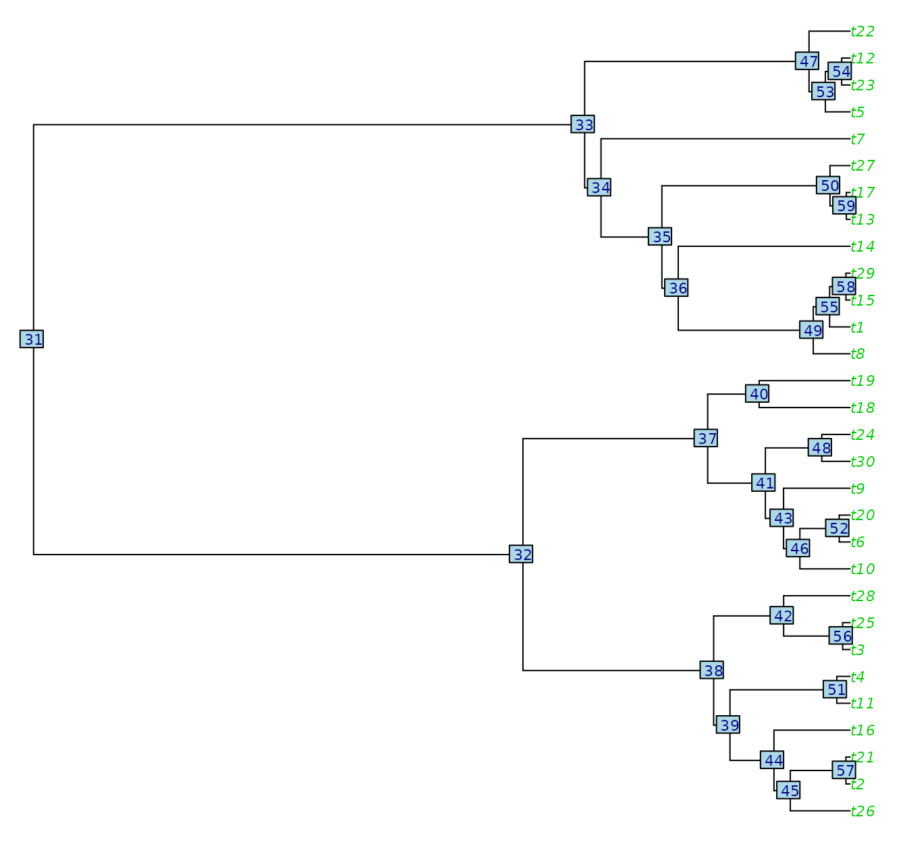

# Format inputs prior to grafting

  
This vignette explains how to **format the inputs** needed to graft
missing lineages: the **`missing_taxa_list`** that describes the taxa to
graft and the constraints on where they can be grafted, and, optionally,
the **`total_richness_per_clades`** that accounts for the species that
are neither in the backbone nor in the list (i.e., **unsampled
species**).

All the examples use the **toy datasets** shipped with the package: a
backbone phylogeny of 30 tips (`toy_backbone`), tables in `.csv` format,
and the corresponding R objects.

For a full analysis from scratch, see the main workflow tutorial:
[`vignette("main_workflow")`](https://maeldore.github.io/phylograftR/articles/main_workflow.md).  
For the tutorials listed by theme, see:
[`vignette("phylograftR")`](https://maeldore.github.io/phylograftR/articles/phylograftR.md).

  

## 1/ What does grafting need?

### The `missing_taxa_list`

Each missing taxon is assigned to a clade of the **backbone phylogeny**,
defined by **tips**: a pair of tips whose most recent common ancestor
(MRCA) is the clade, or a single tip for a terminal branch. There are
two types of missing lineages, grafted with two functions:

| Type | Grafting function | Clade item | Meaning |
|:---|:---|:---|:---|
| Missing **taxa** | [`graft_missing_taxa()`](https://maeldore.github.io/phylograftR/reference/graft_missing_taxa.md) | `Target_clade` | The taxon is grafted **within** its target clade. |
| Missing **clades** | [`graft_missing_clades()`](https://maeldore.github.io/phylograftR/reference/graft_missing_clades.md) | `Sister_clade` | The taxa sharing the same sister clade are grafted **together**, as one missing clade attached to the stem branch of their sister clade. |

The `missing_taxa_list` is a list with the following items. Every item
is **named after the taxa** (`$Taxon_name`):

| Item | Used for | Content |
|:---|:---|:---|
| `Taxon_name` | Both | Names of the taxa to graft. They must be unique and absent from the backbone. |
| `Target_clade` or `Sister_clade` | Taxa / Clades | One clade per taxon (a vector of tips). |
| `Target_clade_name` or `Sister_clade_name` | Both | (Optional) Names of the clades, to make outputs easier to read. |
| `include_target_clade_stem` | Taxa | (Optional) Can the taxon be grafted on the stem branch of its target clade? |
| `Excluded_subclades` | Taxa | (Optional) Subclades of the target clade where the taxon is known **not** to belong. |
| `exclude_subclades_stem` | Taxa | (Optional) Is the stem branch of each excluded subclade also excluded? |
| `allowed_states` | Both | (Optional) States of a stochastic map where the taxon can be grafted. See the tutorials on data types. |

### The backbone phylogeny: `phy`

The **backbone phylogeny** (`phy`) is the time-calibrated phylogeny on
which the missing lineages are grafted: it must be **rooted, binary (no
polytomies) and ultrametric**. All the clades used to define the
constraints of the grafting are clades of the backbone phylogeny:

- the **target clade** of a missing taxon: the clade within which it is
  grafted;
- the **excluded subclades** of a missing taxon: clades nested within
  its target clade where it must **not** be grafted;
- the **sister clade** of a missing clade: the clade of the backbone
  whose stem branch receives the missing clade.

Each of these clades can be a **clade with several tips**, or a **single
terminal branch**, when it is defined by one tip only.

Clades are defined from the **labels of the tips** and the **IDs of the
nodes** of the backbone:

- a **pair of tips** defines the clade subtended by their most recent
  common ancestor (MRCA). Any pair of tips whose MRCA is the clade can
  be used, so a clade can be written in several ways;
- a **single tip** defines the terminal branch of this tip;
- a **node ID** defines the clade subtended by this internal node
  directly, with no need to pick tips. Node IDs are the integers that
  follow the tip IDs (`1` to `Ntip`) and are displayed by
  [`ape::nodelabels()`](https://rdrr.io/pkg/ape/man/nodelabels.html).

The toy backbone is shown below with its **tip labels in green** and its
**node IDs in blue boxes**. We will use both in the following Sections.
For instance, the clade of node `34` is also defined by the pair of tips
`t8` and `t7`, whose MRCA is node `34`, and the tip `t5` alone is the
terminal branch of `t5`.

``` r

data(toy_backbone)

# Plot the backbone with the tip labels in green, and the node IDs in label boxes
ape::plot.phylo(toy_backbone, cex = 0.7, no.margin = TRUE, tip.color = "green3")
ape::nodelabels(cex = 0.7, frame = "rect", bg = "lightblue", col = "darkblue")
```



### The `total_richness_per_clades`

The backbone is incomplete, and the missing taxa of the
`missing_taxa_list` are not necessarily all the missing species: some
species may be **unsampled**, i.e., neither in the backbone nor in the
list. Optionally, the grafting functions use a
**`total_richness_per_clades`** to account for them: it gives the
**total number of species of some clades** of the backbone (their
richness), and their number of unsampled species is deduced from it:

`total_richness = nb_backbone + nb_missing + nb_unsampled`

with `nb_backbone` the tips of the backbone in the clade, `nb_missing`
the taxa of the `missing_taxa_list` that belong to the clade, and
`nb_unsampled` the unsampled species. This information is used to
estimate the **sampling fraction** of the clades when fitting the
**birth-death models** used to draw the divergence times of the grafted
lineages (it requires `method = "BD_clades"` for the missing taxa).
**Unsampled species are only used to fit the rates**: they are not
grafted and do not need to be identified. Only their count is deduced
from the `total_richness` values provided per clade:

- For a clade with a total richness provided,
  `nb_unsampled = total_richness - nb_backbone - nb_missing`.
- For a clade without a total richness (`NA`, or not listed),
  `nb_unsampled` is the sum of the unsampled species of the largest
  clades nested within it that have a total richness provided (or 0 if
  there is none). Unsampled species of nested clades are never counted
  twice.
- Without `total_richness_per_clades`, all the clades are assumed to
  have no unsampled species.

The total richness is described in a table with the clades and their
total richness, which is converted by dedicated functions: see *Section
9*.

### The stochastic maps: `simmap`

Grafting can also be constrained by **species attributes** (e.g., traits
or biogeographic ranges) described by **stochastic character maps**
(`simmap`) of the backbone summarizing the evolutionary history of
traits or ranges along branches. These stochastic maps are another input
of the grafting functions, used with the `allowed_states` of the
`missing_taxa_list` to further constrain grafting: **each taxon can only
be grafted on the pieces of the available branches that are in its
allowed states**. This combines with the other constraints:

- For **missing taxa**, the available branches are those of the target
  clade, minus the excluded subclades, restricted to pieces in the
  allowed states.
- For **missing clades**, the available branch is the stem branch of the
  sister clade, restricted to pieces in the allowed states.

Preparing these maps is thoroughly explained in a dedicated tutorial:
[`vignette("prepare_stochastic_maps")`](https://maeldore.github.io/phylograftR/articles/prepare_stochastic_maps.md).
The use of **allowed states** is only briefly introduced in *Section 6*
of this vignette.

## 2/ Which way to build the list?

The `missing_taxa_list` can be obtained in three ways all returning the
**same kind of object**, validated against the backbone. Whatever the
way chosen, the list can then be **edited by hand** afterward for finer
level of control.

| You have… | Use | Section |
|:---|:---|:---|
| A **taxonomy** of the backbone tips, and the taxonomic groups of the missing taxa | [`build_missing_taxa_list_from_taxonomy()`](https://maeldore.github.io/phylograftR/reference/build_missing_taxa_list_from_taxonomy.md) | 3 |
| A table that defines the **clades** directly (with pairs of tips or node IDs) | [`build_missing_taxa_list()`](https://maeldore.github.io/phylograftR/reference/build_missing_taxa_list.md) for a data.frame already in R, or [`import_missing_taxa_list()`](https://maeldore.github.io/phylograftR/reference/import_missing_taxa_list.md) for an external file | 4 |
| A list written by hand in R, with **node IDs** defining the clades of interest | [`convert_nodes_to_tips()`](https://maeldore.github.io/phylograftR/reference/convert_nodes_to_tips.md) | 5 |
| **Any of the above**: a list already built that you want to fine-tune further (stem branches, excluded subclades, taxa to keep…) | Edit the list **manually** in R. This is available **independently of the way the list was built** (taxonomy, table/data.frame, or by hand) | 8 |

The taxonomy is the most convenient way to start, as it only requires
the **names** of the groups. Defining the clades from a data.frame or an
external table offers more **fine-tuning**, as any node of the backbone
can be used.

  

## 3/ Use a taxonomy: `build_missing_taxa_list_from_taxonomy()`

When the missing taxa are known by their **taxonomic groups** (families,
genera, tribes…), they can be used to retrieve the defining tips of the
clades of interest (i.e., target clades, excluded subclades, sister
clades) directly from the **taxonomy of the backbone tips**.

**When to use taxonomic tables?**

Taxonomic tables are the **go-to option for large phylogenies with
neatly defined taxonomic levels** (e.g., Family, Subfamily, Tribe,
Genus). The taxonomy of the backbone is provided **once**, and each
taxon to graft only needs its own taxonomic levels: the constraints
(target clade, sister clade, excluded subclades) are written with the
**names of the taxonomic groups** or of the **taxonomic levels** to use,
and the clades are retrieved from the phylogeny. The same taxonomic
group is therefore always the same clade, whatever the number of taxa,
which avoids the typos and inconsistencies of clades written taxon by
taxon, and the tables can be taken as such from a taxonomic database.
The limit is that **only the taxonomic groups of the backbone table can
be used as clades**: see *Section 4* for finer control using any clade
and *Section 8* for editing the `missing_taxa_list` after building it.

Two tables are needed, and they can be imported from external files
(text or Excel) with
[`import_taxonomic_table()`](https://maeldore.github.io/phylograftR/reference/import_taxonomic_table.md):

- the **backbone table**: one row per tip of the backbone, one column
  per taxonomic level (`type = "backbone"`).
- the **missing taxa table**: one row per taxon to graft, with its
  taxonomic groups, and the constraints written with taxonomic group
  names (`type = "missing_taxa"`).

``` r

# ------ Step 1: Look at the taxonomic tables ------ #

# Taxonomy of the backbone: the first column holds the tip labels (`Taxa`)
data(toy_backbone_taxonomic_table)
head(toy_backbone_taxonomic_table)
#>   Taxa   Family Subfamily     Tribe Genus
#> 1  t26 Family_A Subfam_A2 Tribe_A2a  <NA>
#> 2   t2 Family_A Subfam_A2 Tribe_A2a  <NA>
#> 3  t21 Family_A Subfam_A2 Tribe_A2a  <NA>
#> 4  t16 Family_A Subfam_A2 Tribe_A2a  <NA>
#> 5  t11 Family_A Subfam_A2 Tribe_A2a  <NA>
#> 6   t4 Family_A Subfam_A2 Tribe_A2a  <NA>

# Description of the taxa to graft: one row per taxon
data(toy_missing_taxa_taxonomic_table)
toy_missing_taxa_taxonomic_table
#>           Taxa   Type   Family Subfamily     Tribe   Genus Target_clade
#> 1      New_sp1   taxa Family_A      <NA>      <NA>    <NA>       Family
#> 2      New_sp2   taxa Family_A      <NA>      <NA>    <NA>       Family
#> 3      New_sp3   taxa Family_A      <NA>      <NA>    <NA>       Family
#> 4      New_sp4   taxa Family_B      <NA>      <NA>    <NA>     Family_B
#> 5      New_sp5   taxa Family_B Subfam_B1      <NA>    <NA>    Subfamily
#> 6      New_sp6   taxa Family_B Subfam_B2  Tribe_B2    <NA>        Gen_2
#> 7      New_sp7   taxa Family_B Subfam_B2  Tribe_B2    <NA>        Tribe
#> 8  Genus_a_sp1 clades Family_B Subfam_B1      <NA> Genus_a         <NA>
#> 9  Genus_a_sp2 clades Family_B Subfam_B1      <NA> Genus_a         <NA>
#> 10 Genus_b_sp1 clades Family_A Subfam_A1 Tribe_A1b Genus_b         <NA>
#>    Sister_clade  Excluded_subclades include_target_clade_stem
#> 1          <NA> Subfam_A1;Tribe_A2a                      TRUE
#> 2          <NA>     Tribe_A2a;Gen_3                      TRUE
#> 3          <NA>                <NA>                     FALSE
#> 4          <NA>                <NA>                        NA
#> 5          <NA>               Gen_1                      TRUE
#> 6          <NA>                <NA>                        NA
#> 7          <NA>                <NA>                     FALSE
#> 8         Gen_1                <NA>                        NA
#> 9         Gen_1                <NA>                        NA
#> 10        Tribe                <NA>                        NA
#>    exclude_subclades_stem
#> 1              TRUE;FALSE
#> 2              FALSE;TRUE
#> 3                    <NA>
#> 4                    <NA>
#> 5                    <NA>
#> 6                    <NA>
#> 7                    <NA>
#> 8                    <NA>
#> 9                    <NA>
#> 10                   <NA>
```

In the table of missing taxa:

- `Type` states whether the taxon is grafted within a target clade
  (`"taxa"`), or as part of a missing clade (`"clades"`).
- `Target_clade` and `Sister_clade` are written with **group names**
  (e.g., `"Family_B"`), or with the **name of a taxonomic level** (e.g.,
  `"Family"`, meaning the family of the taxon, as written in the column
  `Family`).
- `Excluded_subclades` are written the same way, several groups being
  separated by semicolons.

The tables can be imported from external files with the same checks
against the backbone:

``` r

# ------ Step 2: Import the tables from external files (optional) ------ #

backbone_path <- system.file("extdata", "toy_backbone_taxonomic_table.csv", package = "phylograftR")
missing_taxa_path <- system.file("extdata", "toy_missing_taxa_taxonomic_table.csv",
                                 package = "phylograftR")

# Import the taxonomy of the backbone, checked against the tips of the phylogeny
backbone_taxonomic_table <- import_taxonomic_table(file = backbone_path, type = "backbone",
                                                   phy = toy_backbone, verbose = FALSE)

# Import the description of the taxa to graft
missing_taxa_taxonomic_table <- import_taxonomic_table(file = missing_taxa_path, type = "missing_taxa",
                                                       phy = toy_backbone, verbose = FALSE)
```

``` r

# ------ Step 3: Build the missing_taxa_list ------ #

# Taxonomic names are converted into clades of the backbone phylogeny
missing_taxa_lists <- build_missing_taxa_list_from_taxonomy(
  backbone_taxonomic_table = toy_backbone_taxonomic_table,
  missing_taxa_taxonomic_table = toy_missing_taxa_taxonomic_table,
  phy = toy_backbone,
  verbose = FALSE)

# Since both types of taxa were provided, the output has one list per grafting function
names(missing_taxa_lists)
#> [1] "taxa"   "clades"
str(missing_taxa_lists$taxa, max.level = 1)
#> List of 6
#>  $ Taxon_name               : chr [1:7] "New_sp1" "New_sp2" "New_sp3" "New_sp4" ...
#>  $ Target_clade             :List of 7
#>  $ Target_clade_name        : Named chr [1:7] "Family_A" "Family_A" "Family_A" "Family_B" ...
#>   ..- attr(*, "names")= chr [1:7] "New_sp1" "New_sp2" "New_sp3" "New_sp4" ...
#>  $ include_target_clade_stem: Named logi [1:7] TRUE TRUE FALSE NA TRUE NA ...
#>   ..- attr(*, "names")= chr [1:7] "New_sp1" "New_sp2" "New_sp3" "New_sp4" ...
#>  $ Excluded_subclades       :List of 7
#>  $ exclude_subclades_stem   :List of 7

# Clades are written as pairs of tips, and named after their taxonomic groups
missing_taxa_lists$taxa$Target_clade$New_sp1
#> [1] "t26" "t19"
missing_taxa_lists$taxa$Target_clade_name
#>     New_sp1     New_sp2     New_sp3     New_sp4     New_sp5     New_sp6 
#>  "Family_A"  "Family_A"  "Family_A"  "Family_B" "Subfam_B1"     "Gen_2" 
#>     New_sp7 
#>  "Tribe_B2"

# Taxa to graft as a clade have the same sister clade: they will be grafted together
missing_taxa_lists$clades$Sister_clade_name
#> Genus_a_sp1 Genus_a_sp2 Genus_b_sp1 
#>     "Gen_1"     "Gen_1" "Tribe_A1b"

# Information on the groups used (clade node, number of tips, monophyly...) can be inspected
# in the attribute "taxonomic_groups"
attr(missing_taxa_lists, "taxonomic_groups")[, c("Group", "Level", "clade_node",
                                                 "n_tips_clade", "monophyletic")]
#>        Group     Level clade_node n_tips_clade monophyletic
#> 1   Family_A    Family         32           17         TRUE
#> 2   Family_B    Family         33           13         TRUE
#> 3  Subfam_B1 Subfamily         34            9         TRUE
#> 4      Gen_2     Genus         27            1         TRUE
#> 5   Tribe_B2     Tribe         53            3         TRUE
#> 6      Gen_1     Genus         50            3         TRUE
#> 7  Tribe_A1b     Tribe         40            2         TRUE
#> 8  Subfam_A1 Subfamily         37            8         TRUE
#> 9  Tribe_A2a     Tribe         39            6         TRUE
#> 10     Gen_3     Genus         14            1         TRUE
```

**Non-monophyletic groups.** A taxonomic group is not always
monophyletic in the backbone. The argument `non_monophyletic` controls
what is done:

- `"exclude"` (default) excludes the group from the grafting constraints
  of the taxa that use it;
- `"mrca"` uses the clade of the MRCA of its tips (which includes tips
  of other groups);
- `"error"` stops.

The groups, their MRCA node and their monophyly are reported in the
attribute `"taxonomic_groups"`, so you can check them.

The groups can only be those of the taxonomy. To use **any clade of the
backbone** as a target, sister or excluded clade, define the clades
directly with a data.frame (*Section 4*), or edit the list afterwards
(*Section 8*).

  

## 4/ Build from a data.frame: `build_missing_taxa_list()`

Taxonomic groups are convenient, but they have limits: a clade that is
not an identified taxonomic group cannot be used.
[`build_missing_taxa_list()`](https://maeldore.github.io/phylograftR/reference/build_missing_taxa_list.md)
**converts a data.frame** into a `missing_taxa_list`, and gives you
**full control** over the constraints: **clades are defined directly on
the backbone**, from:

- **tips**: a pair of tips whose MRCA is the clade (`"t26, t18"`), or a
  single tip;
- **node IDs**: the ID of the node of the backbone, as shown by
  [`ape::nodelabels()`](https://rdrr.io/pkg/ape/man/nodelabels.html)
  (e.g., `"34"`).

**Any node of the backbone can therefore be a target, sister, or
excluded clade**, whatever the taxonomy. This option makes it much
easier to **fine-tune** the grafting constraints, for instance to graft
a taxon within a clade that is not named in any taxonomy, or to exclude
a precise subclade. Tips and node IDs can be **mixed** between clades,
but a single clade is defined by either tips or one node ID.

The data.frame has **one row per taxon**, and each column fills an item
of the list:

- `Taxon_name`: name of the taxon to graft.
- `Target_clade` (or `Sister_clade`): tips used to retrieve the MRCA of
  the clade, separated by commas (`"t26,t18"`), or a node ID (`"34"`).
- `Target_clade_name`: (optional) name of the clade, used in printed
  reports (`"Genus_1"`).
- `include_target_clade_stem`: `TRUE` or `FALSE`. A blank cell means the
  default value of the grafting function.
- `Excluded_subclades`: tips (or node IDs) of the subclades. Several
  subclades are separated by **semicolons**, and the tips of one
  subclade by **commas** (`"t10,t19;t26,t4"`).
- `Excluded_subclades_names`: names of the subclades, separated by
  semicolons (`"Tribe_A;Genus_3"`).
- `exclude_subclades_stem`: `TRUE` or `FALSE` with one value per
  excluded subclade, separated by semicolons (`"TRUE;FALSE"`).

``` r

# ------ Step 1: Build the missing_taxa_list from a data.frame ------ #

# Write the table in R, with a mix of tips and node IDs (see the plot of the backbone)
my_table <- data.frame(Taxon_name = c("M1", "M2", "M3"),
                       Target_clade = c("34", "t5, t12", "t26, t18"),
                       Excluded_subclades = c("50", NA, "t10, t19; t26, t4"),
                       Excluded_subclades_names = c(NA, NA, "group_1; group_2"),
                       include_target_clade_stem = c(TRUE, FALSE, NA))
my_table
#>   Taxon_name Target_clade Excluded_subclades Excluded_subclades_names
#> 1         M1           34                 50                     <NA>
#> 2         M2      t5, t12               <NA>                     <NA>
#> 3         M3     t26, t18  t10, t19; t26, t4         group_1; group_2
#>   include_target_clade_stem
#> 1                      TRUE
#> 2                     FALSE
#> 3                        NA

# The table is checked against the backbone phylogeny.
# Node IDs are converted into tips, and the conversions are printed
my_missing_taxa_list <- build_missing_taxa_list(data = my_table, phy = toy_backbone)
#> 2 node ID(s) converted into tips (a tip node gives its tip, an internal node gives one pair of tips with this MRCA node):
#>   - node 34 (internal node, 9 tips) -> t8, t7   [Target_clade: M1]
#>   - node 50 (internal node, 3 tips) -> t13, t27   [Excluded_subclades: M1]
str(my_missing_taxa_list, max.level = 1)
#> List of 4
#>  $ Taxon_name               : chr [1:3] "M1" "M2" "M3"
#>  $ Target_clade             :List of 3
#>  $ include_target_clade_stem: Named logi [1:3] TRUE FALSE NA
#>   ..- attr(*, "names")= chr [1:3] "M1" "M2" "M3"
#>  $ Excluded_subclades       :List of 3

# Node 34 is now defined by a pair of tips whose MRCA is node 34
my_missing_taxa_list$Target_clade$M1
#> [1] "t8" "t7"
```

Any data.frame can be used, for instance a table loaded in R with
[`read.csv()`](https://rdrr.io/r/utils/read.table.html). The function
removes extra spaces and treats blank cells and `"NA"` as missing
values.

### Import the table from an external file

The table can also be stored in an **external file**, which is
convenient to edit it with a spreadsheet, to share it, or to keep it
with the data of a project.
[`import_missing_taxa_list()`](https://maeldore.github.io/phylograftR/reference/import_missing_taxa_list.md)
is **equivalent** to reading the file and giving the data.frame to
[`build_missing_taxa_list()`](https://maeldore.github.io/phylograftR/reference/build_missing_taxa_list.md):
it uses the same table format, the same checks and the same conversions
of node IDs, and the clades are defined directly on the backbone, with
the same flexibility. Text files (`.csv`, `.tsv`, `.txt`) and Excel
files (`.xlsx`, `.xls`) are supported, and the format is chosen from the
extension of the file.

``` r

# ------ Step 2 (optional): Import the table from an external file ------ #

# Path to a table provided with the package
file_path <- system.file("extdata", "toy_missing_taxa.csv", package = "phylograftR")

# One row per taxon, one column per item of the list
read.csv(file_path)
#>   Taxon_name Target_clade Target_clade_name include_target_clade_stem
#> 1    New_sp1      t26,t18          Family_A                      TRUE
#> 2    New_sp2      t26,t18          Family_A                      TRUE
#> 3    New_sp3      t26,t18          Family_A                     FALSE
#> 4    New_sp4       t8,t22          Family_B                        NA
#> 5    New_sp5        t8,t7         Subfam_B1                      TRUE
#> 6    New_sp6           t5             Gen_2                        NA
#> 7    New_sp7       t5,t12          Tribe_B2                     FALSE
#>   Excluded_subclades Excluded_subclades_names exclude_subclades_stem
#> 1     t10,t19;t26,t4      Subfam_A1;Tribe_A2a             TRUE;FALSE
#> 2         t26,t4;t30          Tribe_A2a;Gen_3             FALSE;TRUE
#> 3                                                                   
#> 4                                                                   
#> 5            t13,t27                    Gen_1                       
#> 6                                                                   
#> 7

# Import it as a missing_taxa_list, checked against the backbone phylogeny
missing_taxa_list <- import_missing_taxa_list(file = file_path, phy = toy_backbone)

# Items are named after the taxa, tips are split, and excluded subclades are named
str(missing_taxa_list, max.level = 1)
#> List of 6
#>  $ Taxon_name               : chr [1:7] "New_sp1" "New_sp2" "New_sp3" "New_sp4" ...
#>  $ Target_clade             :List of 7
#>  $ Target_clade_name        : Named chr [1:7] "Family_A" "Family_A" "Family_A" "Family_B" ...
#>   ..- attr(*, "names")= chr [1:7] "New_sp1" "New_sp2" "New_sp3" "New_sp4" ...
#>  $ include_target_clade_stem: Named logi [1:7] TRUE TRUE FALSE NA TRUE NA ...
#>   ..- attr(*, "names")= chr [1:7] "New_sp1" "New_sp2" "New_sp3" "New_sp4" ...
#>  $ Excluded_subclades       :List of 7
#>  $ exclude_subclades_stem   :List of 7

# Example of the clades of one taxon
missing_taxa_list$Target_clade$New_sp1
#> [1] "t26" "t18"
missing_taxa_list$Excluded_subclades$New_sp1
#> $Subfam_A1
#> [1] "t10" "t19"
#> 
#> $Tribe_A2a
#> [1] "t26" "t4"
missing_taxa_list$exclude_subclades_stem$New_sp1
#> Subfam_A1 Tribe_A2a 
#>      TRUE     FALSE

# The result is the same as reading the file and building the list from the data.frame
identical(missing_taxa_list, build_missing_taxa_list(data = read.csv(file_path), phy = toy_backbone))
#> [1] TRUE

# The same list is provided as a dataset
data(toy_missing_taxa_list)
identical(missing_taxa_list, toy_missing_taxa_list)
#> [1] TRUE
```

To import an **Excel file**, use the same function with the `sheet`
argument to select the sheet. It requires the package `readxl`. Any
other format (e.g., `.ods`, or an export of an online spreadsheet) can
be read with your own function, provided in `reader`.

``` r

# Import an Excel file
missing_taxa_list <- import_missing_taxa_list(file = "my_missing_taxa.xlsx",
                                              phy = toy_backbone, sheet = "missing_taxa")

# Import any other format with a reader function (e.g., '.ods')
missing_taxa_list <- import_missing_taxa_list(file = "my_missing_taxa.ods", phy = toy_backbone,
                                              reader = readODS::read_ods)
```

  

## 5/ Convert node IDs of a list: `convert_nodes_to_tips()`

If you build the **list directly in R**, by hand (without a table),
clades can be defined by node IDs too, but the grafting functions only
accept **tips**.
[`convert_nodes_to_tips()`](https://maeldore.github.io/phylograftR/reference/convert_nodes_to_tips.md)
converts all the node IDs of the list into tips. It also **checks the
list against the backbone tree** to make sure that it is valid: items
named after `$Taxon_name`, node IDs and tips that exist in the backbone,
no mix of tips and node IDs in a clade… It is used internally by
[`build_missing_taxa_list()`](https://maeldore.github.io/phylograftR/reference/build_missing_taxa_list.md),
[`import_missing_taxa_list()`](https://maeldore.github.io/phylograftR/reference/import_missing_taxa_list.md)
and
[`build_missing_taxa_list_from_taxonomy()`](https://maeldore.github.io/phylograftR/reference/build_missing_taxa_list_from_taxonomy.md),
so it is only needed for lists written by hand.

``` r

# A list with clades defined by node IDs, tips, or both
list_with_nodes <- list(
  Taxon_name = c("X1", "X2", "X3"),
  Target_clade = list(X1 = 34, X2 = c("t5", "t12"), X3 = "t26"),
  Excluded_subclades = list(X1 = list(group_1 = 50), X2 = NULL, X3 = NULL))

# Convert the node IDs into tips: the conversions are printed
list_with_tips <- convert_nodes_to_tips(list_with_nodes, phy = toy_backbone)
#> 2 node ID(s) converted into tips (a tip node gives its tip, an internal node gives one pair of tips with this MRCA node):
#>   - node 34 (internal node, 9 tips) -> t8, t7   [Target_clade: X1]
#>   - node 50 (internal node, 3 tips) -> t13, t27   [Excluded_subclades: X1]
list_with_tips$Target_clade$X1
#> [1] "t8" "t7"
```

An internal node is converted into a **pair of tips whose MRCA is the
node**, chosen in a deterministic way. A clade that is already defined
by tips in the list is always defined by the same tips, so the same
clade has the same tips in all the objects. The
`total_richness_per_clades` (*Section 9*) can be converted at the same
time to keep this consistency:
`convert_nodes_to_tips(list, phy, total_richness_per_clades = richness)`.

  

## 6/ Species attributes: allowed states

Columns of the table can also restrict the **states of a stochastic
map** where each taxon can be grafted. For instance, `allowed_states`
gives one or several states for each taxon, separated by commas (blank
cells mean no restriction for the taxon):

``` r

file_path <- system.file("extdata", "toy_missing_taxa_with_allowed_states.csv", package = "phylograftR")
read.csv(file_path)[, c("Taxon_name", "Target_clade_name", "allowed_states")]
#>   Taxon_name Target_clade_name allowed_states
#> 1    New_sp1          Family_A            red
#> 2    New_sp2          Family_A               
#> 3    New_sp3          Family_A               
#> 4    New_sp4          Family_B    blue, green
#> 5    New_sp5         Subfam_B1          green
#> 6    New_sp6             Gen_2               
#> 7    New_sp7          Tribe_B2      blue, red

# In this example, the allowed states define color (i.e., "red", "blue", "green") that evolve along the branches of a `simmap`
# and are used to contraint the grafting of each taxon depending on its allowed states.

missing_taxa_list_states <- import_missing_taxa_list(file = file_path, phy = toy_backbone, verbose = FALSE)
missing_taxa_list_states$allowed_states
#> $New_sp1
#> [1] "red"
#> 
#> $New_sp2
#> NULL
#> 
#> $New_sp3
#> NULL
#> 
#> $New_sp4
#> [1] "blue"  "green"
#> 
#> $New_sp5
#> [1] "green"
#> 
#> $New_sp6
#> NULL
#> 
#> $New_sp7
#> [1] "blue" "red"
```

These constraints are used only when a stochastic map (`simmap`) is
provided to the grafting function. Please refer to the dedicated
tutorials explaining how to prepare the maps
([`vignette("prepare_stochastic_maps")`](https://maeldore.github.io/phylograftR/articles/prepare_stochastic_maps.md))
and how to use the ranges and several traits
([`vignette("biogeographic_data")`](https://maeldore.github.io/phylograftR/articles/biogeographic_data.md)
and
[`vignette("multiple_traits")`](https://maeldore.github.io/phylograftR/articles/multiple_traits.md))
for more detailed information.

  

## 7/ Both types of missing lineages in one table

A single table can describe **both types of missing lineages**. With a
column `Type` (`"taxa"` or `"clades"`), each row fills the clade item of
its type (`Target_clade` or `Sister_clade`). Without `Type`, the clade
item filled (`Target_clade` or `Sister_clade`) defines the type of the
row. The builders
([`import_missing_taxa_list()`](https://maeldore.github.io/phylograftR/reference/import_missing_taxa_list.md),
[`build_missing_taxa_list()`](https://maeldore.github.io/phylograftR/reference/build_missing_taxa_list.md),
[`build_missing_taxa_list_from_taxonomy()`](https://maeldore.github.io/phylograftR/reference/build_missing_taxa_list_from_taxonomy.md))
then return a **named list with two elements**, `taxa` and `clades`:

``` r

# ------ Step 1: A table with both types ------ #

both_table <- data.frame(Taxon_name = c("M1", "M2", "M3", "M4"),
                         Type = c("taxa", "taxa", "clades", "clades"),
                         Target_clade = c("t26, t18", "t5, t12", NA, NA),
                         Sister_clade = c(NA, NA, "t10, t19", "t10, t19"),
                         Excluded_subclades = c("t26, t4", NA, NA, NA))

# ------ Step 2: Build the lists ------ #

lists <- build_missing_taxa_list(data = both_table, phy = toy_backbone)
names(lists)
#> [1] "taxa"   "clades"
lists$taxa$Taxon_name      # Taxa to graft with graft_missing_taxa()
#> [1] "M1" "M2"
lists$clades$Taxon_name    # Taxa to graft with graft_missing_clades()
#> [1] "M3" "M4"
lists$clades$Sister_clade  # M3 and M4 have the same sister clade: they form one missing clade
#> $M3
#> [1] "t10" "t19"
#> 
#> $M4
#> [1] "t10" "t19"
```

This `list(taxa, clades)` is the format expected by
[`graft_missing_taxa_and_clades()`](https://maeldore.github.io/phylograftR/reference/graft_missing_taxa_and_clades.md),
which grafts both types in one run, see
[`vignette("combine_missing_taxa_and_clades")`](https://maeldore.github.io/phylograftR/articles/combine_missing_taxa_and_clades.md).
The functions that **check** the grafting before or after
([`check_grafting_plan()`](https://maeldore.github.io/phylograftR/reference/check_grafting_plan.md),
[`check_grafting_constraints()`](https://maeldore.github.io/phylograftR/reference/check_grafting_constraints.md),
[`extract_grafting_info()`](https://maeldore.github.io/phylograftR/reference/extract_grafting_info.md),
[`extract_sampling_info()`](https://maeldore.github.io/phylograftR/reference/extract_sampling_info.md))
and
[`convert_nodes_to_tips()`](https://maeldore.github.io/phylograftR/reference/convert_nodes_to_tips.md)
accept it too. They return a named list with the result of each type,
see
[`vignette("check_grafting")`](https://maeldore.github.io/phylograftR/articles/check_grafting.md).
To graft the types separately, use each element with the matching
function: `lists$taxa` for
[`graft_missing_taxa()`](https://maeldore.github.io/phylograftR/reference/graft_missing_taxa.md)
and `lists$clades` for
[`graft_missing_clades()`](https://maeldore.github.io/phylograftR/reference/graft_missing_clades.md).

  

## 8/ Edit the list manually

The `missing_taxa_list` is a regular R list. Whatever the way it was
built (taxonomy, data.frame, external table, or by hand), it can be
**edited directly in R** before grafting, and the same edit can also be
applied to a list of both types of taxa (*Section 7*), element by
element. This is the **final level of fine-tuning** and control: any
item can be changed for any taxon.

The rules to keep in mind are:

- every item must remain **named after `$Taxon_name`** and have **one
  element per taxon** (in the same order);
- clades must be defined by **tips**: if you use node IDs, convert them
  with
  [`convert_nodes_to_tips()`](https://maeldore.github.io/phylograftR/reference/convert_nodes_to_tips.md)
  (see *Section 5*);
- the list of a given type must keep its clade item (`Target_clade` for
  the missing taxa, `Sister_clade` for the missing clades).

``` r

# ------ Step 1: Edit the list ------ #

# Start from the list of taxa built from the taxonomy (Section 3)
taxa_list <- missing_taxa_lists$taxa

# Allow New_sp3 to be grafted on the stem branch of its target clade
taxa_list$include_target_clade_stem[["New_sp3"]] <- TRUE

# Add an excluded subclade (and exclude its stem) for New_sp4
taxa_list$Excluded_subclades[["New_sp4"]] <- list(Gen_1 = c("t13", "t27"))
taxa_list$exclude_subclades_stem[["New_sp4"]] <- c(Gen_1 = TRUE)

# Remove a taxon: subset all the items with the same selection
keep <- taxa_list$Taxon_name != "New_sp7"
taxa_list <- lapply(taxa_list, function (item) item[keep])

# ------ Step 2: Check the edited list ------ #

# The structure of the list and the availability of branches for grafting
# can be checked with check_grafting_plan() (see `vignette("check_grafting")`)
plan <- check_grafting_plan(phy = toy_backbone, missing_taxa_list = taxa_list, verbose = FALSE)
plan[, c("Taxon_name", "n_branches", "feasible")]
#>   Taxon_name n_branches feasible
#> 1    New_sp1          8     TRUE
#> 2    New_sp2         22     TRUE
#> 3    New_sp3         33     TRUE
#> 4    New_sp4         20     TRUE
#> 5    New_sp5         12     TRUE
#> 6    New_sp6          1     TRUE
```

The checks stop with an explicit message if the edited list is not
valid, for instance if a clade is defined by a node ID, or if an item
does not have one element per taxon.

  

## 9/ The total richness of clades

The backbone is incomplete, and the missing taxa of the list are not
necessarily all the missing species: other species may also be
**unsampled** (neither in the backbone nor in the `missing_taxa_list`).
Optionally, the grafting functions use a **`total_richness_per_clades`**
to account for them: it gives the **total number of species of some
clades** of the backbone (their richness), and their number of unsampled
species is deduced from it:

`total_richness = nb_backbone + nb_missing + nb_unsampled`

with `nb_backbone` the tips of the backbone in the clade, `nb_missing`
the taxa of the `missing_taxa_list` that belong to the clade, and
`nb_unsampled` the unsampled species. This information is used to
estimate the **sampling fraction** of the clades when fitting the
**birth-death models** used to draw the divergence times of the grafted
lineages (it requires `method = "BD_clades"` for the missing taxa).
**Unsampled species are only used to fit the rates**: they are not
grafted and do not need to be identified. Only their count is deduced
from the `total_richness` values provided per clade:

- For a clade with a total richness provided,
  `nb_unsampled = total_richness - nb_backbone - nb_missing`.
- For a clade without a total richness (`NA`, or not listed),
  `nb_unsampled` is the sum of the unsampled species of the largest
  clades nested within it that have a total richness provided (or 0 if
  there is none). Unsampled species of nested clades are never counted
  twice.
- Without `total_richness_per_clades`, all the clades are assumed to
  have no unsampled species.

A table with the clades and their total richness is converted by
[`build_total_richness_per_clades()`](https://maeldore.github.io/phylograftR/reference/build_total_richness_per_clades.md)
(internal data.frame) or
[`import_total_richness_per_clades()`](https://maeldore.github.io/phylograftR/reference/import_total_richness_per_clades.md)
(external file). Both need the **`missing_taxa_list`** (or the
`list(taxa, clades)`) to check the richness values against the species
of the backbone and of the list, and to make sure that the clades are
defined by the same tips.

``` r

# ------ Step 1: A table with the clades and their total richness ------ #

# Clades are written with their taxonomic names, as in the list built from the taxonomy.
# Use NA if the total richness is unknown
richness_table <- data.frame(Clade = c("Family_A", "Family_B", "Subfam_B1", "Tribe_B2"),
                             total_richness = c(25, NA, 14, 8))

# ------ Step 2: Build the total_richness_per_clades ------ #

# Check against the backbone and the lists of both types
richness_per_clades <- build_total_richness_per_clades(data = richness_table, phy = toy_backbone,
                                                       missing_taxa_list = missing_taxa_lists,
                                                       verbose = FALSE)

# With both types, the output has one element per type. Clades are defined by the same tips as in the lists
names(richness_per_clades)
#> [1] "taxa"   "clades"
str(richness_per_clades, max.level = 2)
#> List of 2
#>  $ taxa  :List of 3
#>   ..$ Target_clade     :List of 7
#>   ..$ Target_clade_name: chr [1:7] "Family_A" "Family_B" "Subfam_B1" "Tribe_B2" ...
#>   ..$ total_richness   : int [1:7] 25 NA 14 8 NA NA NA
#>  $ clades:List of 3
#>   ..$ Sister_clade     :List of 7
#>   ..$ Sister_clade_name: chr [1:7] "Family_A" "Family_B" "Subfam_B1" "Tribe_B2" ...
#>   ..$ total_richness   : int [1:7] 25 NA 14 8 NA NA NA
#>  - attr(*, "richness_table")='data.frame':   7 obs. of  8 variables:
#>   ..$ Clade_name             : chr [1:7] "Family_A" "Family_B" "Subfam_B1" "Tribe_B2" ...
#>   ..$ Clade_tips             : chr [1:7] "t26, t19" "t8, t22" "t8, t7" "t5, t12" ...
#>   ..$ total_richness_provided: num [1:7] 25 NA 14 8 NA NA NA
#>   ..$ total_richness         : num [1:7] 25 24 14 8 2 3 2
#>   ..$ nb_backbone_species    : num [1:7] 17 13 9 3 1 3 2
#>   ..$ nb_missing_species     : num [1:7] 4 6 3 2 1 0 0
#>   ..$ nb_unsampled_species   : num [1:7] 4 5 2 3 0 0 0
#>   ..$ sampling_fraction      : num [1:7] 0.84 0.792 0.857 0.625 1 ...

# ------ Step 3: Check the richness before grafting ------ #

# Expected richness and sampling fraction of each clade
attr(richness_per_clades, "richness_table")[, c("Clade_name", "total_richness", "nb_backbone_species",
                                                "nb_missing_species", "nb_unsampled_species",
                                                "sampling_fraction")]
#>   Clade_name total_richness nb_backbone_species nb_missing_species
#> 1   Family_A             25                  17                  4
#> 2   Family_B             24                  13                  6
#> 3  Subfam_B1             14                   9                  3
#> 4   Tribe_B2              8                   3                  2
#> 5      Gen_2              2                   1                  1
#> 6      Gen_1              3                   3                  0
#> 7  Tribe_A1b              2                   2                  0
#>   nb_unsampled_species sampling_fraction
#> 1                    4         0.8400000
#> 2                    5         0.7916667
#> 3                    2         0.8571429
#> 4                    3         0.6250000
#> 5                    0         1.0000000
#> 6                    0         1.0000000
#> 7                    0         1.0000000
```

The attribute `"richness_table"` gives the number of species in the
backbone, the missing species of the list, and the **unsampled species**
deduced from the total richness, and the resulting **sampling fraction**
of each clade. It can be removed with `return_richness_table = FALSE`.

**These values are expectations, computed before any grafting.** The
table assumes that all the taxa to graft end up in the clade where they
belong. However, where taxa are actually grafted varies among the
grafted phylogenies (and among the stochastic maps, if any): a taxon can
be grafted on the stem of its target clade, which is outside of the
clade, or within a clade nested in its target clade, which changes the
richness of these nested clades. The **effective sampling fractions of
the grafted phylogenies may therefore differ** from the expected ones.
They can be extracted **a posteriori** with
[`extract_sampling_info()`](https://maeldore.github.io/phylograftR/reference/extract_sampling_info.md),
using the same `total_richness_per_clades`, on the output of the
grafting functions (see the tutorial on checks:
[`vignette("check_grafting")`](https://maeldore.github.io/phylograftR/articles/check_grafting.md)).

### Import the richness data from an external file

A table in an external file is imported the same way, with the same
checks:

``` r

file_path <- system.file("extdata", "toy_total_richness.csv", package = "phylograftR")
read.csv(file_path)
#>   Target_clade Target_clade_name total_richness
#> 1      t26,t18          Family_A             25
#> 2       t8,t22          Family_B             NA
#> 3        t8,t7         Subfam_B1             14
#> 4           t5             Gen_2             NA
#> 5       t5,t12          Tribe_B2              8

# The richness table of the toy dataset is defined with tips, and goes with the toy missing_taxa_list
richness <- import_total_richness_per_clades(file = file_path, phy = toy_backbone,
                                             missing_taxa_list = toy_missing_taxa_list,
                                             verbose = FALSE)
str(richness, max.level = 1)
#> List of 3
#>  $ Target_clade     :List of 5
#>  $ Target_clade_name: chr [1:5] "Family_A" "Family_B" "Subfam_B1" "Gen_2" ...
#>  $ total_richness   : int [1:5] 25 NA 14 NA 8
#>  - attr(*, "richness_table")='data.frame':   5 obs. of  8 variables:
```

### Define the clades of the richness table by node IDs

The clades of the total richness table can be defined by **tips or node
IDs** too (see *Section 4*). When the objects are written **by hand in
R**,
[`convert_nodes_to_tips()`](https://maeldore.github.io/phylograftR/reference/convert_nodes_to_tips.md)
converts the node IDs of the `missing_taxa_list` **and** of its
`total_richness_per_clades` in the same call (see *Section 5*), so that
**the same clade is defined by the same tips in both objects**:

``` r

# A missing_taxa_list written by hand with node IDs and tips (see Section 5)
list_with_nodes <- list(
  Taxon_name = c("X1", "X2"),
  Target_clade = list(X1 = 34, X2 = c("t5", "t12")))

# A total_richness_per_clades written by hand: node 34 is the clade of X1
richness_with_nodes <- list(Target_clade = list(34, c("t5", "t12")),
                            total_richness = c(14, 8))

# Convert both objects at the same time
converted <- convert_nodes_to_tips(missing_taxa_list = list_with_nodes, phy = toy_backbone,
                                   total_richness_per_clades = richness_with_nodes)
#> 1 node ID(s) converted into tips (a tip node gives its tip, an internal node gives one pair of tips with this MRCA node):
#>   - node 34 (internal node, 9 tips) -> t8, t7   [Target_clade: X1 | total_richness_per_clades$Target_clade: clade 1]
names(converted)
#> [1] "missing_taxa_list"         "total_richness_per_clades"

# Node 34 is defined by the same tips in the list and in the total richness
converted$missing_taxa_list$Target_clade$X1
#> [1] "t8" "t7"
converted$total_richness_per_clades$Target_clade[[1]]
#> [1] "t8" "t7"
```

With both types of missing lineages,
[`convert_nodes_to_tips()`](https://maeldore.github.io/phylograftR/reference/convert_nodes_to_tips.md)
takes the `list(taxa, clades)` and a `total_richness_per_clades` of the
same form, and converts both parts with a shared record of the clades.

The richness is provided to the grafting functions in the argument
`total_richness_per_clades`: the list of the matching type to
[`graft_missing_taxa()`](https://maeldore.github.io/phylograftR/reference/graft_missing_taxa.md)
or
[`graft_missing_clades()`](https://maeldore.github.io/phylograftR/reference/graft_missing_clades.md),
and the `list(taxa, clades)` to
[`graft_missing_taxa_and_clades()`](https://maeldore.github.io/phylograftR/reference/graft_missing_taxa_and_clades.md).

  

## 10/ Common input errors

The functions check the inputs against the backbone and stop with
**explicit messages**, before any grafting. Below are the most common
cases.

``` r

# Helper to display the message of an error
show_error <- function (expr) cat("Error:", conditionMessage(tryCatch(expr, error = function (e) e)), "\n")

# A tip that is not in the backbone (e.g., a typo, or a wrong separator)
show_error(build_missing_taxa_list(data.frame(Taxon_name = c("M1", "M2"), Target_clade = c("t1, t999", "t5")),
                                   phy = toy_backbone, verbose = FALSE))
#> Error: Some tips of 'Target_clade' are missing from the backbone phylogeny (check the spelling of the tips, or the separators):
#>   - M1 (row 1): t999

# Tips and a node ID mixed in the same clade
show_error(build_missing_taxa_list(data.frame(Taxon_name = c("M1", "M2"), Target_clade = c("t1, 34", "t5")),
                                   phy = toy_backbone, verbose = FALSE))
#> Error: 'Target_clade' of 'M1' mixes node IDs and tips in the same clade: t1, 34.
#> A clade is defined either by tips (labels with at least one other character than digits), or by one node ID, not both.

# A node ID that does not exist
show_error(build_missing_taxa_list(data.frame(Taxon_name = c("M1", "M2"), Target_clade = c("t8, t7", "900")),
                                   phy = toy_backbone, verbose = FALSE))
#> Error: 'Target_clade' of 'M2' has an invalid node ID: 900. Node IDs of 'phy' are integers between 1 and 59 (1 to 30 for the tips).

# Duplicated names of taxa
show_error(build_missing_taxa_list(data.frame(Taxon_name = c("M1", "M1"), Target_clade = c("t8, t7", "t5")),
                                   phy = toy_backbone, verbose = FALSE))
#> Error: 'Taxon_name' must be unique. Duplicated: M1

# A taxon to graft that is already a tip of the backbone
show_error(build_missing_taxa_list(data.frame(Taxon_name = c("t5", "M2"), Target_clade = c("t8, t7", "t5")),
                                   phy = toy_backbone, verbose = FALSE))
#> Error: 'Taxon_name' must be absent from the backbone phylogeny (these are taxa to graft). Present in 'phy': t5

# A taxon without clade
show_error(build_missing_taxa_list(data.frame(Taxon_name = c("M1", "M2"), Target_clade = c("t8, t7", NA)),
                                   phy = toy_backbone, verbose = FALSE))
#> Error: 'Target_clade' is empty for: 'M2' (row 2)
```

Node IDs are recognized as text made **only of digits**: tip labels of
the backbone must therefore include at least one other character than
digits. If some tips are only digits, rename them first.

  

## Next steps

With a `missing_taxa_list` (and optionally a
`total_richness_per_clades`), you are ready to graft:

- the **missing taxa**:
  [`graft_missing_taxa()`](https://maeldore.github.io/phylograftR/reference/graft_missing_taxa.md),
  see
  [`vignette("graft_missing_taxa")`](https://maeldore.github.io/phylograftR/articles/graft_missing_taxa.md);
- the **missing clades**:
  [`graft_missing_clades()`](https://maeldore.github.io/phylograftR/reference/graft_missing_clades.md),
  see
  [`vignette("graft_missing_clades")`](https://maeldore.github.io/phylograftR/articles/graft_missing_clades.md);
- **both types** in one run:
  [`graft_missing_taxa_and_clades()`](https://maeldore.github.io/phylograftR/reference/graft_missing_taxa_and_clades.md),
  see
  [`vignette("combine_missing_taxa_and_clades")`](https://maeldore.github.io/phylograftR/articles/combine_missing_taxa_and_clades.md).

The **grafting plan** can be checked beforehand with
[`check_grafting_plan()`](https://maeldore.github.io/phylograftR/reference/check_grafting_plan.md):
[`vignette("check_grafting")`](https://maeldore.github.io/phylograftR/articles/check_grafting.md).

If you wish to use **species attributes** to further constraint grafting
based on the evolutionary history of traits and/or biogeographic ranges,
you will need to provide **stochastic character maps** under the
`simmap` argument to grafting functions. Please refer to the dedicated
tutorials explaining how to:

- prepare the **stochastic maps**: see
  [`vignette("prepare_stochastic_maps")`](https://maeldore.github.io/phylograftR/articles/prepare_stochastic_maps.md);
- use **biogeographic ranges** as constraints (i.e., GIG =
  **geographically-informed grafting**): see
  [`vignette("biogeographic_data")`](https://maeldore.github.io/phylograftR/articles/biogeographic_data.md);
- use **several traits** as constraints: see
  [`vignette("multiple_traits")`](https://maeldore.github.io/phylograftR/articles/multiple_traits.md).
