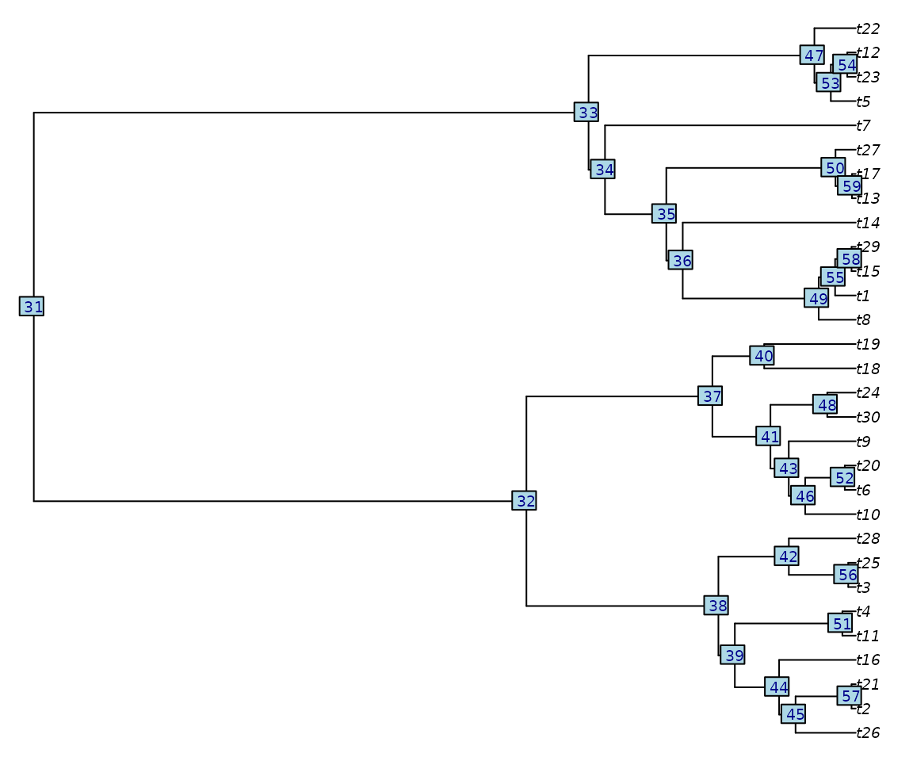
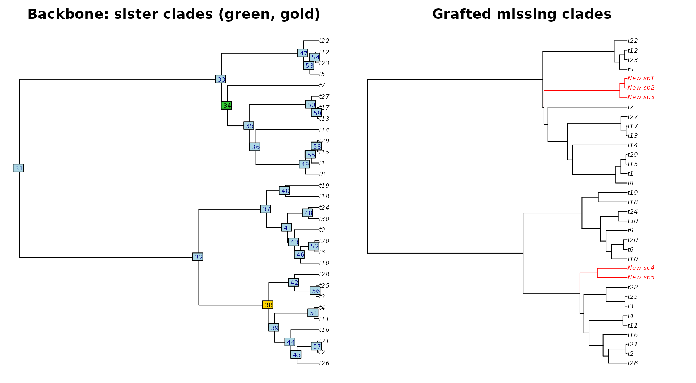
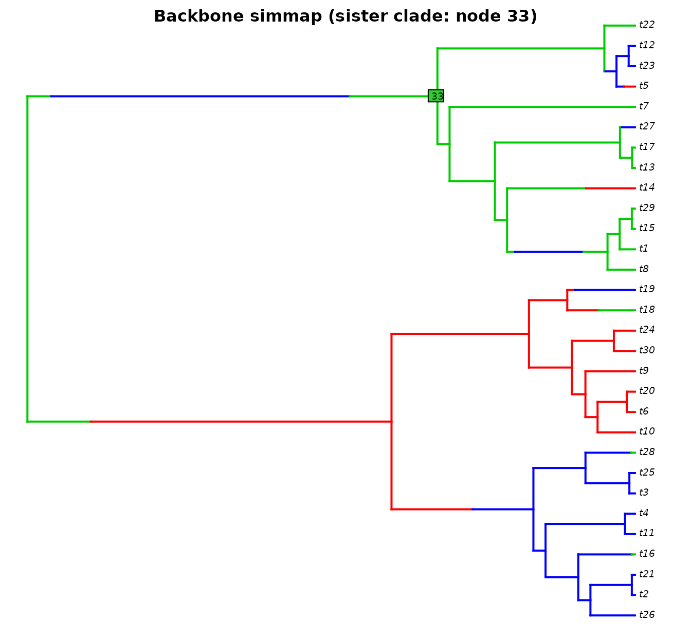
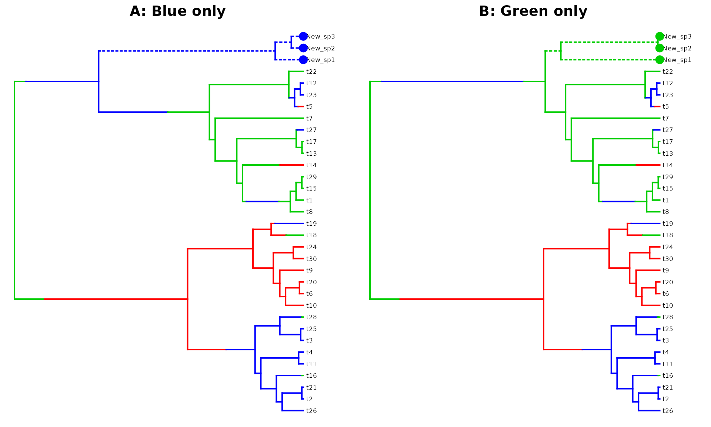

# Explore options to graft missing clades

[`graft_missing_clades()`](https://maeldore.github.io/phylograftR/reference/graft_missing_clades.md)
grafts **groups of missing taxa that form a clade** (**missing clades**)
as the **sister** of a clade of the backbone phylogeny. Where
[`graft_missing_taxa()`](https://maeldore.github.io/phylograftR/reference/graft_missing_taxa.md)
places each taxon within a target clade (see
[`vignette("graft_missing_taxa")`](https://maeldore.github.io/phylograftR/articles/graft_missing_taxa.md)),
[`graft_missing_clades()`](https://maeldore.github.io/phylograftR/reference/graft_missing_clades.md)
grafts the **whole group** at once, with a subtree generated under a
diversification model. The
[`vignette("main_workflow")`](https://maeldore.github.io/phylograftR/articles/main_workflow.md)
shows the complete workflow with its default settings. This tutorial
instead explores **the arguments of the function** and explains **how
they work and how they affect the output**:

1.  **What is a missing clade**: sister clades, stem branches and
    grouping of the taxa.
2.  **How the missing clade is generated**: the birth-death models,
    `min_tips`, and unsampled species.
3.  **Species attributes**: stochastic maps (`simmap`) and allowed
    states.

Each section changes **one group of arguments** and compares the grafted
phylogenies **side by side**, with the **same seed**, so that the
differences come from the arguments. Grafting is stochastic: the grafted
phylogenies you obtain with other seeds will differ in the details, but
the **effects of the constraints** remain.

**Arguments not covered here**

Some arguments are explained in **dedicated tutorials**:

- `seed`, `nb_simulations`, `force_simulations`, and the use of several
  stochastic maps, to **handle uncertainty** and ensure the
  **reproducibility** of the runs with the **seed system**: see
  [`vignette("handle_uncertainty")`](https://maeldore.github.io/phylograftR/articles/handle_uncertainty.md);
- `parallel` computation to **speed up** the process: see
  [`vignette("parallel_grafting")`](https://maeldore.github.io/phylograftR/articles/parallel_grafting.md);
- `save_temp`, `resume` and the other arguments used to save temporary
  files and **resume interrupted runs**: see
  [`vignette("resume_run")`](https://maeldore.github.io/phylograftR/articles/resume_run.md);
- `treat_states_as_ranges`, and the stochastic maps of **several
  traits** used together: see
  [`vignette("biogeographic_data")`](https://maeldore.github.io/phylograftR/articles/biogeographic_data.md)
  and
  [`vignette("multiple_traits")`](https://maeldore.github.io/phylograftR/articles/multiple_traits.md).

## 0/ Setup

We use the toy backbone, and **helper functions** that build a list of
missing clades to graft, and plot the results.

``` r

data(toy_backbone)

# Plot the backbone with its node IDs, to identify the clades used below
ape::plot.phylo(toy_backbone, cex = 0.6, no.margin = TRUE)
ape::nodelabels(cex = 0.6, frame = "rect", bg = "lightblue", col = "darkblue")
```



``` r

# Helper 1: build a missing_taxa_list with n taxa to graft as one missing clade, sister to a clade defined by tips
make_clade_list <- function(n, sister_tips, prefix = "New_sp", start = 1, sister_name = NULL)
{
  taxa <- paste0(prefix, seq(start, length.out = n))
  out <- list(Taxon_name = taxa,
              Sister_clade = setNames(rep(list(sister_tips), n), taxa))
  if (!is.null(sister_name)) out$Sister_clade_name <- setNames(rep(sister_name, n), taxa)
  return(out)
}

# Helper 2: combine the lists of several missing clades
combine_lists <- function(...)
{
  lists <- list(...)
  list(Taxon_name = unlist(lapply(lists, `[[`, "Taxon_name")),
       Sister_clade = do.call(c, lapply(lists, `[[`, "Sister_clade")))
}

# Helper 3: plot two grafted phylogenies side by side
plot_two <- function(phy_1, title_1, phy_2, title_2)
{
  par(mfrow = c(1, 2), mar = c(0.5, 0.5, 2, 0.5))
  plot_grafted(phy_1, use_simmap = FALSE, cex = 0.55, main = title_1)
  plot_grafted(phy_2, use_simmap = FALSE, cex = 0.55, main = title_2)
  par(mfrow = c(1, 1), mar = c(5.1, 4.1, 4.1, 2.1))
}

# Helper 4: summarize the grafting of the missing clades in a table
summarize_clades <- function(phy_grafted, missing_taxa_list)
{
  info <- extract_grafting_info(phy_grafted, missing_taxa_list, phy_backbone = toy_backbone)
  data.frame(Missing_clade = info$Missing_clade, Taxa = info$Taxa, n_taxa = info$n_taxa,
             sister_tips = info$parent_tips,
             graft_age = round(info$graft_age, 2), crown_age = round(info$crown_age, 2))
}
```

## 1/ What is a missing clade?

In `missing_taxa_list`, each taxon has a **sister clade**: a clade of
the backbone, defined by a **pair of tips** (the clade of their most
recent common ancestor), or by a **single tip** (the terminal branch of
this tip). **Taxa with the same sister clade are grafted together, as
one missing clade.**

The missing clade is always grafted **on the stem branch of its sister
clade**: it becomes the **sister** of this clade, and is never nested
within it. This is why, unlike for missing taxa, there is no target
clade, no excluded subclade and no `include_target_clade_stem` argument:
the only constraint is the sister clade. The sister clade cannot be the
whole tree, as it would have no stem branch. Clades must be **defined by
tips**, not by node IDs (see
[`vignette("format_inputs")`](https://maeldore.github.io/phylograftR/articles/format_inputs.md)
and
[`convert_nodes_to_tips()`](https://maeldore.github.io/phylograftR/reference/convert_nodes_to_tips.md)).

Here, we graft **two missing clades**: three taxa as sister of
`Subfam_B1` (node `34`, defined by the tips `t8` and `t7`), and two taxa
as sister of `Subfam_A2` (node `38`, defined by the tips `t28` and
`t26`).

``` r

# ------ Missing clades: taxa grouped by their sister clade ------ #

# Missing clade 1: three taxa, sister to Subfam_B1 (node 34)
clade_1 <- make_clade_list(n = 3, sister_tips = c("t8", "t7"))
# Missing clade 2: two taxa, sister to Subfam_A2 (node 38)
clade_2 <- make_clade_list(n = 2, sister_tips = c("t28", "t26"), start = 4)

# Missing taxa list with both missing clades
taxa_two_clades <- combine_lists(clade_1, clade_2)

# Graft the missing clades
grafted_two_clades <- graft_missing_clades(phy = toy_backbone, missing_taxa_list = taxa_two_clades,
                                           seed = 2, verbose = FALSE)

# Summarize grafting info on the missing clades
summarize_clades(grafted_two_clades, taxa_two_clades)
#>   Missing_clade                      Taxa n_taxa sister_tips graft_age
#> 1             1 New_sp1, New_sp2, New_sp3      3      t8, t7      16.0
#> 2             2          New_sp4, New_sp5      2     t26, t3       9.1
#>   crown_age
#> 1      1.47
#> 2      5.77

# Plot the backbone vs the grafted phylogeny
par(mfrow = c(1, 2), mar = c(0.5, 0.5, 2, 0.5))
# Left: the backbone with its node IDs, and the sister clades: node 34 in limegreen, node 38 in gold
ape::plot.phylo(toy_backbone, cex = 0.55, main = "Backbone: sister clades (green, gold)")
ape::nodelabels(cex = 0.55, frame = "rect", bg = "lightblue", col = "darkblue")
ape::nodelabels(node = 34, cex = 0.55, frame = "rect", bg = "limegreen", col = "black")
ape::nodelabels(node = 38, cex = 0.55, frame = "rect", bg = "gold", col = "black")
# Right: the grafted phylogeny
plot_grafted(grafted_two_clades, use_simmap = FALSE, cex = 0.55, main = "Grafted missing clades")
```



``` r

par(mfrow = c(1, 1), mar = c(5.1, 4.1, 4.1, 2.1))
```

Each missing clade is a **monophyletic group** attached to the stem of
its sister clade. Missing clades **nested within** other sister clades
are processed first, so a missing clade can be grafted on a phylogeny
that already includes the missing clades grafted within its sister
clade. A sister clade defined by a **single tip** is the terminal branch
of this tip, and a **single missing taxon** is grafted on the stem of
its sister clade as a missing clade.

Taxa sharing the same sister clade **must share the same attributes**:
for instance, they must have the same `allowed_states` (the function
stops otherwise, see *Section 3*).

## 2/ How is the missing clade generated?

Unlike missing taxa, a missing clade needs a **subtree**: the
relationships and ages of its taxa. It is generated under a
**birth-death (BD) model**, with three steps for each missing clade:

1.  A BD model is fitted on the **sister clade**, or on the **smallest
    enclosing clade** with at least `min_tips` tips if the sister clade
    is too small.
2.  The **graft age** of the missing clade is drawn on the stem branch
    of the sister clade (between its crown age and its stem age).
3.  The **subtree** of the missing taxa is generated under the fitted
    model, conditioned on the number of taxa and on the graft age.

**A BD model is therefore always required**: there is no `method`
argument, and no `"uniform"` alternative as in
[`graft_missing_taxa()`](https://maeldore.github.io/phylograftR/reference/graft_missing_taxa.md).
The BD models can be reported with `return_BD_model_summary = TRUE`, and
extracted with
[`extract_BD_model_summary()`](https://maeldore.github.io/phylograftR/reference/extract_BD_model_summary.md).

### Fit the models on enough tips: `min_tips`

If the sister clade has **fewer than `min_tips` tips** (default: `5`,
minimum: `3`), the model is fitted on the smallest enclosing clade with
at least `min_tips` tips.

Here, we graft 4 taxa as sister of `Gen_1` (node `50`, tips `t13` and
`t27`, with 3 tips in the backbone) with `min_tips = 3` (the sister
clade has enough tips) and `min_tips = 5` (it does not). Then, we
**compare the fits of the BD models** used to produce the subtrees of
the missing clade, and draw the graft age:

``` r

# ------ min_tips: clade used to fit the birth-death model ------ #

taxa_gen1 <- make_clade_list(n = 4, sister_tips = c("t13", "t27"))

grafted_min3 <- graft_missing_clades(phy = toy_backbone, missing_taxa_list = taxa_gen1,
                                     min_tips = 3, return_BD_model_summary = TRUE,
                                     seed = 1234, verbose = FALSE)
grafted_min5 <- graft_missing_clades(phy = toy_backbone, missing_taxa_list = taxa_gen1,
                                     min_tips = 5, return_BD_model_summary = TRUE,
                                     seed = 1234, verbose = FALSE)

# Summary of the BD models: sister clade vs enclosing clade used to fit the diversification model
cols <- c("n_taxa", "initial_clade_n_tips", "enclosing", "fitted_clade_n_tips", "min_tips",
          "b", "d", "net_diversification", "relative_extinction", "rho")
rbind(extract_BD_model_summary(grafted_min3)[, cols], extract_BD_model_summary(grafted_min5)[, cols])
#>   n_taxa initial_clade_n_tips enclosing fitted_clade_n_tips min_tips         b
#> 1      4                    3     FALSE                   3        3 1.3647565
#> 2      4                    3      TRUE                   8        5 0.7608622
#>           d net_diversification relative_extinction       rho
#> 1 1.3511089         0.013647565                0.99 1.0000000
#> 2 0.7532536         0.007608622                0.99 0.6666667
```

With `min_tips = 5`, the model is fitted on a 8-tip enclosing clade: the
rates describe the dynamics of a larger part of the tree rather than of
the sister clade, and differ from the rates of the 3-tip clade. You can
play with the `min_tips` parameter to adjust the way BD models are
fitted:

- increase `min_tips` if the rates estimated on small clades are not
  reliable;
- decrease `min_tips` (down to `3`) to keep the model close to the
  sister clade.

### Unsampled species: `total_richness_per_clades`

The backbone and the missing clades to graft may not cover all the
species of the clades. Providing the **total richness of clades** (see
[`vignette("format_inputs")`](https://maeldore.github.io/phylograftR/articles/format_inputs.md))
lets the BD models account for the **unsampled species** with:
`total_richness = nb_backbone + nb_missing + nb_unsampled`.

Therefore, BD models are fitted with **sampling fraction** defined as
`rho = n_present / (n_present + n_pending + n_unsampled)` to account for
those unsampled species. **Unsampled species are only used to fit the
models**: they are not grafted.

As for missing taxa, many unsampled species lower the sampling fraction,
and give **higher speciation and extinction rates**: the lineages of the
missing clade are expected to diverge **more recently**, so the **crown
age of the missing clade is expected to be younger**. The **graft age**
is drawn on the stem of the sister clade, between its crown age and its
stem age: it is constrained by the backbone, and is expected to be much
less affected, yet still younger in average than without accounting for
unsampled species.

Here, we graft 4 taxa as sister of `Subfam_A1` (node `37`, tips `t19`
and `t10`, 8 tips in the backbone) without total richness, and with a
total richness of 60 species:

``` r

# ------ Total richness: no unsampled species vs many unsampled species ------ #

# Create list of taxa to graft as a missing clade sister to Subfam_A1
taxa_subfam_a1 <- make_clade_list(n = 4, sister_tips = c("t19", "t10"), sister_name = "Subfam_A1")


# Create richness table to account for unsampled species
# Total richness of Subfam_A1: 60 species, so 60 - 8 = 52 unsampled species
richness_subfam_a1 <- list(Sister_clade = list(c("t19", "t10")), Sister_clade_name = "Subfam_A1",
                       total_richness = 60)

# Graft with and without accounting for unsampled species
grafted_no_richness <- graft_missing_clades(phy = toy_backbone, missing_taxa_list = taxa_subfam_a1,
                                            return_BD_model_summary = TRUE, seed = 1234, verbose = FALSE)
grafted_richness <- graft_missing_clades(phy = toy_backbone, missing_taxa_list = taxa_subfam_a1,
                                         total_richness_per_clades = richness_subfam_a1,
                                         return_BD_model_summary = TRUE, seed = 1234, verbose = FALSE)

# Inspect the effective sampling fraction and the rates of the BD models
cols <- c("n_taxa", "n_unsampled", "rho", "b", "d", "net_diversification")
rbind(extract_BD_model_summary(grafted_no_richness)[, cols],
      extract_BD_model_summary(grafted_richness)[, cols])
#>   n_taxa n_unsampled       rho         b         d net_diversification
#> 1      4           0 1.0000000 0.1589055 0.0000000           0.1589055
#> 2      4          52 0.1333333 0.8782356 0.6317844           0.2464512

##  The sampling fraction (rho) is lower with many unsampled species
##  As a result, the speciation (b) and extinction (d) rates are higher
```

We then compare graft ages and crown ages across **100 simulations**
with each setting:

``` r


# Graft 100 times with and without accounting for unsampled species
sims_no_richness <- graft_missing_clades(phy = toy_backbone, missing_taxa_list = taxa_subfam_a1,
                                         nb_simulations = 100, seed = 1234, verbose = FALSE)
sims_richness <- graft_missing_clades(phy = toy_backbone, missing_taxa_list = taxa_subfam_a1,
                                      total_richness_per_clades = richness_subfam_a1,
                                      nb_simulations = 100, seed = 1234, verbose = FALSE)

# Extract the graft ages and crown ages of the missing clade from the simulations
info_no_richness <- extract_grafting_info(sims_no_richness, taxa_subfam_a1, phy_backbone = toy_backbone)
info_richness <- extract_grafting_info(sims_richness, taxa_subfam_a1, phy_backbone = toy_backbone)

# Summarize the ages across the simulations
ages_summary <- function(info) c(mean_graft_age = mean(info$graft_age),
                                 median_graft_age = median(info$graft_age),
                                 mean_crown_age = mean(info$crown_age),
                                 median_crown_age = median(info$crown_age))
round(rbind("No total richness" = ages_summary(info_no_richness),
            "Total richness = 60" = ages_summary(info_richness)), 2)
#>                     mean_graft_age median_graft_age mean_crown_age
#> No total richness            13.39            13.09           7.80
#> Total richness = 60          12.48            11.91           3.78
#>                     median_crown_age
#> No total richness               7.60
#> Total richness = 60             3.26

## As expected, the crown age of the missing clade is much younger with many unsampled species,
## while the graft age is only slightly younger.
```

## 3/ Species attributes: `simmap` and allowed states

Grafting can be constrained by a **species attribute**: a stochastic map
(`simmap`) gives the state of the attribute along the branches of the
backbone. Each missing clade is grafted on the **portions of the stem
branch of its sister clade that are in its allowed states**.

The **whole missing clade** is then in **the state of the point where it
was grafted**: a missing clade inherits a single state.

Allowed states are set **for each missing clade** with the
`allowed_states` of the list (**all the taxa of a missing clade must
have the same value**), or **for all missing clades** with the
`allowed_states` argument (the list value takes precedence). The
stochastic maps are built from tip data (see
[`vignette("prepare_stochastic_maps")`](https://maeldore.github.io/phylograftR/articles/prepare_stochastic_maps.md)).
Here we use the toy map of a **single categorical trait**, with three
states (`"blue"`, `"green"`, `"red"`).

This section presents the **general principle** with a simple example.
For more details, please refer to the tutorials dedicated to the
different types of species attributes:

- for **biogeographic ranges** (multi-area states,
  `treat_states_as_ranges`):
  [`vignette("biogeographic_data")`](https://maeldore.github.io/phylograftR/articles/biogeographic_data.md);
- for **combining several traits** (or a trait and ranges) as
  constraints:
  [`vignette("multiple_traits")`](https://maeldore.github.io/phylograftR/articles/multiple_traits.md);
- for **continuous traits**:
  [`vignette("continuous_data")`](https://maeldore.github.io/phylograftR/articles/continuous_data.md).

Here, we graft 3 taxa as a missing clade, sister of `Family_B` (node
`33`, tips `t8` and `t22`). The stem branch of `Family_B` has **two
states**: green (at both ends) and blue (most of the branch), as shown
on the backbone simmap:

``` r

# ------ The backbone simmap ------ #

data(toy_simmap)
state_colors <- c(blue = "blue", green = "green3", red = "red")

# Plot the simmap, with the sister clade (node 33) in limegreen
par(mar = c(0.5, 0.5, 2.5, 0.5))
phytools::plotSimmap(toy_simmap, colors = state_colors, fsize = 0.6, ftype = "i", lwd = 2)
title("Backbone simmap (sister clade: node 33)", line = -1, cex.main = 1)
ape::nodelabels(node = 33, cex = 0.6, frame = "rect", bg = "limegreen", col = "black")
```



``` r

par(mar = c(5.1, 4.1, 4.1, 2.1))
```

We compare the grafting with **blue only** and **green only** as allowed
states:

``` r

# ------ Allowed states: blue only vs green only ------ #

# Missing clade sister to Family_B
taxa_fam_b <- make_clade_list(n = 3, sister_tips = c("t8", "t22"))

# Graft the missing clade with only blue as 'allowed_states'
grafted_blue <- graft_missing_clades(phy = toy_backbone, missing_taxa_list = taxa_fam_b,
                                     simmap = toy_simmap, allowed_states = "blue",
                                     seed = 48, verbose = FALSE)
# Graft the same missing clade, with only green as 'allowed_states'
grafted_green <- graft_missing_clades(phy = toy_backbone, missing_taxa_list = taxa_fam_b,
                                      simmap = toy_simmap, allowed_states = "green",
                                      seed = 48, verbose = FALSE)

# The simmap is updated: the whole missing clade has the state of the point where it was grafted
sapply(list("Blue only" = grafted_blue, "Green only" = grafted_green),
       function(phy_grafted) unique(phytools::getStates(phy_grafted$simmap, type = "tips")[taxa_fam_b$Taxon_name]))
#>  Blue only Green only 
#>     "blue"    "green"

# Helper: plot the updated simmap of a grafted phylogeny
# Grafted branches are dashed, and grafted tips are marked with a point in the color of their final state
plot_states <- function(phy_grafted, main)
{
  plot_grafted(phy_grafted, which = "edges", simmap_colors = state_colors, fsize = 0.55, main = main)
  grafted_tips <- which(phy_grafted$grafted_tips)
  tip_states <- phytools::getStates(phy_grafted$simmap, type = "tips")[phy_grafted$tip.label[grafted_tips]]
  ape::tiplabels(tip = grafted_tips, pch = 19, cex = 1.5, col = state_colors[tip_states])
}

# Plot both updated simmaps
par(mfrow = c(1, 2), mar = c(0.5, 0.5, 2, 0.5))
plot_states(grafted_blue, main = "A: Blue only")
plot_states(grafted_green, main = "B: Green only")
```



``` r

par(mfrow = c(1, 1), mar = c(5.1, 4.1, 4.1, 2.1))
```

In panel A (resp. B), the missing clade is grafted on the **blue (resp.
green) portion of the stem** of `Family_B`, so all its taxa have this
state, and the graft age falls in the corresponding range of ages.

Without `allowed_states`, it can be grafted on any portion of the stem
and takes the state of the point where it was grafted.

Several states can be allowed (e.g., `c("blue", "green")`), and the
states must **match the names of the states of the map exactly**. With
`return_simmap = FALSE`, the updated map is not added to the output
(`$simmap`).

As for missing taxa, `min_valid_fraction` warns about the missing clades
with a **narrow window of ages in the allowed states**, and
`max_age_redraws` limits the redraws of the graft age when it falls
where no stem portion is in the allowed states (see
[`vignette("graft_missing_taxa")`](https://maeldore.github.io/phylograftR/articles/graft_missing_taxa.md)
and
[`vignette("check_grafting")`](https://maeldore.github.io/phylograftR/articles/check_grafting.md)).

## Next steps

Now that you know all the tweaks of **grafting missing clades**, you may
be interested in exploring options for:

- grafting **missing taxa** within target clades:
  [`graft_missing_taxa()`](https://maeldore.github.io/phylograftR/reference/graft_missing_taxa.md),
  see
  [`vignette("graft_missing_taxa")`](https://maeldore.github.io/phylograftR/articles/graft_missing_taxa.md);
- grafting **both types** in one run:
  [`graft_missing_taxa_and_clades()`](https://maeldore.github.io/phylograftR/reference/graft_missing_taxa_and_clades.md),
  see
  [`vignette("combine_missing_taxa_and_clades")`](https://maeldore.github.io/phylograftR/articles/combine_missing_taxa_and_clades.md);
- **checking** the grafting plan and the resulting grafted phylogenies:
  see
  [`vignette("check_grafting")`](https://maeldore.github.io/phylograftR/articles/check_grafting.md);
- handling **uncertainty** with several simulations and stochastic maps,
  and ensuring the **reproducibility** of the runs with the seed system:
  [`vignette("handle_uncertainty")`](https://maeldore.github.io/phylograftR/articles/handle_uncertainty.md);
- speeding up your runs by using **parallel computation**:
  [`vignette("parallel_grafting")`](https://maeldore.github.io/phylograftR/articles/parallel_grafting.md);
- **resuming** interrupted runs:
  [`vignette("resume_run")`](https://maeldore.github.io/phylograftR/articles/resume_run.md).
