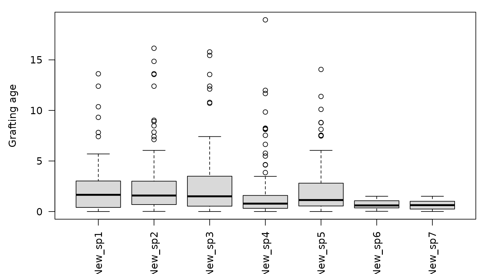
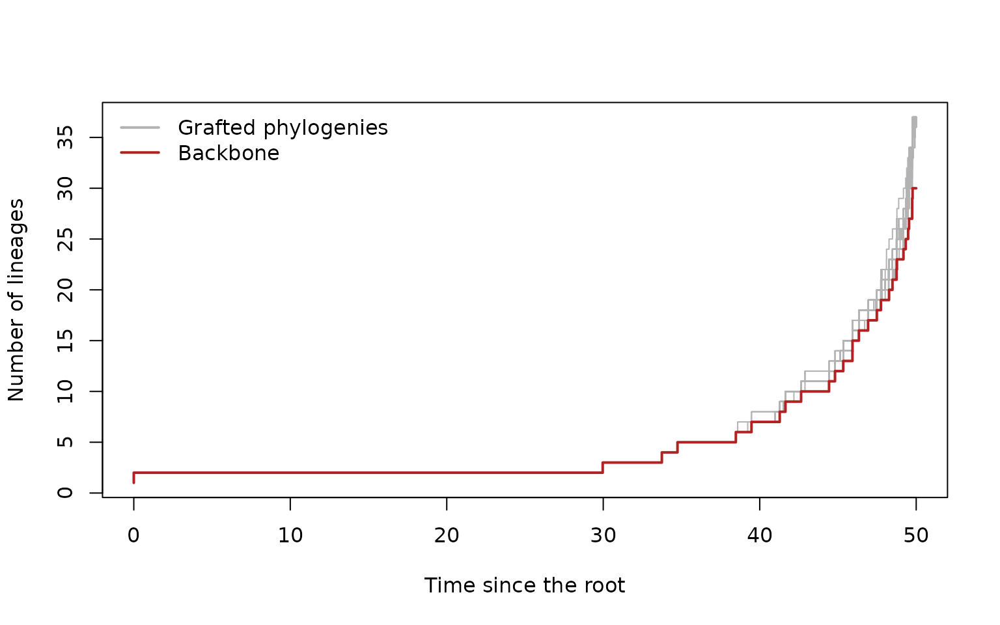
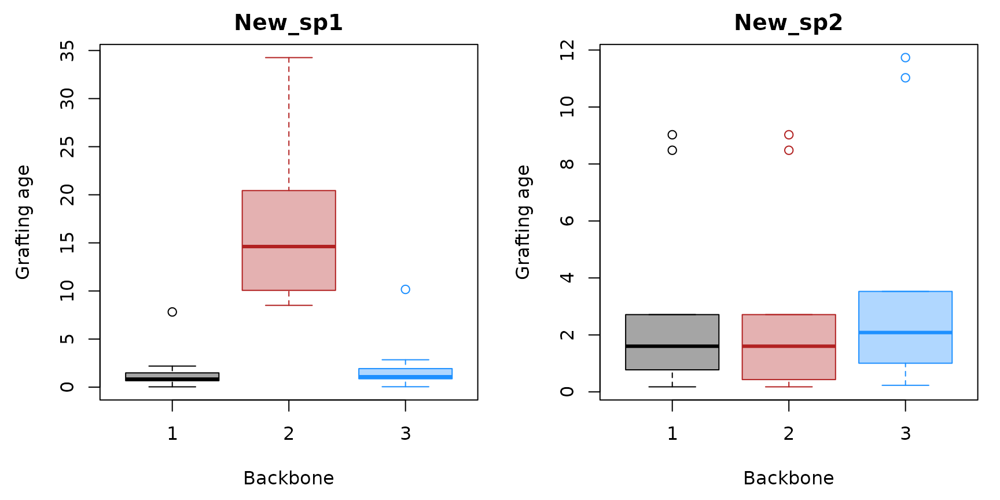
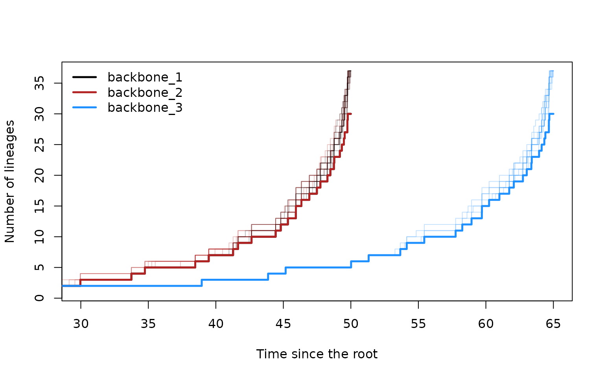

# Handle uncertainty: simulations, stochastic maps and backbones

A grafted phylogeny is **one realization** of a stochastic process,
conditioned on the information you provide. It can be used for your main
analyses, but ideally you would like to accoutn for potential **sources
of uncertainty** in order to assess the robustness of your results. This
tutorial explains how to account for different sources of uncertainty
with phylograftR, and how to handle the resulting sets of grafted
phylogenies in downstream analyses.

Here, we cover:

1.  **N simulations**: the uncertainty in the **stochasticity of the
    grafting process** itself.
2.  **P stochastic maps**: the uncertainty in the **evolution of the
    traits** used as constraints.
3.  **P x N**: how the stochastic maps and the simulations are
    **crossed** to produce grafted phylogenies that account for both
    sources of uncertainty mentioned above.
4.  How to **flatten** the outputs with
    [`flatten_grafted_phylogenies()`](https://maeldore.github.io/phylograftR/reference/flatten_grafted_phylogenies.md)
    to use them in downstream analyses.
5.  Summary the **format and the naming system of the outputs**.
6.  **Loop over several backbones** to account for the uncertainty in
    the backbone phylogeny (topology + divergence dating).

The principle is the same **whatever the type of attribute** used as
constraint: categorical traits, biogeographic ranges, and continuous
traits (once discretized into states). To learn how to build the
stochastic maps from your own tip data, see
[`vignette("prepare_stochastic_maps")`](https://maeldore.github.io/phylograftR/articles/prepare_stochastic_maps.md).

This tutorial is also about **reproducibility**. The grafting is
stochastic, so phylograftR relies on a **seed system**: a single `seed`
makes a whole run reproducible (all the simulations and all the maps),
and **each grafted phylogeny can be reproduced alone** from its own seed
(and its map). We explain how the seeds work in *Section 1*
(simulations), *Section 3* (maps and simulations crossed), and *Section
6* (several backbones), and what it implies for the analyses.

## 0/ Data

We use the toy backbone, the toy list of **7 missing taxa**, and the toy
**`multiSimmap`** of 10 stochastic maps of a color with three states. 10
maps are enough for illustration, but real analyses should use **100
maps or more** to properly account for the uncertainty in trait
evolution.

``` r

# ------ Toy data ------ #

data(toy_backbone)
data(toy_missing_taxa_list) # Taxonomic constraints only (target clades and excluded subclades)
data(toy_missing_taxa_list_with_allowed_states) # Same, with colors allowed for some taxa
data(toy_multiSimmap) # 10 stochastic maps of the color

# Missing taxa list with the colors allowed for some taxa
taxa_colors <- toy_missing_taxa_list_with_allowed_states

# New_sp1 is only allowed in "red" in the shipped list. We also allow "green", so that a branch
# is available for it in each of the 10 maps (see the end of Section 2 for what happens otherwise)
taxa_colors$allowed_states[["New_sp1"]] <- c("red", "green")
```

To show the variability among grafted phylogenies, we use
[`extract_grafting_info()`](https://maeldore.github.io/phylograftR/reference/extract_grafting_info.md).
This function is used **a posteriori** to returns a summary table with
**one row per grafted taxon and per grafted phylogeny**, with the **age
of the grafting** and the **branch** (`parent_node`) on which the taxon
was grafted (see
[`vignette("check_grafting")`](https://maeldore.github.io/phylograftR/articles/check_grafting.md)).

## 1/ N simulations: stochasticity of the grafting

Even with the same backbone and the same constraints, **two runs of the
grafting function with different seeds give different phylogenies**.
With the default method (`"BD_clades"`), the **divergence ages are drawn
at random** from the distributions expected under the birth-death model
fit on each target clade, and the **branch is drawn at random** among
the branches available at this age. For the `"uniform"` method, there is
no diversification model involved, but the location of the graft is
**still drawn at random** from a uniform distribution among all
avaialble branches. A single grafted phylogeny is thus **one possible
outcome** among many.

`nb_simulations` runs the grafting **N times** from the same inputs,
producing **N different outcomes**. A **unique seed** makes the run
reproducible. It controls the series of seeds used to produce each of
the outcomes.

``` r

# ------ N simulations ------ #

# Graft the missing taxa 100 times, with taxonomic constraints only (no stochastic map)
grafted_sims <- graft_missing_taxa(phy = toy_backbone, missing_taxa_list = toy_missing_taxa_list,
                                   nb_simulations = 100, verbose = FALSE, seed = 1)

# The output is a multiPhylo with one phylogeny per simulation
class(grafted_sims)
#> [1] "multiPhylo"
length(grafted_sims)
#> [1] 100
head(names(grafted_sims))
#> [1] "sim_1" "sim_2" "sim_3" "sim_4" "sim_5" "sim_6"

# The seed of each simulation is stored in the attribute "seeds"
head(attr(grafted_sims, "seeds"))
#>      sim_1      sim_2      sim_3      sim_4      sim_5      sim_6 
#>          1 1140350788  312928385  866248189 1909893419  554504146
```

The grafting of each taxon **varies across the simulations**: the
**ages** and the **branches** differ. We use
[`extract_grafting_info()`](https://maeldore.github.io/phylograftR/reference/extract_grafting_info.md)
to summarize the **branch** (`parent_node`) on which the taxon was
grafted and the **age of the grafting** across simulations.

``` r

# ------ Variability of the grafting among simulations ------ #

info_sims <- extract_grafting_info(grafted_sims, missing_taxa_list = toy_missing_taxa_list,
                                   phy_backbone = toy_backbone)

# Summarize the number of different branches used for each taxon, and their median grafting age
data.frame(N_simulations = tapply(info_sims$simulation, info_sims$Taxon_name, length),
           N_parent_branches = tapply(info_sims$parent_node, info_sims$Taxon_name, function (x) length(unique(x))),
           Graft_age_median = round(tapply(info_sims$graft_age, info_sims$Taxon_name, median), 2))
#>         N_simulations N_parent_branches Graft_age_median
#> New_sp1           100                 7             1.65
#> New_sp2           100                18             1.58
#> New_sp3           100                28             1.51
#> New_sp4           100                21             0.78
#> New_sp5           100                11             1.14
#> New_sp6           100                 1             0.61
#> New_sp7           100                 4             0.63

# Distribution of the grafting ages
par(mar = c(4.5, 4.5, 1, 1))
boxplot(graft_age ~ Taxon_name, data = info_sims, ylab = "Grafting age", xlab = "",
        las = 2, col = "grey85")
```



``` r

par(mar = c(5.1, 4.1, 4.1, 2.1))
```

The **more constrained a taxon is** (e.g., a younger and smaller target
clade like `New_sp6` and `New_sp7`), the **less it varies**. Downstream
analyses performed over the 100 grafted phylogenies are **more robust**
than the results obtained from a single phylogeny.

### Ensure reproducibility across simulations

**phylograftR** is design to ensure **full reproducibility of analyses**
based on the use of `seed` controlling the random number generation. The
**first simulation in a grafting run uses the value in `seed`**, and the
seeds of the other simulations of the run are all derived from it. Each
simulation can therefore be **reproduced alone** with its own seed, and
the whole set of simulations can be reproduced with the unique `seed`
too:

``` r

# ------ Reproduce one simulation ------ #

# Rerun the simulation 3 alone, with its seed
seed_3 <- attr(grafted_sims, "seeds")["sim_3"]
sim_3_alone <- graft_missing_taxa(phy = toy_backbone, missing_taxa_list = toy_missing_taxa_list,
                                  nb_simulations = 1, verbose = FALSE, seed = seed_3)

# Same grafted phylogeny
all.equal(sim_3_alone$edge, grafted_sims[["sim_3"]]$edge)
#> [1] TRUE
all.equal(sim_3_alone$edge.length, grafted_sims[["sim_3"]]$edge.length)
#> [1] TRUE
```

If some simulations fail because of the random draws (e.g., no usable
age after many redraws), they are skipped with a warning, and listed in
the attribute `"failed"`. Use `force_simulations = TRUE` (the default is
`FALSE`) to try new seeds until `nb_simulations` phylogenies are
obtained (see
[`?graft_missing_taxa`](https://maeldore.github.io/phylograftR/reference/graft_missing_taxa.md)).

## 2/ P maps: uncertainty in the trait evolution

When the grafting is constrained by a **trait** or by **biogeographic
ranges**, the **evolutionary history of this attribute** along the
backbone is itself uncertain: ancestral states are inferred using
models, not observed. A **stochastic map** (`simmap`) is only **one
possible history**. A **set of stochastic maps** of the same trait (a
**`multiSimmap`**) describes the uncertainty in its evolutionary
history, and each map can be used as a different constraint for the
grafting (see also *Section 3* in
[`vignette("prepare_stochastic_maps")`](https://maeldore.github.io/phylograftR/articles/prepare_stochastic_maps.md)).

The `multiSimmap` is provided to the same argument `simmap`. The
grafting is run **with each of the P maps**, so the uncertainty in the
trait history is **propagated to the grafted phylogenies**.

``` r

# ------ P maps ------ #

# Graft with each of the 10 maps (one simulation per map by default)
grafted_maps <- graft_missing_taxa(phy = toy_backbone, missing_taxa_list = taxa_colors,
                                   simmap = toy_multiSimmap, verbose = FALSE, seed = 1)

# The output is a list with one grafted phylogeny per map, named after the maps
class(grafted_maps)
#> [1] "list"
names(grafted_maps)
#>  [1] "map_1"  "map_2"  "map_3"  "map_4"  "map_5"  "map_6"  "map_7"  "map_8" 
#>  [9] "map_9"  "map_10"
class(grafted_maps$map_1)
#> [1] "phylo"
```

The maps differ in the **branches in the allowed states**, so the
constraints applied when grafting differ, and a taxon is not grafted in
the same location from one map to the next:

``` r

# ------ Variability of the grafting among maps ------ #

info_maps <- extract_grafting_info(grafted_maps, missing_taxa_list = taxa_colors,
                                   phy_backbone = toy_backbone)

# Number of different branches used for each taxon across the 10 maps
tapply(info_maps$parent_node, info_maps$Taxon_name, function (x) length(unique(x)))
#> New_sp1 New_sp2 New_sp3 New_sp4 New_sp5 New_sp6 New_sp7 
#>       1       4       2       4       2       1       2
```

The variability depends on the taxon: it is higher for the taxa whose
allowed states, and thus the available branches, change more among the
maps.

Each grafted phylogeny comes with its **updated simmap** (`$simmap`),
derived from the map it was grafted on. The same applies to **several
traits**: provide a **list of `multiSimmap`s** with the same number of
maps for each trait, and the maps are **paired** (see
[`vignette("multiple_traits")`](https://maeldore.github.io/phylograftR/articles/multiple_traits.md)).
Each grafted phylogeny then has one updated simmap per trait.

**This works for all the types of attributes.** Biogeographic stochastic
maps (`multiSimmap` of ranges, see
[`vignette("biogeographic_data")`](https://maeldore.github.io/phylograftR/articles/biogeographic_data.md))
and the maps discretized from continuous stochastic maps
([`vignette("continuous_data")`](https://maeldore.github.io/phylograftR/articles/continuous_data.md))
are `multiSimmap`s too, and are used in the same way.

### What happens when a map cannot be used?

A map can fail for two reasons, which are handled differently:

**1/ Random failure**

A taxon can be grafted in a map, but the draws of its divergence age did
not give a usable age after `max_age_redraws` attempts (see
[`vignette("graft_missing_taxa")`](https://maeldore.github.io/phylograftR/articles/graft_missing_taxa.md)).
In this case, the map is **dropped from the output with a warning**,
while the other maps are returned, and the dropped map is listed in the
attribute `"failed_maps"`.

We illustrate it by allowing very few redraws:

``` r

# ------ A map dropped at random ------ #

# Only 3 attempts to draw a usable divergence age
grafted_dropped <- graft_missing_taxa(phy = toy_backbone, missing_taxa_list = taxa_colors,
                                      simmap = toy_multiSimmap, max_age_redraws = 3,
                                      verbose = FALSE, seed = 1)
#> Warning: Map 'map_7': none of the 1 simulation(s) could be obtained, the map is dropped from the output.
#> Reasons:
#>   - No usable divergence age was found for 1 taxa of the target clade defined by t26, t18 after 3 redraws of their divergence ages ('max_age_redraws').
#> Time window of the divergence ages: from age 0 to age 50 (stem age of the target clade).
#> Share of this window crossed by the available branches in the allowed states (current tree):
#>   - New_sp1: 46.72% (allowed states: red, green)
#> No available branch crosses the ages drawn: the part of the time window where branches are available is too narrow or too far from the ages expected from the diversification model.
#> Increase 'max_age_redraws', extend the allowed states, or use method = 'uniform'.

# An output is produced, without the map(s) that failed
names(grafted_dropped)
#> [1] "map_1"  "map_2"  "map_3"  "map_4"  "map_5"  "map_6"  "map_8"  "map_9" 
#> [9] "map_10"
attr(grafted_dropped, "failed_maps")$map
#> [1] "map_7"
```

With more maps or simulations, `force_simulations = TRUE` tries new
seeds until the requested number of phylogenies is obtained, so that
fewer maps are dropped. With the default `max_age_redraws = 1000`, such
random failures are rare, except for very narrow windows of grafting.

**2/ Hard constraints that cannot be met**

A taxon cannot be grafted in a map because its constraints (i.e., target
clade, excluded subclades, allowed states) leaves no available branch
pieces for grafting. In this case, the run **stops with an error**.

To illustrate this, we now use the original list, where `New_sp1` is
only allowed in `"red"`:

``` r

# ------ A map where the constraints cannot be met ------ #

# Colors allowed for New_sp1 in the shipped list
toy_missing_taxa_list_with_allowed_states$allowed_states[["New_sp1"]]
#> [1] "red"

# Graft with each of the 10 maps
graft_missing_taxa(phy = toy_backbone, missing_taxa_list = toy_missing_taxa_list_with_allowed_states,
                   simmap = toy_multiSimmap, verbose = FALSE, seed = 1)
#> Error:
#> ! Map 'map_3': 1 taxa have no branch available for grafting in their allowed states: none of the available branches of their target clade has a piece in these states.
#>   - New_sp1 (target clade tips: t26, t18; allowed states: red)
#> Adjust 'allowed_states' (global or in missing_taxa_list), or the constraints on the branches ('include_target_clade_stem', 'Excluded_subclades', 'exclude_subclades_stem') for these taxa.
```

The grafting **stops with an error** that names the map: in the map 3,
**no branch of the target clade of `New_sp1` has a piece in red**. Since
the problem is in the inputs, the whole run is stopped instead of
silently skipping the map.
[`check_grafting_plan()`](https://maeldore.github.io/phylograftR/reference/check_grafting_plan.md)
finds such maps **before** the run (see
[`vignette("check_grafting")`](https://maeldore.github.io/phylograftR/articles/check_grafting.md)):

``` r

# ------ Check the grafting plan across the maps ------ #

plan_maps <- check_grafting_plan(phy = toy_backbone,
                                 missing_taxa_list = toy_missing_taxa_list_with_allowed_states,
                                 simmap = toy_multiSimmap, verbose = FALSE)

# Number of maps where each taxon cannot be grafted
plan_maps[, c("Taxon_name", "allowed_states", "n_maps_infeasible")]
#>   Taxon_name   allowed_states n_maps_infeasible
#> 1    New_sp1              red                 1
#> 2    New_sp2 blue, green, red                 0
#> 3    New_sp3 blue, green, red                 0
#> 4    New_sp4      blue, green                 0
#> 5    New_sp5            green                 0
#> 6    New_sp6 blue, green, red                 0
#> 7    New_sp7        blue, red                 0

# Which maps?
per_map <- attr(plan_maps, "per_map")
per_map[!per_map$feasible, c("map", "Taxon_name", "cause")]
#>      map Taxon_name          cause
#> 15 map_3    New_sp1 allowed_states
```

To solve it, **relax the constraints of the taxon** (as we did in
*Section 0*), remove the maps that cannot be used, or change the other
constraints of the taxon (e.g., its target clade or its excluded
subclades).

## 3/ P x N: crossing maps and simulations

The two sources of uncertainty are **independent**: a given stochastic
map still leaves room for the stochasticity of the grafting. Therefore,
both sources can be combined: each map is used for `nb_simulations`
simulations, so `P` maps give **`P * nb_simulations` grafted
phylogenies**.

``` r

# ------ P x N ------ #

# Graft with each of the 10 maps, 5 simulations per map: 50 grafted phylogenies
grafted_crossed <- graft_missing_taxa(phy = toy_backbone, missing_taxa_list = taxa_colors,
                                      simmap = toy_multiSimmap, nb_simulations = 5,
                                      verbose = FALSE, seed = 1)

# One element per map, each a multiPhylo with the 5 simulations of this map
length(grafted_crossed)
#> [1] 10
sapply(grafted_crossed, length)
#>  map_1  map_2  map_3  map_4  map_5  map_6  map_7  map_8  map_9 map_10 
#>      5      5      5      5      5      5      5      5      5      5

# Total number of grafted phylogenies
sum(sapply(grafted_crossed, length))
#> [1] 50

# Names of the phylogenies in the first map: "<map>_sim_<k>"
names(grafted_crossed$map_1)
#> [1] "map_1_sim_1" "map_1_sim_2" "map_1_sim_3" "map_1_sim_4" "map_1_sim_5"
```

The seeds of the simulations are the **same in each map** (the
simulation 1 of each map uses `seed`, the simulation 2 of each map uses
the second seed, etc.). Each phylogeny can be **reproduced alone** from
its map (as a single `simmap`) and its seed, which is stored in the
attribute `"seeds"` of the map:

``` r

# ------ Reproduce one phylogeny of the crossed output ------ #

# Seed of the simulation 2 of the map 3
seed_map_3_sim_2 <- attr(grafted_crossed$map_3, "seeds")["map_3_sim_2"]
seed_map_3_sim_2
#> map_3_sim_2 
#>  1140350788

# Graft again with the map 3 alone (a single simmap) and this seed
map_3_sim_2_alone <- graft_missing_taxa(phy = toy_backbone, missing_taxa_list = taxa_colors,
                                        simmap = toy_multiSimmap[[3]], nb_simulations = 1,
                                        verbose = FALSE, seed = seed_map_3_sim_2)

# Same grafted phylogeny
all.equal(map_3_sim_2_alone$edge, grafted_crossed$map_3[["map_3_sim_2"]]$edge)
#> [1] TRUE
all.equal(map_3_sim_2_alone$edge.length, grafted_crossed$map_3[["map_3_sim_2"]]$edge.length)
#> [1] TRUE
```

We can compare how much of the variation among grafted phylogenies is
**due to the maps** or **due to the simulations**, with the grafting
ages:

``` r

# ------ Variation among maps and within maps ------ #

info_crossed <- extract_grafting_info(grafted_crossed, missing_taxa_list = taxa_colors,
                                      phy_backbone = toy_backbone)

# For each taxon: standard deviation of the grafting age among simulations of the same map (within),
# and standard deviation of the mean grafting age of the maps (between)
sd_within <- tapply(info_crossed$graft_age, info_crossed$Taxon_name, function (x) NA)
for (taxon in names(sd_within))
{
  ages <- info_crossed[info_crossed$Taxon_name == taxon, ]
  sd_within[taxon] <- sqrt(mean(tapply(ages$graft_age, ages$map, var)))
}
sd_between <- tapply(info_crossed$graft_age, list(info_crossed$Taxon_name, info_crossed$map), mean)
data.frame(SD_within_maps = round(sd_within, 2), SD_between_maps = round(apply(sd_between, 1, sd), 2))
#>         SD_within_maps SD_between_maps
#> New_sp1           1.65            0.80
#> New_sp2           4.22            0.70
#> New_sp3           1.79            0.05
#> New_sp4           0.46            0.17
#> New_sp5           1.76            0.48
#> New_sp6           0.51            0.00
#> New_sp7           0.52            0.09
```

**How are these values computed?** For each taxon, the 50 grafting ages
are arranged by map (10 maps) and by simulation (5 simulations per map):

- `SD_within_maps` is the variation **among the 5 simulations of the
  same map**. We compute the variance of the 5 ages in each map, average
  these 10 variances, and take the square root.
- `SD_between_maps` is the variation **among the maps**. We compute the
  mean age of the 5 simulations of each map, and take the standard
  deviation of these 10 means.

In most cases, **both sources of uncertainty contribute**. Here, the
variation among the simulations of a map is larger than the variation
among the mean ages of the maps, but this depends on the taxon and on
how much the constraint changes from one map to the next. The maps also
change the **branches** that can be used, not only the ages.

A `SD_between_maps` of `0.00` means that all the maps have the same mean
age. This is the case for `New_sp6`. It is a particular case: `New_sp6`
has a target clade made of a single tip and **all colors allowed**, so
its constraints are **the same in all the maps**.

### Beware of the inflation

The number of grafted phylogenies grows with the **product**
`P * nb_simulations` (and with the number of traits and of backbones:
see *Section 6*), and so do the **computation time** and the **memory
usage**. 100 maps with 100 simulations each already make 10,000 grafted
phylogenies with eventually 10,000 associated simmaps (per trait). **A
warning is sent if the total number of grafted phylogenies is more than
1000**:

``` r

# ------ Not run: more than 1000 grafted phylogenies ------ #

# 10 maps x 101 simulations = 1010 phylogenies
graft_missing_taxa(phy = toy_backbone, missing_taxa_list = taxa_colors,
                   simmap = toy_multiSimmap, nb_simulations = 101, seed = 1)
#> Warning: 10 maps x 101 simulations = 1010 grafted phylogenies will be produced (more than 1000):
#> this can take a long time and use a lot of memory.
```

Some ways to keep the size of the problem manageable:

- Use **a few simulations per map** (even one) when you have many maps:
  the maps already provide a variety of constraints, and within each
  map, the graft age is still **drawn at random** among all the valid
  branch pieces in the respective allowed states of each missing
  taxon/clade.
- Use `return_simmap = FALSE` if you do not need the **updated simmaps**
  (`$simmap`) of the grafted phylogenies. They are stored in each
  phylogeny, **once per trait**, so they can take more space than the
  phylogeny itself. They can also be removed afterwards with
  `flatten_grafted_phylogenies(keep_simmap = FALSE)` (see *Section 4*).
- Use **parallel computation** for large problems (see
  [`vignette("parallel_grafting")`](https://maeldore.github.io/phylograftR/articles/parallel_grafting.md)),
  and **temporary saves** to resume a crashed run (see
  [`vignette("resume_run")`](https://maeldore.github.io/phylograftR/articles/resume_run.md)).

## 4/ Flatten the outputs for downstream analyses

If you use P maps with N simulations, you will produce
`P * nb_simulations` grafted phylogenies stored as a list of P
`multiPhylo` objects holding the N simulations based on each map. All
**phylograftR functions** used downstream (e.g.,
[`check_grafting_constraints()`](https://maeldore.github.io/phylograftR/reference/check_grafting_constraints.md),
[`extract_grafting_info()`](https://maeldore.github.io/phylograftR/reference/extract_grafting_info.md),
…) accept the nested outputs as such, as we did above. However, **most
functions of other packages** (e.g., `ape`, `phytools`) **expect a
single `multiPhylo`**, not a list of `multiPhylo` objects. The function
[`flatten_grafted_phylogenies()`](https://maeldore.github.io/phylograftR/reference/flatten_grafted_phylogenies.md)
is provided as a tool to flattens the output into **one `multiPhylo`**
holding the `P * nb_simulations` grafted phylogenies, where each
phylogeny is **named after both its map and its simulation**:

``` r

# ------ Flatten the grafted phylogenies ------ #

# We use the output of Section 3, where 5 simulations per map where produced
# stored as a list of 10 multiPhylo, with 5 simulations each
length(grafted_crossed)
#> [1] 10
sapply(grafted_crossed, length)
#>  map_1  map_2  map_3  map_4  map_5  map_6  map_7  map_8  map_9 map_10 
#>      5      5      5      5      5      5      5      5      5      5

# We flatten this output into a single multiPhylo with 50 grafted phylogenies
flat_phylos <- flatten_grafted_phylogenies(grafted_crossed)
class(flat_phylos)
#> [1] "multiPhylo"
length(flat_phylos)
#> [1] 50
head(names(flat_phylos))
#> [1] "map_1_sim_1" "map_1_sim_2" "map_1_sim_3" "map_1_sim_4" "map_1_sim_5"
#> [6] "map_2_sim_1"

# The map, the simulation and the seed of each phylogeny are kept in the attribute "phylogenies"
head(attr(flat_phylos, "phylogenies"))
#>          name   map simulation       seed
#> 1 map_1_sim_1 map_1          1          1
#> 2 map_1_sim_2 map_1          2 1140350788
#> 3 map_1_sim_3 map_1          3  312928385
#> 4 map_1_sim_4 map_1          4  866248189
#> 5 map_1_sim_5 map_1          5 1909893419
#> 6 map_2_sim_1 map_2          1          1
```

The flattened set can be used by any function that accepts a
`multiPhylo`. For instance, we plot the **lineages through time** of the
50 grafted phylogenies, against the backbone phylogeny:

``` r

# ------ Use the multiPhylo: lineages through time ------ #

# phytools::ltt() takes the flattened multiPhylo as such
ltt_grafted <- phytools::ltt(flat_phylos, plot = FALSE, gamma = FALSE)
ltt_backbone <- phytools::ltt(toy_backbone, plot = FALSE, gamma = FALSE)

# Plot the 50 grafted phylogenies, then add the backbone
plot(ltt_grafted, col = "grey70", log.lineages = FALSE,
     xlab = "Time since the root", ylab = "Number of lineages")
plot(ltt_backbone, add = TRUE, col = "firebrick", lwd = 2, log.lineages = FALSE)
legend("topleft", legend = c("Grafted phylogenies", "Backbone"),
       col = c("grey70", "firebrick"), lwd = 2, bty = "n")
```



The function
[`flatten_grafted_phylogenies()`](https://maeldore.github.io/phylograftR/reference/flatten_grafted_phylogenies.md)
can also **subset** the phylogenies, and **remove the updated simmaps**
to save memory when they are not needed:

``` r

# ------ Subset and remove the simmaps ------ #

# Keep the first two simulations of two maps only, without the simmaps
subset_phylos <- flatten_grafted_phylogenies(grafted_crossed, maps = c("map_1", "map_3"),
                                             simulations = 1:2, keep_simmap = FALSE)
attr(subset_phylos, "phylogenies")
#>          name   map simulation       seed
#> 1 map_1_sim_1 map_1          1          1
#> 2 map_1_sim_2 map_1          2 1140350788
#> 3 map_3_sim_1 map_3          1          1
#> 4 map_3_sim_2 map_3          2 1140350788

# Memory used with and without the simmaps (in Mb)
round(c(with_simmaps = as.numeric(object.size(flat_phylos)),
        without_simmaps = as.numeric(object.size(flatten_grafted_phylogenies(grafted_crossed,
                                                                             keep_simmap = FALSE)))) / 1e6, 2)
#>    with_simmaps without_simmaps 
#>            2.41            0.68
```

## 5/ Summary of the output formats

The format of the output of
[`graft_missing_taxa()`](https://maeldore.github.io/phylograftR/reference/graft_missing_taxa.md)
(and of
[`graft_missing_clades()`](https://maeldore.github.io/phylograftR/reference/graft_missing_clades.md))
depends on the **number of maps** (P) and on `nb_simulations` (N). This
summary table provides an overview of the associated **output formats**
and the **naming scheme** used to identify the resulting grafted
phylogenies.

| `simmap` | `nb_simulations` | Output | Names of the phylogenies |
|:---|:---|:---|:---|
| none, a `simmap`, or a list of `simmap`s (one per trait) | `1` | a single `phylo` |  |
| none, a `simmap`, or a list of `simmap`s (one per trait) | `N > 1` | a `multiPhylo` of N phylogenies | `sim_1`, …, `sim_N` |
| a `multiSimmap`, or a list of `multiSimmap`s (one per trait) with P maps each | `1` | a list of P `phylo` | `map_1`, …, `map_P` (or the names of the maps) |
| a `multiSimmap`, or a list of `multiSimmap`s (one per trait) with P maps each | `N > 1` | a list of P `multiPhylo` of N phylogenies | list: `map_k`; phylogenies in the element `map_k`: `map_k_sim_1`, …, `map_k_sim_N` |
| any of the above, after [`flatten_grafted_phylogenies()`](https://maeldore.github.io/phylograftR/reference/flatten_grafted_phylogenies.md) | any | a single `multiPhylo` of all the phylogenies | as above (`map_k_sim_j`, `map_k`, or `sim_j`) |

Whatever the format, **each grafted phylogeny has the same elements**:
`$grafted_tips` and `$grafted_edges` (what was grafted) and `$simmap`
(the updated map, or a list of maps with one per trait, if a `simmap`
was provided). The attributes `"seeds"`, `"failed"` and `"failed_maps"`
document the reproducibility and the failures.

## 6/ Several backbones: uncertainty in the backbone phylogeny

So far we covered the sources of uncertainty associated to the
stochasticity of the grafting (*Section 1*), the trait evolution
(*Section 2*), and how to combine them (*Section 3*). All of these are
handled within the grafting function (i.e.,
[`graft_missing_taxa()`](https://maeldore.github.io/phylograftR/reference/graft_missing_taxa.md)
and
[`graft_missing_clades()`](https://maeldore.github.io/phylograftR/reference/graft_missing_clades.md)).

Yet, there is one more potential sources of uncertainty that may require
to be accounted for: the **uncertainty in the backbone phylogeny**. The
**topology** and **divergence dating** of the backbone itself can be
uncertain. **Sensitivity analyses** are typically performed across a set
of phylogenies such as **posterior samples of time-calibrated trees**.

We account for this source of uncertainty outside of the grafting
functions: we **loop over the B backbones** and graft on each of them.
Each element of the loop is a complete grafting, so it can also use P
maps and N simulations: the total number of grafted phylogenies is then
**B x P x N**.

``` r

# ------ Alternative backbones ------ #

data(toy_backbone_taxonomic_table) # Taxonomy of the tips (the same for all the backbones)
data(toy_missing_taxa_taxonomic_table) # Taxonomic groups of the missing taxa

# For illustration, we build two alternative backbones from the toy backbone
# Backbone 2: the tips t16 and t3 are swapped, which changes the topology
backbone_2 <- toy_backbone
swapped <- match(c("t16", "t3"), backbone_2$tip.label)
backbone_2$tip.label[swapped] <- backbone_2$tip.label[rev(swapped)]

# Backbone 3: same topology, older ages (all the branches are 30% longer)
backbone_3 <- toy_backbone
backbone_3$edge.length <- backbone_3$edge.length * 1.30

backbones <- list(backbone_1 = toy_backbone, backbone_2 = backbone_2, backbone_3 = backbone_3)

# One color per backbone, used in the figures below
backbone_colors <- c(backbone_1 = "black", backbone_2 = "firebrick", backbone_3 = "dodgerblue")
```

### The missing taxa list may need to be adapted to each backbone

The `missing_taxa_list` defines the clades with **tips** (the MRCA of
the tips gives the clade), so **it refers to a given topology**. When
the topology changes, **the same tips may define a different clade**,
and the same list does not describe the same taxonomic constraints. For
example, the excluded subclade `Tribe_A2a` of the taxa `New_sp1` and
`New_sp2` is defined by the tips `t26` and `t4`. In the backbone 2, the
clade defined by these two tips contains `t3`, which belongs to another
tribe, and no longer contains `t16`, which belongs to `Tribe_A2a`:

``` r

# ------ The same list in two topologies ------ #

# Identify the tips of Tribe_A2a across the different backbone phylogenies
excluded_tips <- toy_missing_taxa_list$Excluded_subclades$New_sp1$Tribe_A2a
clade_tips <- lapply(backbones, FUN = function (phy) 
   { sort(ape::extract.clade(phy, phytools::findMRCA(phy, excluded_tips))$tip.label) }) 
clade_tips
#> $backbone_1
#> [1] "t11" "t16" "t2"  "t21" "t26" "t4" 
#> 
#> $backbone_2
#> [1] "t11" "t2"  "t21" "t26" "t3"  "t4" 
#> 
#> $backbone_3
#> [1] "t11" "t16" "t2"  "t21" "t26" "t4"

# Compare to the tips of Tribe_A2a as identified in the taxonomic table used
# to describe the initial backbone (i.e., Backbone 1)
tribe_A2a <- toy_backbone_taxonomic_table$Taxa[which(toy_backbone_taxonomic_table$Tribe == "Tribe_A2a")]
sapply(clade_tips, function (x) all(x %in% tribe_A2a))
#> backbone_1 backbone_2 backbone_3 
#>       TRUE      FALSE       TRUE
```

The safest way is to **build one `missing_taxa_list` per backbone from
the taxonomy**, which retrieves the clades from the names of the
taxonomic groups in each topology (see
[`vignette("format_inputs")`](https://maeldore.github.io/phylograftR/articles/format_inputs.md)).
The function **reports the groups that are not monophyletic** in a
backbone, which tells you that the constraints should be reconsidered
for this backbone:

``` r

# ------ One missing_taxa_list per backbone ------ #

# Rebuild the missing_taxa_list based on the taxonomic table, across all backbone phylogenies
taxa_lists <- lapply(backbones, function (phy)
{
  build_missing_taxa_list_from_taxonomy(backbone_taxonomic_table = toy_backbone_taxonomic_table,
                                        missing_taxa_taxonomic_table = toy_missing_taxa_taxonomic_table,
                                        phy = phy, verbose = FALSE)$taxa
})
#> Warning: Excluded groups are not monophyletic: their clade (MRCA of their tips) is excluded, so all its descending branches are excluded too, including the tips of other groups:
#>   - Tribe_A2a (Tribe): 3 tip(s) of other groups among 9 tips

# The excluded clade corresponding to the smallest clade that contains all tips labeled as
# belonging to Tribe_A2a has different tips in the backbone 2 (since we swapped tips on purpose)
sapply(taxa_lists, function (x) paste(x$Excluded_subclades$New_sp1$Tribe_A2a, collapse = ", "))
#> backbone_1 backbone_2 backbone_3 
#>  "t26, t4" "t26, t28"  "t26, t4"
```

When the maps are used, they also need to be **built for each backbone**
(a map is only valid for the tips, the topology and the branch lengths
of the backbone it was built on): you need to prepare **one `simmap` (or
`multiSimmap`) per backbone** (see
[`vignette("prepare_stochastic_maps")`](https://maeldore.github.io/phylograftR/articles/prepare_stochastic_maps.md)).

### Loop over the backbones

We graft the taxa on each backbone, with 10 simulations each. We use the
**same seed for each backbone**, so that the differences among the
grafted phylogenies are due to the changes of backbone **only**: the
taxa that are not affected by the changes of backbone get the same
random draws, and thus the same ages, in each backbone. If you want to
avoid this **pseudo-replication**, you can simply set a different seed
for each backbone run. Each run remains **fully reproducible** with its
seed.

``` r

# ------ Graft on each backbone ------ #

# Loop across all backbone, using each dedicated missing_taxa_list
grafted_backbones <- lapply(seq_along(backbones), function (i)
{
  graft_missing_taxa(phy = backbones[[i]], missing_taxa_list = taxa_lists[[i]],
                     nb_simulations = 10, verbose = FALSE, seed = 1)
})
names(grafted_backbones) <- names(backbones)

# Since we provided no stochastic maps for constraints,
# we only produce 10 simulations per backbone.
# The output is therefore a list with one multiPhylo of 10 phylogenies per backbone
sapply(grafted_backbones, length)
#> backbone_1 backbone_2 backbone_3 
#>         10         10         10
```

With stochastic maps to constrain the grafting, loop over the backbones
**with their own `multiSimmap`** and respective missing taxa lists:

``` r

# ------ Not run: loop over backbones, with one multiSimmap per backbone ------ #

grafted_backbones_maps <- lapply(seq_along(backbones), function (i)
{
  graft_missing_taxa(phy = backbones[[i]], missing_taxa_list = taxa_lists[[i]],
                     simmap = multiSimmaps_per_backbone[[i]],
                     nb_simulations = 5, verbose = FALSE, seed = 1)
})
names(grafted_backbones_maps) <- names(backbones)
```

The grafted phylogenies are on **different backbones**. If you want to
summarize the results of the grafting process, you need to apply the
check functions over **each of the backbone and the list that were
used**.

Here, we apply
[`extract_grafting_info()`](https://maeldore.github.io/phylograftR/reference/extract_grafting_info.md)
backbone by backbone, and the results are then pooled in a shared
data.frame:

``` r

# ------ Compare the grafting among backbones ------ #

info_backbones <- do.call(rbind, lapply(names(backbones), function (name)
{
  info <- extract_grafting_info(grafted_backbones[[name]], 
                                missing_taxa_list = taxa_lists[[name]],
                                phy_backbone = backbones[[name]])
  cbind(backbone = name, info)
}))

# Grafting ages of the two taxa of the family A ("New_sp1", "New_sp2"), per backbone
par(mfrow = c(1, 2), mar = c(4.5, 4.5, 2, 1))
for (taxon in c("New_sp1", "New_sp2"))
{
  boxplot(graft_age ~ backbone, data = info_backbones[info_backbones$Taxon_name == taxon, ],
          main = taxon, ylab = "Grafting age", xlab = "Backbone",
          names = 1:3, col = adjustcolor(backbone_colors, alpha.f = 0.35), border = backbone_colors)
}
```



``` r

par(mfrow = c(1, 1), mar = c(5.1, 4.1, 4.1, 2.1))
```

Here, we see that the grafting age of `New_sp1` is much more sensitive
to the tip swapping (Backbone 2) than the one of `New_sp2`. This is
because of differences in their **constraints**: the number of
**branches available** for the grafting changes a lot for `New_sp1`, not
for `New_sp2`. Between backbone 1 and backbone 2, the available branches
for `New_sp1` are much more restricted (and older) due to the change in
the definition of its excluded subclade `Tribe_A2a` due to the tip
swapping. Meanwhile, `New_sp2` is less affected, with most branches of
its target clade remainng available. Overall, the backbone 3 has older
grafting ages: it retaints the **same topology** as the backbone 1, with
the same branches available, but with all ages **stretched by 30%**.
Since we used the same seed, the ages of the backbone 3 are exactly the
ages of the backbone 1 multiplied by 1.30.

To use all the grafted phylogenies in a downstream analysis, **flatten
each backbone** and pool them in a **single `multiPhylo`**, with names
that keep the backbone:

``` r

# ------ Pool the phylogenies of all the backbones ------ #

# Flatten results of each backbone and name the resulting grafted phylogenies accordingly
flat_backbones <- lapply(names(grafted_backbones), function (name)
{
  flat <- flatten_grafted_phylogenies(grafted_backbones[[name]])
  names(flat) <- paste0(name, "_", names(flat))
  flat
})
# Concatenate in a shared list all flatten outputs from each backbone
all_phylos <- do.call(c, flat_backbones)

class(all_phylos)
#> [1] "multiPhylo"
length(all_phylos)
#> [1] 30
head(names(all_phylos))
#> [1] "backbone_1_sim_1" "backbone_1_sim_2" "backbone_1_sim_3" "backbone_1_sim_4"
#> [5] "backbone_1_sim_5" "backbone_1_sim_6"
table(sub("_sim_[0-9]+$", "", names(all_phylos)))
#> 
#> backbone_1 backbone_2 backbone_3 
#>         10         10         10
```

The pooled `multiPhylo` can be used as any set of phylogenies. For
instance, as for the single backbone in *Section 4*, we can plot the
**lineages through time** of the three backbones, and of all the grafted
phylogenies obtained on each of them :

``` r

# ------ Lineages through time of the backbones and of the grafted phylogenies ------ #

backbone_of_phylo <- sub("_sim_[0-9]+$", "", names(all_phylos))

# phytools::ltt() takes the pooled multiPhylo: we split it by backbone to color the curves
ltt_pooled <- lapply(names(backbones), function (name)
{
  phytools::ltt(all_phylos[backbone_of_phylo == name], plot = FALSE, gamma = FALSE)
})
names(ltt_pooled) <- names(backbones)
ltt_backbones <- lapply(backbones, phytools::ltt, plot = FALSE, gamma = FALSE)

# The backbone 3 is the oldest: start the plot with it, and zoom on the recent part of the time axis
plot(ltt_pooled$backbone_3, col = adjustcolor(backbone_colors["backbone_3"], alpha.f = 0.25),
     log.lineages = FALSE, xlim = c(30, 65),
     xlab = "Time since the root", ylab = "Number of lineages")
for (name in c("backbone_2", "backbone_1"))
{
  plot(ltt_pooled[[name]], add = TRUE, col = adjustcolor(backbone_colors[name], alpha.f = 0.25), log.lineages = FALSE)
}

# Backbones: thick lines
for (name in names(backbones))
{
  plot(ltt_backbones[[name]], add = TRUE, col = backbone_colors[name], lwd = 2.5, log.lineages = FALSE)
}
legend("topleft", legend = names(backbones), col = backbone_colors, lwd = 2.5, bty = "n")
```



## Next steps

- Choose the method and the **options of the grafting**: see
  [`vignette("graft_missing_taxa")`](https://maeldore.github.io/phylograftR/articles/graft_missing_taxa.md)
  and
  [`vignette("graft_missing_clades")`](https://maeldore.github.io/phylograftR/articles/graft_missing_clades.md).
- Prepare the **stochastic maps** from your own data: see
  [`vignette("prepare_stochastic_maps")`](https://maeldore.github.io/phylograftR/articles/prepare_stochastic_maps.md).
- **Check** the feasibility of the plan across the maps, and the result
  of the grafting: see
  [`vignette("check_grafting")`](https://maeldore.github.io/phylograftR/articles/check_grafting.md).
- Run large sets of grafted phylogenies in **parallel**: see
  [`vignette("parallel_grafting")`](https://maeldore.github.io/phylograftR/articles/parallel_grafting.md),
  and resume a crashed run: see
  [`vignette("resume_run")`](https://maeldore.github.io/phylograftR/articles/resume_run.md).
