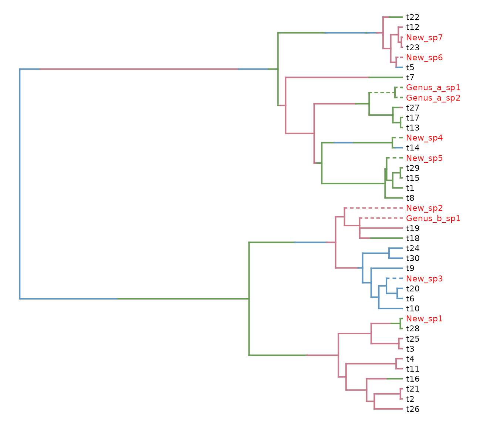
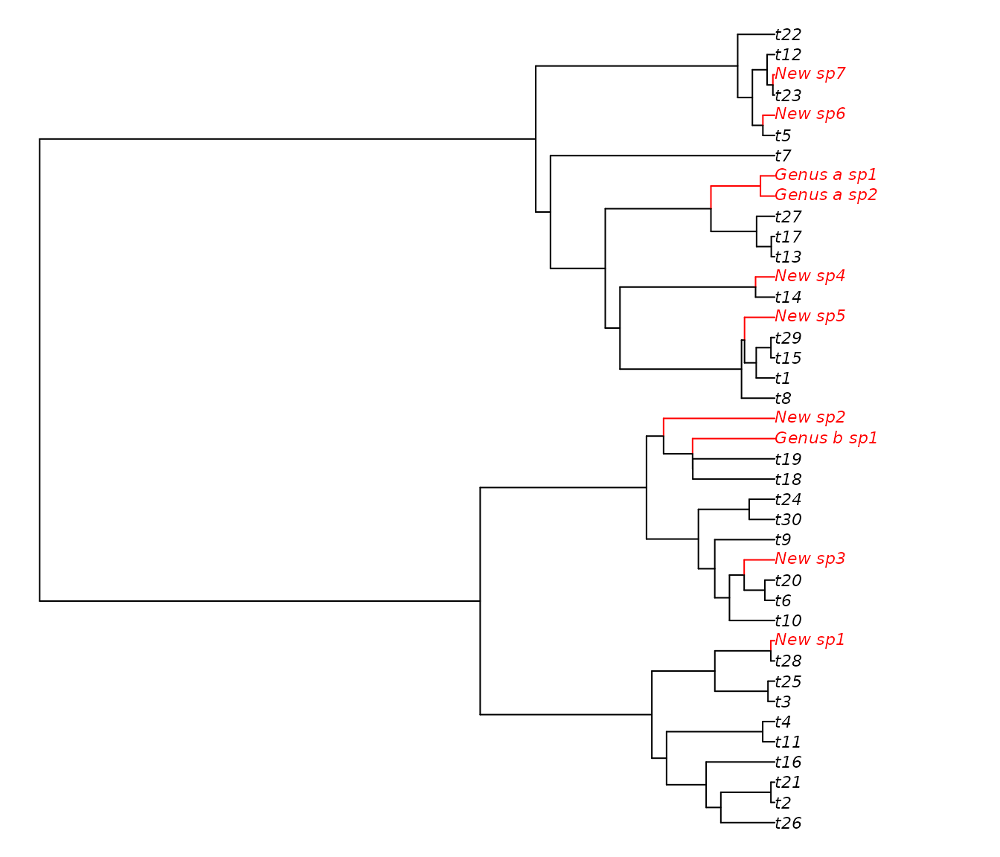
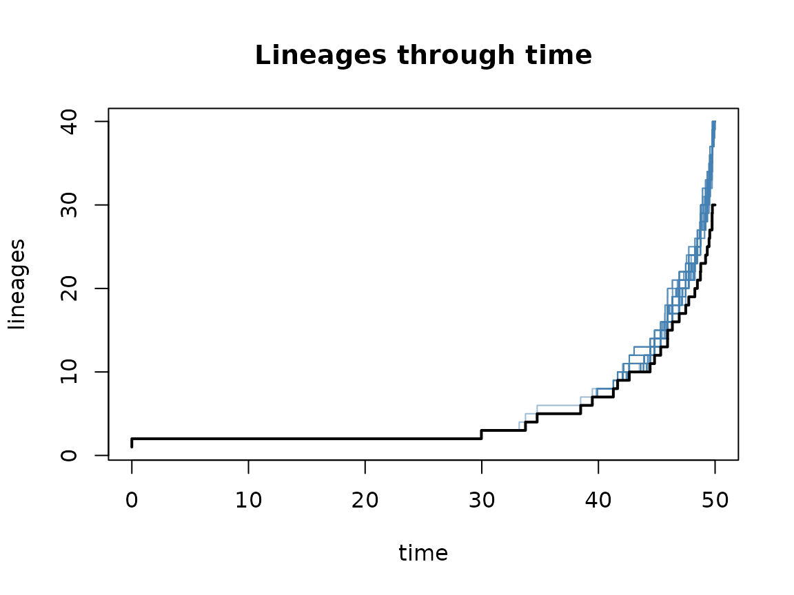

# Main workflow: from data to grafted phylogenies

This tutorial presents the **full workflow** to graft missing lineages
on a time-calibrated phylogeny, **from the data to the checked grafted
phylogenies**, following good practices to **account for uncertainty**:

1.  Start from a **backbone phylogeny**, its **taxonomy**, and **tip
    data** on a species attribute.
2.  Build **stochastic maps** (`simmap`) of the attribute, to constrain
    where taxa can be grafted.
3.  Build the **`missing_taxa_list`** of the taxa and the clades to
    graft from the taxonomy, and the **`total_richness_per_clades`**.
4.  **Check** that the grafting is feasible
    ([`check_grafting_plan()`](https://maeldore.github.io/phylograftR/reference/check_grafting_plan.md)).
5.  **Graft** both types of missing lineages in one run, on several
    stochastic maps with several simulations each
    ([`graft_missing_taxa_and_clades()`](https://maeldore.github.io/phylograftR/reference/graft_missing_taxa_and_clades.md)).
6.  **Check** the grafted phylogenies
    ([`check_grafting_constraints()`](https://maeldore.github.io/phylograftR/reference/check_grafting_constraints.md)),
    and **extract** grafting information
    ([`extract_grafting_info()`](https://maeldore.github.io/phylograftR/reference/extract_grafting_info.md)).
7.  **Plot** a grafted phylogeny
    ([`plot_grafted()`](https://maeldore.github.io/phylograftR/reference/plot_grafted.md)),
    **flatten** the outputs
    ([`flatten_grafted_phylogenies()`](https://maeldore.github.io/phylograftR/reference/flatten_grafted_phylogenies.md)),
    and use them in a **downstream analysis**.

All the examples use the **toy datasets** shipped with the package. The
inputs are only briefly presented here: see
[`vignette("format_inputs")`](https://maeldore.github.io/phylograftR/articles/format_inputs.md)
for all the different ways to build and adjust them, and
[`vignette("prepare_stochastic_maps")`](https://maeldore.github.io/phylograftR/articles/prepare_stochastic_maps.md)
for the handling of stochastic maps.

## 1/ Data: backbone, taxonomy and tip data

The **backbone phylogeny** is a time-calibrated, rooted, binary and
ultrametric phylogeny of the sampled species (30 tips). Its **taxonomy**
is described by a table with one row per tip and one column per
taxonomic level.

``` r

# ------ Step 1: Load the backbone phylogeny and its taxonomy ------ #

data(toy_backbone)
data(toy_backbone_taxonomic_table)

# Backbone phylogeny
toy_backbone
#> 
#> Phylogenetic tree with 30 tips and 29 internal nodes.
#> 
#> Tip labels:
#>   t26, t2, t21, t16, t11, t4, ...
#> 
#> Rooted; includes branch length(s).

# Taxonomy of the backbone tips
head(toy_backbone_taxonomic_table)
#>   Taxa   Family Subfamily     Tribe Genus
#> 1  t26 Family_A Subfam_A2 Tribe_A2a  <NA>
#> 2   t2 Family_A Subfam_A2 Tribe_A2a  <NA>
#> 3  t21 Family_A Subfam_A2 Tribe_A2a  <NA>
#> 4  t16 Family_A Subfam_A2 Tribe_A2a  <NA>
#> 5  t11 Family_A Subfam_A2 Tribe_A2a  <NA>
#> 6   t4 Family_A Subfam_A2 Tribe_A2a  <NA>
```

The **tip data** gives the state of a species attribute for each tip
(here, a trait with three states: `"blue"`, `"green"`, and `"red"`). We
use the tip states of the toy `simmap` as our “observed” tip data.

``` r

# ------ Step 2: Load the tip data ------ #

data(toy_simmap)

# Named vector of states: one value per tip of the backbone
tip_data <- phytools::getStates(toy_simmap, type = "tips")
head(tip_data)
#>     t26      t2     t21     t16     t11      t4 
#>  "blue"  "blue"  "blue" "green"  "blue"  "blue"
table(tip_data)
#> tip_data
#>  blue green   red 
#>    11    11     8
```

## 2/ Stochastic maps of the trait

Grafting is **constrained by the trait**: each taxon is only grafted on
branches where the trait was in one of its `allowed_states`. The history
of the trait on the backbone is not known with certainty, so we build
**several stochastic maps** (here, 10) with
[`phytools::make.simmap()`](https://rdrr.io/pkg/phytools/man/make.simmap.html),
which sample plausible histories from tip data. The 10 maps are the
**alternative hypotheses** over which the grafting is replicated, so the
uncertainty on the trait history is propagated to the grafted
phylogenies.

``` r

# ------ Step 3: Build 10 stochastic maps of the trait ------ #

# Sample 10 stochastic maps with an equal-rates model of evolution
set.seed(1234)
simmaps <- phytools::make.simmap(tree = toy_backbone, x = tip_data[toy_backbone$tip.label],
                                 model = "ER", nsim = 10, message = FALSE)

# A set of maps is a 'multiSimmap'
class(simmaps)
#> [1] "multiSimmap" "multiPhylo"
length(simmaps)
#> [1] 10
```

*Alternatives:* The `deepSTRAPP` R package provides tools to prepare the
trait data and build the stochastic maps (including for biogeographic
ranges and continuous traits), with possibilities to tune transition
parameters, compare inference models, and select the best fitted one,
all in one call: see
[`vignette("prepare_stochastic_maps")`](https://maeldore.github.io/phylograftR/articles/prepare_stochastic_maps.md).

## 3/ Missing lineages: build the `missing_taxa_list` from the taxonomy

The taxa to graft are described by a **taxonomic table**: one row per
taxon, with its taxonomic groups and the constraints of its grafting.
Two types of lineages are described in the same table:

- **missing taxa** (`Type = "taxa"`), grafted within a **target clade**
  (excluding some subclades if needed);
- **missing clades** (`Type = "clades"`), which are groups of taxa
  grafted together as a clade, **sister to a clade of the backbone**.

``` r

# ------ Step 4: Describe the missing lineages ------ #

data(toy_missing_taxa_taxonomic_table)
missing_taxa_table <- toy_missing_taxa_taxonomic_table

# The trait states in which each taxon can be grafted, separated by commas (empty: all states allowed)
missing_taxa_table$allowed_states <- c("green, red", NA, NA, "blue, green", "green",
                                       NA, "blue, red", NA, NA, NA)
missing_taxa_table[, c("Taxa", "Type", "Target_clade", "Sister_clade", "allowed_states")]
#>           Taxa   Type Target_clade Sister_clade allowed_states
#> 1      New_sp1   taxa       Family         <NA>     green, red
#> 2      New_sp2   taxa       Family         <NA>           <NA>
#> 3      New_sp3   taxa       Family         <NA>           <NA>
#> 4      New_sp4   taxa     Family_B         <NA>    blue, green
#> 5      New_sp5   taxa    Subfamily         <NA>          green
#> 6      New_sp6   taxa        Gen_2         <NA>           <NA>
#> 7      New_sp7   taxa        Tribe         <NA>      blue, red
#> 8  Genus_a_sp1 clades         <NA>        Gen_1           <NA>
#> 9  Genus_a_sp2 clades         <NA>        Gen_1           <NA>
#> 10 Genus_b_sp1 clades         <NA>        Tribe           <NA>
```

The taxonomic names are converted into clades of the backbone with
[`build_missing_taxa_list_from_taxonomy()`](https://maeldore.github.io/phylograftR/reference/build_missing_taxa_list_from_taxonomy.md):

``` r

# ------ Step 5: Build the missing_taxa_list ------ #

missing_taxa_lists <- build_missing_taxa_list_from_taxonomy(
  backbone_taxonomic_table = toy_backbone_taxonomic_table,
  missing_taxa_taxonomic_table = missing_taxa_table,
  phy = toy_backbone,
  verbose = FALSE)

# Both types were provided: one list for the missing taxa, one for the missing clades
names(missing_taxa_lists)
#> [1] "taxa"   "clades"
missing_taxa_lists$taxa$Taxon_name
#> [1] "New_sp1" "New_sp2" "New_sp3" "New_sp4" "New_sp5" "New_sp6" "New_sp7"
missing_taxa_lists$clades$Taxon_name
#> [1] "Genus_a_sp1" "Genus_a_sp2" "Genus_b_sp1"
```

## 4/ Unsampled species: the `total_richness_per_clades`

The backbone and the missing taxa may not cover all the species of the
clades: some are **unsampled**. Providing the **total richness of some
clades** lets the grafting account for them when fitting the
diversification models that draw the divergence ages of the grafted
lineages. Unsampled species are not grafted.

``` r

# ------ Step 6: Provide the total richness of some clades ------ #

richness_table <- data.frame(Clade = c("Family_A", "Family_B", "Subfam_B1", "Tribe_B2"),
                             total_richness = c(25, NA, 14, 8))

richness_per_clades <- build_total_richness_per_clades(data = richness_table, phy = toy_backbone,
                                                       missing_taxa_list = missing_taxa_lists,
                                                       verbose = FALSE)
```

## 5/ Check the grafting plan

Before grafting,
[`check_grafting_plan()`](https://maeldore.github.io/phylograftR/reference/check_grafting_plan.md)
verifies that **each lineage can be grafted** with the constraints in
**each stochastic map**: there must be branches in the allowed states,
in the target clade, over a sufficient part of the time window of
grafting.

``` r

# ------ Step 7: Check that the grafting is feasible ------ #

grafting_plan <- check_grafting_plan(phy = toy_backbone,
                                     missing_taxa_list = missing_taxa_lists,
                                     simmap = simmaps)
#> === Missing taxa (graft_missing_taxa()) ===
#> Grafting plan: 7 taxa, 10 maps
#>   - Can be grafted in all the maps: 7/7
#>   - Share of the available branches in allowed states (worst map, feasible taxa): min 28.0%, median 100.0%
#>   - Share of the time window with grafting possible (worst map, feasible taxa): min 42.0%, median 100.0%
#>   - Target clades smaller than 'min_tips' = 5 (birth-death model fitted on an enclosing clade): 2/7; enclosing clades of 13 tips in the backbone; in practice, the clade used can be nested within them, as previously grafted taxa count towards 'min_tips'
#>   => All can be grafted with these constraints
#> === Missing clades (graft_missing_clades()) ===
#> Grafting plan: 2 missing clades, 10 maps
#>   - Can be grafted in all the maps: 2/2
#>   - Share of the available branches in allowed states (worst map, feasible missing clades): min 100.0%, median 100.0%
#>   - Share of the time window with grafting possible (worst map, feasible missing clades): min 100.0%, median 100.0%
#>   - Sister clades smaller than 'min_tips' = 5 (birth-death model fitted on an enclosing clade): 2/2; enclosing clades of 8 tips in the backbone; in practice, the clade used can be nested within them, as previously grafted taxa count towards 'min_tips'
#>   => All can be grafted with these constraints
```

The function reports the lineages that cannot be grafted in some maps,
and the lineages with a narrow room for grafting (below
`min_valid_fraction`), which should be fixed before grafting (e.g., by
extending the allowed states). See
[`vignette("check_grafting")`](https://maeldore.github.io/phylograftR/articles/check_grafting.md)
for details.

## 6/ Graft the missing lineages

[`graft_missing_taxa_and_clades()`](https://maeldore.github.io/phylograftR/reference/graft_missing_taxa_and_clades.md)
grafts **both types of lineages in one run**, with a single set of
arguments and a unique seed: the missing taxa first, then the missing
clades. It is run with the **10 stochastic maps** and **10 simulations
per map** (`nb_simulations`): each simulation draws new divergence ages
and new positions of the grafted lineages. This gives **100 grafted
phylogenies** that cover two sources of uncertainty: the **trait
history** and the **grafting itself**.

``` r

# ------ Step 8: Graft the missing taxa and the missing clades ------ #

grafted_phylos <- graft_missing_taxa_and_clades(
  phy = toy_backbone,
  missing_taxa_list = missing_taxa_lists,
  total_richness_per_clades = richness_per_clades,
  simmap = simmaps,
  nb_simulations = 10,
  seed = 1234,
  verbose = FALSE)

# One element per stochastic map, each with 10 grafted phylogenies (one per simulation)
class(grafted_phylos)
#> [1] "list"
names(grafted_phylos)
#>  [1] "map_1"  "map_2"  "map_3"  "map_4"  "map_5"  "map_6"  "map_7"  "map_8" 
#>  [9] "map_9"  "map_10"
class(grafted_phylos$map_1)
#> [1] "multiPhylo"
length(grafted_phylos$map_1)
#> [1] 10
```

Each grafted phylogeny has the 30 tips of the backbone and the 10
grafted tips (the 7 missing taxa and the 3 taxa of the 2 missing
clades). The **grafted tips and branches** are flagged with the
`$grafted_tips` and `$grafted_edges` items present in each grafted
phylogeny. Each also carries an **updated stochastic map** in its
`$simmap` item, in which the grafted branches have the state of the
point where they were grafted.

``` r

# Extract the first grafted phylogeny
first_phylo <- grafted_phylos$map_1[[1]]
# Explore tips of the first grafted phylogeny
ape::Ntip(first_phylo)
#> [1] 40
# Identify the grafted tips
first_phylo$tip.label[first_phylo$grafted_tips]
#>  [1] "New_sp1"     "New_sp3"     "Genus_b_sp1" "New_sp2"     "New_sp5"    
#>  [6] "New_sp4"     "New_sp6"     "New_sp7"     "Genus_a_sp2" "Genus_a_sp1"
```

## 7/ Check the grafted phylogenies

[`check_grafting_constraints()`](https://maeldore.github.io/phylograftR/reference/check_grafting_constraints.md)
verifies **a posteriori** that every grafted phylogeny respects all the
constraints: target clades, excluded subclades, sister clades, allowed
states, and the preservation of the backbone.

``` r

# ------ Step 9: Check the constraints on the grafted phylogenies ------ #

constraints <- check_grafting_constraints(phy_grafted = grafted_phylos,
                                          phy_backbone = toy_backbone,
                                          missing_taxa_list = missing_taxa_lists)
#> === Missing taxa (graft_missing_taxa()) ===
#> 100 phylogenies checked (10 map(s)), 7 taxa each
#>   - Phylogenies respecting all the constraints: 100/100
#>   Violations, over all the phylogenies (number of taxa x phylogenies):
#>   - Missing from the grafted tree: 0
#>   - Target clade violated:          0
#>   - Excluded subclade violated:     0
#>   - Allowed states violated:        0
#>   - Backbone: preserved in 100/100 phylogenies, branch lengths shifted by max 1.4e-10 of backbone depth (tolerance = 1e-06)
#>   => All constraints respected
#> === Missing clades (graft_missing_clades()) ===
#> 100 phylogenies checked (10 map(s)), 2 missing clades each
#>   - Phylogenies respecting all the constraints: 100/100
#>   Violations, over all the phylogenies (number of missing clades x phylogenies):
#>   - Missing from the grafted tree:    0
#>   - Not forming one clade:            0
#>   - Not sister to their sister clade: 0
#>   - Allowed states violated:        0
#>   - Backbone: preserved in 100/100 phylogenies, branch lengths shifted by max 1.4e-10 of backbone depth (tolerance = 1e-06)
#>   => All constraints respected
#> => Both types: all constraints respected
```

## 8/ Extract information on the grafting

[`extract_grafting_info()`](https://maeldore.github.io/phylograftR/reference/extract_grafting_info.md)
returns **where and when** each lineage was grafted in each phylogeny:
parent node, graft age, divergence age, state of the lineage.

``` r

# ------ Step 10: Extract the grafting information ------ #

grafting_info <- extract_grafting_info(phy_grafted = grafted_phylos,
                                       missing_taxa_list = missing_taxa_lists,
                                       phy_backbone = toy_backbone)
names(grafting_info)
#> [1] "taxa"   "clades"

# Information on the missing taxa, recorded per taxon, per grafted phylogeny
# Here, only info for the first map and first simulation are printed
head(grafting_info$taxa[, c("map", "simulation", "Taxon_name", "parent_tips", "divergence_age")])
#>     map simulation Taxon_name parent_tips divergence_age
#> 1 map_1          1    New_sp1         t28      0.2653928
#> 2 map_1          1    New_sp2    t18, t19      7.5591270
#> 3 map_1          1    New_sp3     t6, t20      2.0761216
#> 4 map_1          1    New_sp4         t14      1.3009784
#> 5 map_1          1    New_sp5     t1, t15      2.0508008
#> 6 map_1          1    New_sp6          t5      0.8025359

# The divergence age of the taxa varies among the maps and simulations
# You can use this output to summarize all grafting information per taxon across grafted phylgoenies
aggregate(divergence_age ~ Taxon_name, data = grafting_info$taxa,
          FUN = function(x) round(c(mean = mean(x), median = median(x), min = min(x), max = max(x)), 1))
#>   Taxon_name divergence_age.mean divergence_age.median divergence_age.min
#> 1    New_sp1                 1.5                   0.4                0.0
#> 2    New_sp2                 3.6                   3.3                0.1
#> 3    New_sp3                 1.7                   1.3                0.0
#> 4    New_sp4                 1.7                   0.9                0.1
#> 5    New_sp5                 1.3                   0.7                0.1
#> 6    New_sp6                 0.6                   0.5                0.1
#> 7    New_sp7                 0.3                   0.3                0.0
#>   divergence_age.max
#> 1               16.8
#> 2                7.9
#> 3                4.3
#> 4                6.4
#> 5                6.1
#> 6                1.5
#> 7                1.1
```

## 9/ Plot a grafted phylogeny

[`plot_grafted()`](https://maeldore.github.io/phylograftR/reference/plot_grafted.md)
plots a grafted phylogeny, highlighting the **grafted tips and
branches** (dashed lines and red labels), and the **stochastic map**
carried by the phylogeny.

``` r

# ------ Step 11: Plot one grafted phylogeny ------ #

# Extract the first grafted phylogeny
first_phylo <- grafted_phylos$map_1[[1]]

# Plot its simmap (default, when available)
# Grafted branches are dashed lines, grafted tips in red
plot_grafted(first_phylo, fsize = 0.7)
```



``` r


# Plot the plain phylogeny
# Grafted branches and tips are red
plot_grafted(first_phylo, use_simmap = FALSE, cex = 0.7)
```



## 10/ Flatten the grafted phylogenies for downstream analyses

The output of the grafting is a list with one element per stochastic
map. Most functions that work on sets of phylogenies expect a single
**`multiPhylo`** object:
[`flatten_grafted_phylogenies()`](https://maeldore.github.io/phylograftR/reference/flatten_grafted_phylogenies.md)
flattens the list into one `multiPhylo` of the 100 phylogenies, named
after their map and simulation.

``` r

# ------ Step 12: Flatten the grafted phylogenies ------ #

flat_phylos <- flatten_grafted_phylogenies(grafted_phylos)
class(flat_phylos)
#> [1] "multiPhylo"
length(flat_phylos)
#> [1] 100
head(names(flat_phylos))
#> [1] "map_1_sim_1" "map_1_sim_2" "map_1_sim_3" "map_1_sim_4" "map_1_sim_5"
#> [6] "map_1_sim_6"

# Information on each phylogeny: map, simulation, seed
head(attr(flat_phylos, "phylogenies"))
#>          name   map simulation       seed
#> 1 map_1_sim_1 map_1          1       1234
#> 2 map_1_sim_2 map_1          2  488349520
#> 3 map_1_sim_3 map_1          3  469344150
#> 4 map_1_sim_4 map_1          4 1550099436
#> 5 map_1_sim_5 map_1          5   40778633
#> 6 map_1_sim_6 map_1          6  713327526
```

The updated stochastic maps (`$simmap`) are kept in each phylogeny by
default. Use `keep_simmap = FALSE` to remove them and **save memory** if
you do not need them. You can also use `maps` or `simulations` to keep
only a subset of the grafted phylogenies.

The set can then be used as any other set of phylogenies. For instance,
we can compute the **lineage-through-time (LTT) plot** of the 100
grafted phylogenies with
[`phytools::ltt()`](https://rdrr.io/pkg/phytools/man/ltt.html) and
compare it to the backbone:

``` r

# ------ Step 13: Downstream analysis: LTT plots of the grafted phylogenies ------ #

# LTT of the 100 grafted phylogenies, and of the backbone
ltt_grafted <- phytools::ltt(flat_phylos, plot = FALSE, gamma = FALSE)
ltt_backbone <- phytools::ltt(toy_backbone, plot = FALSE, gamma = FALSE)

# Plot the uncertainty due to the grafting and the maps (blue), against the backbone (black)
plot(ltt_grafted, col = adjustcolor("steelblue", alpha.f = 0.3),
     main = "Lineages through time", log.lineages = FALSE)
lines(ltt_backbone$times, ltt_backbone$ltt, lwd = 2, type = "s")
```



The grafted phylogenies reach 40 lineages instead of 30, mostly through
recent divergences, and the **spread of the blue lines** shows the
uncertainty carried by the stochastic maps and the simulations: analyses
run on the **whole set** propagate it, instead of relying on a single
grafted phylogeny.

## Next steps

- [`vignette("graft_missing_taxa")`](https://maeldore.github.io/phylograftR/articles/graft_missing_taxa.md),
  [`vignette("graft_missing_clades")`](https://maeldore.github.io/phylograftR/articles/graft_missing_clades.md)
  and
  [`vignette("combine_missing_taxa_and_clades")`](https://maeldore.github.io/phylograftR/articles/combine_missing_taxa_and_clades.md)
  detail the **grafting options**.
- [`vignette("check_grafting")`](https://maeldore.github.io/phylograftR/articles/check_grafting.md)
  details the **checks** before and after grafting.
- [`vignette("handle_uncertainty")`](https://maeldore.github.io/phylograftR/articles/handle_uncertainty.md)
  explains how to account for **uncertainty** and how the **seed
  system** makes the analyses **reproducible**
- [`vignette("parallel_grafting")`](https://maeldore.github.io/phylograftR/articles/parallel_grafting.md)
  explains how to **scale** to many maps and simulations using
  **parallel computing**.
- [`vignette("resume_run")`](https://maeldore.github.io/phylograftR/articles/resume_run.md)
  explains how to **save the progress** with temporary files and
  **resume** a crashed or interrupted run.
