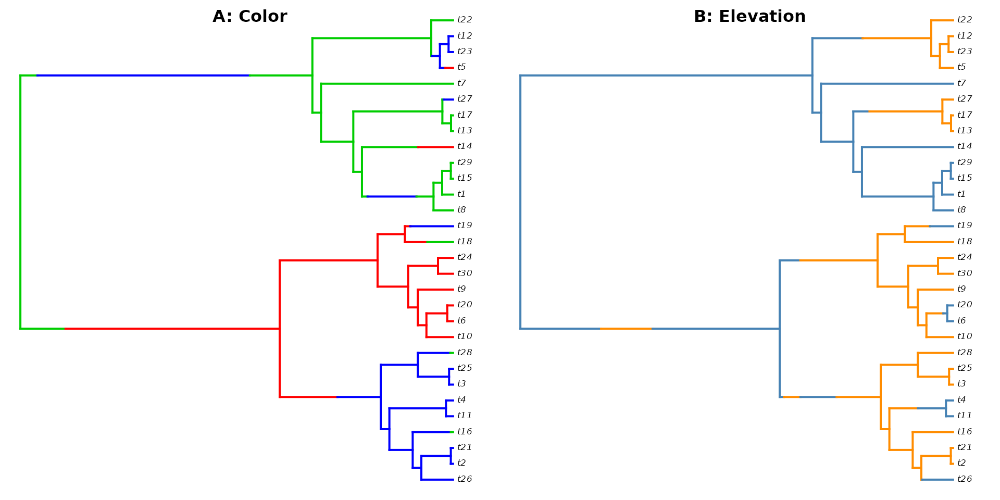
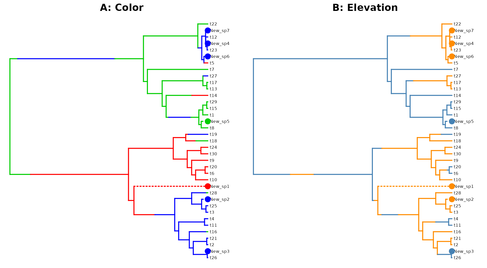
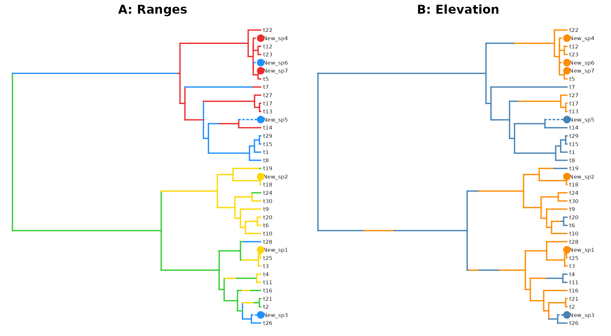

# Combine several traits as constraints

Grafting can be constrained by **species attributes** described by
**stochastic character maps** (`simmap`) of the backbone phylogeny. This
tutorial explains how to use **several traits at once**, e.g., the color
and the elevation of the species, or their biogeographic ranges and
their elevation. The rule is simple: **a taxon can only be grafted on
the parts of the branches that are in one of its allowed states, for
every trait**. The more traits you use, the narrower the **set of
eligible branches** is.

In this tutorial, we cover:

1.  **How to provide the maps and the allowed states** of several
    traits.
2.  **The joint effect of the constraints**, checked with
    [`check_grafting_plan()`](https://maeldore.github.io/phylograftR/reference/check_grafting_plan.md).
3.  **Grafting with two categorical traits**.
4.  **Grafting with one trait treated as biogeographic ranges** and one
    other trait.
5.  **Several maps per trait**.

**Other types of data**

The principle of species attribute-based constraints is the same for all
the types of data. For examples addressing different data types, please
refer to:

- **categorical traits** (single trait):
  [`vignette("main_workflow")`](https://maeldore.github.io/phylograftR/articles/main_workflow.md),
  and the examples of
  [`vignette("graft_missing_taxa")`](https://maeldore.github.io/phylograftR/articles/graft_missing_taxa.md),
  [`vignette("graft_missing_clades")`](https://maeldore.github.io/phylograftR/articles/graft_missing_clades.md)
  and
  [`vignette("combine_missing_taxa_and_clades")`](https://maeldore.github.io/phylograftR/articles/combine_missing_taxa_and_clades.md);
- **biogeographic ranges** (multi-area states,
  `treat_states_as_ranges`):
  [`vignette("biogeographic_data")`](https://maeldore.github.io/phylograftR/articles/biogeographic_data.md);
- **continuous traits**:
  [`vignette("continuous_data")`](https://maeldore.github.io/phylograftR/articles/continuous_data.md);
- **several stochastic maps** to account for the uncertainty in the
  evolutionary history:
  [`vignette("handle_uncertainty")`](https://maeldore.github.io/phylograftR/articles/handle_uncertainty.md).

To build stochastic maps from your own data, see
[`vignette("prepare_stochastic_maps")`](https://maeldore.github.io/phylograftR/articles/prepare_stochastic_maps.md).

## 0/ Data

We use the toy backbone, and the toy stochastic maps of two
**categorical traits**: a **color** with three states (`"blue"`,
`"green"`, `"red"`) and an **elevation** with two states (`"low"`,
`"high"`). Both maps have the **same tips, topology and branch lengths**
as the backbone, as required.

``` r

# ------ Toy data ------ #

data(toy_backbone)
data(toy_simmap)
data(toy_simmap_elevation)
data(toy_missing_taxa_list_with_two_traits)

# Group the maps of the traits in a named list: the names are the names of the traits
maps_color_elevation <- list(color = toy_simmap, elevation = toy_simmap_elevation)

color_colors <- c(blue = "blue", green = "green3", red = "red")
elevation_colors <- c(low = "steelblue", high = "darkorange")

# Plot the two maps side by side
par(mfrow = c(1, 2), mar = c(0.5, 0.5, 2, 0.5))
phytools::plotSimmap(toy_simmap, colors = color_colors, fsize = 0.55, ftype = "i", lwd = 2)
title("A: Color", line = -1, cex.main = 1)
phytools::plotSimmap(toy_simmap_elevation, colors = elevation_colors, fsize = 0.55, ftype = "i", lwd = 2)
title("B: Elevation", line = -1, cex.main = 1)
```



``` r

par(mfrow = c(1, 1), mar = c(5.1, 4.1, 4.1, 2.1))
```

The maps are provided to the grafting functions in a **list with one map
per trait**:
`simmap = list(color = toy_simmap, elevation = toy_simmap_elevation)`.
Naming the elements is optional (the traits are otherwise called
`"trait_1"`, `"trait_2"`, …), but it makes the allowed states and the
outputs easier to read. Names cannot contain `;`, `,`, `=` or `|`.

## 1/ Allowed states of several traits

The allowed states are set of states **for each trait**, provided as
with a single trait:

- **for all the taxa**, with the **global** argument `allowed_states`,
  here as a **list with one element per trait**, in the order of the
  maps. Ex: `list(c("blue", "green"), "high")` restricts the color to
  blue or green and the elevation to high.
- **for each taxon**, with the item `allowed_states` of the
  `missing_taxa_list`: it has the same structure, and its values
  **supersede** the global ones, **trait by trait**.

A trait with `NULL` (or an empty vector, or `NA`) has **no taxon-level
value**, so the global value of the trait is used. If there is no global
value either, **all the states of the trait are allowed**.

Below, we print as a reference the taxon-level values of the 7 missing
taxa of the toy list, for each trait:

``` r

# ------ Allowed states of two traits for each taxon ------ #

# Rename the loaded missing_taxa_list for simplicity
taxa_two_traits <- toy_missing_taxa_list_with_two_traits

# Helper: extract the taxon-level allowed states of one trait
# Elements of the list are either named after the traits, or in the order of the maps
get_allowed <- function(taxa, trait_name, trait_index)
{
  vapply(taxa$allowed_states, function(x)
  {
    values <- if (is.null(names(x))) x[trait_index][[1]] else x[[trait_name]]
    if (is.null(values)) "NULL" else paste(values, collapse = ", ")
  }, character(1))
}

# Build and print allowed states as a data.frame
data.frame(Taxon_name = taxa_two_traits$Taxon_name,
           Color = get_allowed(taxa_two_traits, "color", 1),
           Elevation = get_allowed(taxa_two_traits, "elevation", 2),
           row.names = NULL)
#>   Taxon_name       Color Elevation
#> 1    New_sp1         red      NULL
#> 2    New_sp2        NULL      NULL
#> 3    New_sp3        NULL      NULL
#> 4    New_sp4 blue, green      high
#> 5    New_sp5        NULL       low
#> 6    New_sp6        NULL      NULL
#> 7    New_sp7        NULL      high

# NULL will be using the global 'allowed_states' provided to the grafting function
```

In a `.csv` or `.xlsx` table imported with
[`import_missing_taxa_list()`](https://maeldore.github.io/phylograftR/reference/import_missing_taxa_list.md)
(see
[`vignette("format_inputs")`](https://maeldore.github.io/phylograftR/articles/format_inputs.md)),
the `allowed_states` column uses a compact syntax:

- sets of states for each trait are separated by **semicolons**, in the
  order of the maps (the color, then the elevation);
- the states within a trait are separated by **commas**.

In the `missing_taxa_list`, `$allowed_states` is a list of (named)
character vectors (e.g.,
`list(color = c("red", "blue"), elevation = "low")`). See *Section 2*
below for an example of how to modify the list manually.

For illustration, we print the `allowed_states` column of the .csv table
used to build the toy list
(`taxa_two_traits <- toy_missing_taxa_list_with_two_traits`) loaded
above:

``` r

# The initial table of the toy list
csv_file <- system.file("extdata", "toy_missing_taxa_with_two_traits.csv", package = "phylograftR")
csv_table <- read.csv(csv_file)
csv_table[, c("Taxon_name", "allowed_states")]
#>   Taxon_name   allowed_states
#> 1    New_sp1             red;
#> 2    New_sp2                 
#> 3    New_sp3                 
#> 4    New_sp4 blue, green;high
#> 5    New_sp5             ;low
#> 6    New_sp6                 
#> 7    New_sp7   elevation=high
```

The syntaxes illustrated by the toy table are:

| In the table | Meaning |
|:---|:---|
| `red;` | color `"red"`, no taxon-level value for the elevation (global value used) |
| `blue, green;high` | color `"blue"` or `"green"`, and elevation `"high"` |
| `;low` | no taxon-level value for the color, elevation `"low"` |
| `elevation=high` | traits **named**, so the color can be omitted (no taxon-level value) |
| blank | no taxon-level value for any trait: the global `allowed_states` is used for both |

The **names of the traits** must match the names of the maps in `simmap`
to use the syntax with names.

## 2/ Joint effect of the constraints

[`check_grafting_plan()`](https://maeldore.github.io/phylograftR/reference/check_grafting_plan.md)
reports, for each taxon, the **share of the branches of its target
clade** that are available given **all its constraints**
(`valid_fraction`). To see the **joint effect** of the two traits, we
compare the grafting plan with the constraints on the **color only**, on
the **elevation only**, and on **both**.

In the toy list, the taxa are mostly constrained by one trait only. To
illustrate the **joint effect** of the traits, we add **elevation
constraints** to three taxa, so that the elevation is a limiting factor
for them, and not only the color:

- `New_sp1` is allowed in **red** (as before) and now also in **high
  elevation**;
- `New_sp3` is allowed in the global colors (blue or green) and now also
  in **low elevation**;
- `New_sp4` is now allowed in **blue** (instead of blue or green) and in
  **high elevation**.

We update the list of missing taxa, and **use this updated list for the
rest of the tutorial**.

``` r

# ------ Add elevation constraints to three taxa ------ #

taxa_two_traits$allowed_states$New_sp1 <- list(color = "red", elevation = "high")
taxa_two_traits$allowed_states$New_sp3 <- list(color = NULL, elevation = "low") # NULL: the global colors are used
taxa_two_traits$allowed_states$New_sp4 <- list(color = "blue", elevation = "high")
```

``` r

# ------ Valid fraction with the color only, the elevation only, and both ------ #

# Helper: keep the taxon-level allowed states of one trait only
keep_trait <- function(taxa, trait, traits = c("color", "elevation"))
{
  taxa$allowed_states <- lapply(taxa$allowed_states, function(x)
  {
    if (is.null(x)) return(NULL)
    out <- setNames(vector("list", length(traits)), traits)
    for (i in seq_along(x))
    {
      name <- if (is.null(names(x))) traits[i] else names(x)[i]
      out[name] <- list(x[[i]])
    }
    out[setdiff(traits, trait)] <- list(NULL)
    if (all(vapply(out, is.null, logical(1)))) NULL else out
  })
  taxa
}

# Set the global allowed states: blue or green for the color, no restriction for the elevation
global_allowed_states <- list(c("blue", "green"), NULL)

# Check grafting plan with colors only
plan_colors <- check_grafting_plan(phy = toy_backbone, 
                                   missing_taxa_list = keep_trait(taxa_two_traits, "color"),
                                   simmap = maps_color_elevation,
                                   allowed_states = global_allowed_states, verbose = FALSE)
# Check grafting plan with elevation only
plan_elevation <- check_grafting_plan(phy = toy_backbone, 
                                      missing_taxa_list = keep_trait(taxa_two_traits, "elevation"),
                                   simmap = maps_color_elevation,
                                   allowed_states = list(NULL, NULL), verbose = FALSE)
# Check grafting plan with both
plan_both <- check_grafting_plan(phy = toy_backbone, 
                                 missing_taxa_list = taxa_two_traits,
                                 simmap = maps_color_elevation,
                                 allowed_states = global_allowed_states, verbose = FALSE)

# Extract the valid fractions for each plan
valid_fractions <- data.frame(Taxon_name = taxa_two_traits$Taxon_name,
  Color_only = plan_colors$valid_fraction,
  Elevation_only = plan_elevation$valid_fraction,
  Both = plan_both$valid_fraction)
valid_fractions[, -1] <- round(valid_fractions[, -1], 2)
valid_fractions
#>   Taxon_name Color_only Elevation_only Both
#> 1    New_sp1       0.57           0.48 0.14
#> 2    New_sp2       0.31           1.00 0.31
#> 3    New_sp3       0.52           0.20 0.11
#> 4    New_sp4       0.31           0.23 0.04
#> 5    New_sp5       0.91           1.00 0.91
#> 6    New_sp6       0.41           1.00 0.41
#> 7    New_sp7       0.75           1.00 0.75
```

The traits do not constrain all the taxa in the same way:

- For `New_sp2`, `New_sp5`, `New_sp6` and `New_sp7`, the **color is the
  limiting constraint** and the valid fraction with both traits is the
  one of the color. Their **elevation is not restrictive**
  (`Elevation_only` of 1): either they have no elevation constraint
  (`New_sp2`, `New_sp6`) or all their eligible branches are already in
  the allowed elevation (`New_sp5`, `New_sp7`: e.g., once the excluded
  subclade `Gen_1` is removed, all the branches left for `New_sp5` are
  in low elevation).
- For `New_sp1`, `New_sp3` and `New_sp4`, **the traits interact**: both
  constrain the grafting to a restricted portion of available branches,
  and the **branch pieces that match both constraints are much rarer**
  than those matching each of them (14%, 11% and 4% of branch length,
  respectively), since the states of the two traits are not aligned
  along the branches (see the simmaps in *Section 0* above).

In general, the more traits are combined, the more **likely a taxon has
few or no eligible branches**. Therefore, it is recommended to use
[`check_grafting_plan()`](https://maeldore.github.io/phylograftR/reference/check_grafting_plan.md)
to evaluate the feasibility of the grafting plan beforehand.

Here, the valid fraction of `New_sp4` is below the threshold
`min_valid_fraction` (10% by default), which triggers a warning at
grafting (see
[`vignette("check_grafting")`](https://maeldore.github.io/phylograftR/articles/check_grafting.md)).
Nonetheless, the grafting plan is still feasible.

``` r

# The plan flags New_sp4 for its low valid fraction
plan_both[plan_both$Taxon_name == "New_sp4", c("Taxon_name", "valid_fraction", "feasible", "cause")]
#>   Taxon_name valid_fraction feasible              cause
#> 4    New_sp4     0.04108687     TRUE low_valid_fraction

# Inspect overall feasibility
plan_both[, c("Taxon_name", "feasible")]
#>   Taxon_name feasible
#> 1    New_sp1     TRUE
#> 2    New_sp2     TRUE
#> 3    New_sp3     TRUE
#> 4    New_sp4     TRUE
#> 5    New_sp5     TRUE
#> 6    New_sp6     TRUE
#> 7    New_sp7     TRUE
```

## 3/ Graft with two categorical traits

We graft the 7 taxa with the global
`allowed_states = list(c("blue", "green"), NULL)`. The grafting warns
about `New_sp4`, as anticipated by the plan in *Section 2*: allowed
branches cover only about 4.8% of the time window of its divergence
ages, so its age is drawn within a narrow window, and may need to be
redrawn many times until a suitable divergence ages is found.

``` r

# ------ Graft with two categorical traits ------ #

grafted_two_traits <- graft_missing_taxa(phy = toy_backbone, missing_taxa_list = taxa_two_traits,
                                         simmap = maps_color_elevation,
                                         allowed_states = list(c("blue", "green"), NULL),
                                         verbose = FALSE, seed = 4)
#> Warning: 1 taxa have less than 10% of the time window of their divergence ages covered by available branches in their allowed states ('min_valid_fraction' = 0.1): their divergence ages will be concentrated on a narrow time window, or many ages will need to be redrawn.
#>   - New_sp4 (target clade tips: t8, t22; 4.86% in allowed states)

# The output has one updated simmap per trait, named after the traits
names(grafted_two_traits$simmap)
#> [1] "color"     "elevation"
```

In each updated simmap, the grafted branches are **entirely in the state
of each trait at the point where they were grafted**: each trait is
**inherited from the lineage** the taxon was grafted on. We plot the two
updated maps, with the grafted tips marked with a point in the color of
their state:

``` r

# ------ Compare the updated maps of the two traits ------ #

# Helper: plot the updated simmap of one trait of a grafted phylogeny
plot_trait <- function(phy_grafted, trait, colors, main)
{
  plot_grafted(phy_grafted, which = "edges", trait = trait, simmap_colors = colors, fsize = 0.55, main = main)
  grafted_tips <- which(phy_grafted$grafted_tips)
  tip_states <- phytools::getStates(phy_grafted$simmap[[trait]], type = "tips")[phy_grafted$tip.label[grafted_tips]]
  ape::tiplabels(tip = grafted_tips, pch = 19, cex = 1.5, col = colors[tip_states])
}

par(mfrow = c(1, 2), mar = c(0.5, 0.5, 2, 0.5))
plot_trait(grafted_two_traits, trait = "color", colors = color_colors, main = "A: Color")
plot_trait(grafted_two_traits, trait = "elevation", colors = elevation_colors, main = "B: Elevation")
```



``` r

par(mfrow = c(1, 1), mar = c(5.1, 4.1, 4.1, 2.1))
```

Using
[`extract_grafting_info()`](https://maeldore.github.io/phylograftR/reference/extract_grafting_info.md),
we summarize the state inherited by each taxon for each trait, next to
its allowed states:

``` r

# ------ States of the grafted taxa ------ #

info_two_traits <- extract_grafting_info(grafted_two_traits, missing_taxa_list = taxa_two_traits)

# Helper: allowed states of a trait for each taxon, taxon-level value or else global value
allowed_of_trait <- function(taxa, trait_name, trait_index, global)
{
  values <- get_allowed(taxa, trait_name, trait_index)
  ifelse(values == "NULL", if (is.null(global)) "all" else paste(global, collapse = ", "), values)
}

data.frame(Taxon_name = info_two_traits$Taxon_name,
           Allowed_color = allowed_of_trait(taxa_two_traits, "color", 1, c("blue", "green")),
           Color = info_two_traits$tip_state_color,
           Allowed_elevation = allowed_of_trait(taxa_two_traits, "elevation", 2, NULL),
           Elevation = info_two_traits$tip_state_elevation,
           row.names = NULL)
#>   Taxon_name Allowed_color Color Allowed_elevation Elevation
#> 1    New_sp1           red   red              high      high
#> 2    New_sp2   blue, green  blue               all      high
#> 3    New_sp3   blue, green  blue               low       low
#> 4    New_sp4          blue  blue              high      high
#> 5    New_sp5   blue, green green               low       low
#> 6    New_sp6   blue, green  blue               all      high
#> 7    New_sp7   blue, green  blue              high      high
```

Each taxon has **a state in its allowed states for each trait**. The a
posteriori check of
[`check_grafting_constraints()`](https://maeldore.github.io/phylograftR/reference/check_grafting_constraints.md)
reports it **for each trait** (`states_ok_color`, `states_ok_elevation`)
and **overall** (`states_ok`):

``` r

# ------ A posteriori check ------ #

constraints_two_traits <- check_grafting_constraints(phy_grafted = grafted_two_traits, phy_backbone = toy_backbone,
                                                     missing_taxa_list = taxa_two_traits,
                                                     allowed_states = list(c("blue", "green"), NULL),
                                                     use_excluded_subclades = FALSE, verbose = FALSE)
constraints_two_traits[, c("Taxon_name", "states_ok_color", "states_ok_elevation", "states_ok")]
#>         Taxon_name states_ok_color states_ok_elevation states_ok
#> New_sp1    New_sp1            TRUE                TRUE      TRUE
#> New_sp2    New_sp2            TRUE                TRUE      TRUE
#> New_sp3    New_sp3            TRUE                TRUE      TRUE
#> New_sp4    New_sp4            TRUE                TRUE      TRUE
#> New_sp5    New_sp5            TRUE                TRUE      TRUE
#> New_sp6    New_sp6            TRUE                TRUE      TRUE
#> New_sp7    New_sp7            TRUE                TRUE      TRUE
```

## 4/ Graft with one trait treated as ranges

One of the traits can be **treated as biogeographic ranges** (see
[`vignette("biogeographic_data")`](https://maeldore.github.io/phylograftR/articles/biogeographic_data.md)),
and combined with any number of other traits.

Here, we combine the toy biogeographic ranges (`"A"`, `"B"`, `"AB"`,
`"BC"`) and the elevation:

``` r

# ------ Toy data: ranges and elevation ------ #

data(toy_simmap_ranges)
data(toy_missing_taxa_list_with_ranges_and_elevation)

# Rename the missing taxa list for consistency
taxa_ranges_elevation <- toy_missing_taxa_list_with_ranges_and_elevation
# Combine simmap for biogeographic ranges and elevation
maps_ranges_elevation <- list(biogeo = toy_simmap_ranges, elevation = toy_simmap_elevation)

# Print in a data.frame the taxon-level allowed states of the two traits
data.frame(Taxon_name = taxa_ranges_elevation$Taxon_name,
           Ranges = get_allowed(taxa_ranges_elevation, "biogeo", 1),
           Elevation = get_allowed(taxa_ranges_elevation, "elevation", 2),
           row.names = NULL)
#>   Taxon_name Ranges Elevation
#> 1    New_sp1      A      high
#> 2    New_sp2   NULL      NULL
#> 3    New_sp3   NULL      NULL
#> 4    New_sp4  B, BC      NULL
#> 5    New_sp5   NULL       low
#> 6    New_sp6   NULL      NULL
#> 7    New_sp7  A, BC      high

# NULL will be using the global 'allowed_states' provided to the grafting function
```

The argument `treat_states_as_ranges` is a **logical vector with one
value per trait**, with **at most one `TRUE`** that identifies the
**range trait**. It is either **positional** (`c(TRUE, FALSE)`: the
first trait is the range trait) or **named** after the traits, in any
order (`c(biogeo = TRUE, elevation = FALSE)`).

- The range trait follows the logic of **range matching**: a taxon
  allowed in `"A"` can be grafted on branch pieces in `"A"`, `"AB"` or
  `"ABC"`, and **inherits one of its allowed range**.
- The other traits are **matched exactly**, and are **inherited as they
  are** at the point where the taxon is grafted.

Only one trait can be treated as ranges, to prevent an inflation of the
number of combined states to consider.

Here, we graft the taxa, with the global allowed ranges `"A"` or `"B"`,
and no restriction on the elevation:

``` r

# ------ Graft with ranges and elevation ------ #

grafted_ranges_elevation <- graft_missing_taxa(phy = toy_backbone, 
                                               missing_taxa_list = taxa_ranges_elevation,
                                               simmap = maps_ranges_elevation,
                                               allowed_states = list(c("A", "B"), NULL),
                                               treat_states_as_ranges = c(biogeo = TRUE, elevation = FALSE),
                                               verbose = FALSE, seed = 9)
```

``` r

# ------ Compare the updated maps of the two traits ------ #

range_colors <- c(A = "gold", B = "dodgerblue", AB = "limegreen", BC = "firebrick2")

par(mfrow = c(1, 2), mar = c(0.5, 0.5, 2, 0.5))
plot_trait(grafted_ranges_elevation, trait = "biogeo", colors = range_colors, main = "A: Ranges")
plot_trait(grafted_ranges_elevation, trait = "elevation", colors = elevation_colors, main = "B: Elevation")
```



``` r

par(mfrow = c(1, 1), mar = c(5.1, 4.1, 4.1, 2.1))
```

Using
[`extract_grafting_info()`](https://maeldore.github.io/phylograftR/reference/extract_grafting_info.md),
we summarize, for each taxon, the state of each trait at the point where
it was grafted (`parent_state_*`) and the state it inherited
(`tip_state_*`):

``` r

# ------ States at grafting and inherited states ------ #

info_ranges_elevation <- extract_grafting_info(grafted_ranges_elevation, missing_taxa_list = taxa_ranges_elevation)
info_ranges_elevation[, c("Taxon_name", "parent_state_biogeo", "tip_state_biogeo",
                          "parent_state_elevation", "tip_state_elevation")]
#>   Taxon_name parent_state_biogeo tip_state_biogeo parent_state_elevation
#> 1    New_sp1                   A                A                   high
#> 2    New_sp2                   A                A                   high
#> 3    New_sp3                   B                B                    low
#> 4    New_sp4                  BC               BC                   high
#> 5    New_sp5                  BC                B                    low
#> 6    New_sp6                  BC                B                   high
#> 7    New_sp7                  BC               BC                   high
#>   tip_state_elevation
#> 1                high
#> 2                high
#> 3                 low
#> 4                high
#> 5                 low
#> 6                high
#> 7                high
```

The elevation is always inherited as it is, whereas the **range can be
smaller than the range of the branch**, which represents **subset
sympatric speciation events** (e.g., `(AB) -> (AB), (A)`).

The a posteriori check verifies that the inherited tip range is among
the allowed_states (`states_ok_biogeo` and `states_ok_elevation`). It
also verifies, for the range trait, that **the inherited range is
contained in the range of its parent branch** (`ranges_ok`):

``` r

# ------ A posteriori check ------ #

constraints_ranges_elevation <- check_grafting_constraints(phy_grafted = grafted_ranges_elevation, phy_backbone = toy_backbone,
                                                           missing_taxa_list = taxa_ranges_elevation,
                                                           allowed_states = list(c("A", "B"), NULL),
                                                           treat_states_as_ranges = c(biogeo = TRUE, elevation = FALSE),
                                                           use_excluded_subclades = FALSE, verbose = FALSE)
constraints_ranges_elevation[, c("Taxon_name", "states_ok_biogeo", "states_ok_elevation", "ranges_ok", "ok")]
#>         Taxon_name states_ok_biogeo states_ok_elevation ranges_ok   ok
#> New_sp1    New_sp1             TRUE                TRUE      TRUE TRUE
#> New_sp2    New_sp2             TRUE                TRUE      TRUE TRUE
#> New_sp3    New_sp3             TRUE                TRUE      TRUE TRUE
#> New_sp4    New_sp4             TRUE                TRUE      TRUE TRUE
#> New_sp5    New_sp5             TRUE                TRUE      TRUE TRUE
#> New_sp6    New_sp6             TRUE                TRUE      TRUE TRUE
#> New_sp7    New_sp7             TRUE                TRUE      TRUE TRUE
```

## 5/ Several maps per trait

Each trait can be described by **several stochastic maps** (a
`"multiSimmap"`), to account for the **uncertainty** in its evolutionary
history (see
[`vignette("handle_uncertainty")`](https://maeldore.github.io/phylograftR/articles/handle_uncertainty.md)).
The maps of the traits are **paired**: the grafting is run with the map
1 of every trait, then with the map 2 of every trait, and so on. **All
the traits must therefore have the same number of maps.**

This also applies to a trait described by a **single `simmap`**: it
**cannot be mixed** with a trait described by a `multiSimmap`, and such
a list is refused. You can always **duplicate the single `simmap`** in
the list, so that it pairs with all the maps of the `multiSimmap` of the
other trait. For instance, `toy_multiSimmap_elevation[rep(1, 10)]`
repeats the map 1 of a `multiSimmap` 10 times and keeps the class
`"multiSimmap"`, which is essential to tell phylograftR that this set of
maps are inferred for a unique trait (a list of `simmap`s, without the
`multiSimmap` class, would be read as 10 unique maps for 10 different
traits).

We quickly generate **10 stochastic maps** for each trait with
[`phytools::make.simmap()`](https://rdrr.io/pkg/phytools/man/make.simmap.html),
from the states of the tips of the toy maps (equal-rates model). Of
course, in a real analysis, the maps would be built from your own data
(see
[`vignette("prepare_stochastic_maps")`](https://maeldore.github.io/phylograftR/articles/prepare_stochastic_maps.md)).

``` r

# ------ 10 stochastic maps for the color and for the elevation ------ #

# States of the tips of each trait
tip_colors <- phytools::getStates(toy_simmap, type = "tips")
tip_elevations <- phytools::getStates(toy_simmap_elevation, type = "tips")

# Simulate 10 stochastic maps per trait
set.seed(33)
multi_color <- phytools::make.simmap(toy_backbone, tip_colors, model = "ER", nsim = 10, message = FALSE)
multi_elevation <- phytools::make.simmap(toy_backbone, tip_elevations, model = "ER", nsim = 10, message = FALSE)

# Group them in a named list, as with a single map per trait
multi_maps <- list(color = multi_color, elevation = multi_elevation)
```

With random maps, the constraints can differ a lot from one map to the
next.
[`check_grafting_plan()`](https://maeldore.github.io/phylograftR/reference/check_grafting_plan.md)
summarizes the **valid fraction** of each taxon across the pairs of maps
(minimum, mean and maximum). It also reports the maps with no available
branch for a taxon (`n_maps_infeasible`), which would stop the grafting:

``` r

# ------ Grafting plan across the 10 pairs of maps ------ #

plan_paired <- check_grafting_plan(phy = toy_backbone, missing_taxa_list = taxa_two_traits,
                                   simmap = multi_maps,
                                   allowed_states = list(c("blue", "green"), NULL), verbose = FALSE)
plan_paired[, c("Taxon_name", "valid_fraction_min", "valid_fraction_mean", "valid_fraction_max", "n_maps_infeasible", "feasible")]
#>   Taxon_name valid_fraction_min valid_fraction_mean valid_fraction_max
#> 1    New_sp1        0.004298103           0.1067638          0.4359657
#> 2    New_sp2        0.422849278           0.5879249          0.7761303
#> 3    New_sp3        0.042590491           0.1864553          0.3814805
#> 4    New_sp4        0.062828303           0.1426612          0.2321527
#> 5    New_sp5        0.410359896           0.6267012          0.8664758
#> 6    New_sp6        0.178834499           0.5189147          0.9898609
#> 7    New_sp7        0.649172440           0.7944653          0.9956683
#>   n_maps_infeasible feasible
#> 1                 0     TRUE
#> 2                 0     TRUE
#> 3                 0     TRUE
#> 4                 0     TRUE
#> 5                 0     TRUE
#> 6                 0     TRUE
#> 7                 0     TRUE
```

As in *Section 2*, the strict constraints leave few eligible branches
for some taxa (e.g., `New_sp1`), especially in some maps.

Here, we graft with `method = "uniform"`, which only requires an
available branch in each map as the age of the grafting is not drawn
from a diversification model. This is a solution when constrains are too
strict to be easily realized under diversification models, but at the
cost of ignoring diversification dynamics, which tend to create a bias
towards older divergence ages (see *Section 2*
[`vignette("graft_missing_taxa")`](https://maeldore.github.io/phylograftR/articles/graft_missing_taxa.md)).
**It is not the recommended use of phylograftR**, but is used here only
as illustration.

We also silence the warnings about the low valid fractions already shown
above by setting `min_valid_fraction = 0`, i.e., warnings are sent only
if no branch pieces are available at all.

We generate **5 simulations for each pair of maps**:

``` r

# ------ Graft with paired maps ------ #

grafted_paired <- graft_missing_taxa(phy = toy_backbone, missing_taxa_list = taxa_two_traits,
                                     simmap = multi_maps,
                                     allowed_states = list(c("blue", "green"), NULL),
                                     method = "uniform", min_valid_fraction = 0,
                                     nb_simulations = 5, seed = 1, verbose = FALSE)
```

The output is a **list with one element per pair of maps** (`"map_1"`,
`"map_2"`, …), each being a `multiPhylo` of the **5 grafted
phylogenies** obtained with this pair:

``` r

# ------ Structure of the output ------ #

# One element per pair of maps
length(grafted_paired)
#> [1] 10
names(grafted_paired)
#>  [1] "map_1"  "map_2"  "map_3"  "map_4"  "map_5"  "map_6"  "map_7"  "map_8" 
#>  [9] "map_9"  "map_10"

# Each element contains 5 grafted phylogenies
sapply(grafted_paired, length)
#>  map_1  map_2  map_3  map_4  map_5  map_6  map_7  map_8  map_9 map_10 
#>      5      5      5      5      5      5      5      5      5      5

# Total number of grafted phylogenies
sum(sapply(grafted_paired, length))
#> [1] 50
```

Each grafted phylogeny comes with **one updated simmap per trait**,
derived from the pair of maps it was grafted on:

``` r

# ------ Updated simmaps of a grafted phylogeny ------ #

# First phylogeny of the first pair of maps
phy_1_1 <- grafted_paired$map_1[[1]]
names(phy_1_1$simmap)
#> [1] "color"     "elevation"
class(phy_1_1$simmap$color)
#> [1] "simmap" "phylo"
class(phy_1_1$simmap$elevation)
#> [1] "simmap" "phylo"
```

Note that pairing the map 1 of a trait with the map 1 of the others is a
**choice of the analysis**: the maps of two traits are usually built
independently, so any pairing is arbitrary and does not represent a
correlated evolution of the traits. If you want to **cross every pair of
maps** instead, you can **duplicate the maps in a dedicated fashion** so
that each map of the first trait meets each map of the second trait.
With 10 maps per trait, repeat each map of the color 10 times in a row
(map 1 x 10, then map 2 x 10, …), and repeat the whole series of maps of
the elevation 10 times (maps 1 to 10, then again 1 to 10, …):

``` r

# ------ Not run: cross all the pairs of maps ------ #

# Each map of the color repeated 10 times in a row: c1, c1, ..., c2, c2, ..., c10
crossed_color <- multi_color[rep(1:10, each = 10)]
# The 10 maps of the elevation repeated 10 times: e1, ..., e10, e1, ..., e10, ...
crossed_elevation <- multi_elevation[rep(1:10, times = 10)]

# 100 pairs of maps = all the combinations of the 10 maps of each trait
grafted_crossed <- graft_missing_taxa(phy = toy_backbone, missing_taxa_list = taxa_two_traits,
                                      simmap = list(color = crossed_color, elevation = crossed_elevation),
                                      allowed_states = list(c("blue", "green"), NULL),
                                      nb_simulations = 5, seed = 1)
```

**Beware of the rapid inflation of the number of grafted phylogenies!**

Crossing all the maps multiplies the numbers of maps of the traits:
here, 10 x 10 pairs of maps x 5 simulations = **500 phylogenies**,
instead of 50 with paired maps. In practice, 100 to 1000 stochastic maps
per trait are typically used to **account for the uncertainty in the
evolutionary history**. Crossing 100 maps per trait with 10 simulations
each already gives 100 x 100 x 10 = **100,000 phylogenies**, and
crossing 1000 maps per trait up to 1,000,000 pairs of maps (10,000,000
phylogenies with 10 simulations each). Each additional trait multiplies
this number again. Crossing every pair is therefore only realistic with
a small number of maps, whereas pairing the maps (and a subset of them
if needed) keeps the number of runs manageable.

## Next steps

Now that you know how to use **several traits** as constraints, you may
be interested in:

- exploring options to graft **missing taxa**, **missing clades**, or
  **both types**:
  [`vignette("graft_missing_taxa")`](https://maeldore.github.io/phylograftR/articles/graft_missing_taxa.md),
  [`vignette("graft_missing_clades")`](https://maeldore.github.io/phylograftR/articles/graft_missing_clades.md)
  and
  [`vignette("combine_missing_taxa_and_clades")`](https://maeldore.github.io/phylograftR/articles/combine_missing_taxa_and_clades.md);
- using **biogeographic ranges**:
  [`vignette("biogeographic_data")`](https://maeldore.github.io/phylograftR/articles/biogeographic_data.md);
- using **continuous traits**:
  [`vignette("continuous_data")`](https://maeldore.github.io/phylograftR/articles/continuous_data.md);
- handling **uncertainty** with several simulations and stochastic maps,
  and ensuring the **reproducibility** of the runs with the seed system:
  [`vignette("handle_uncertainty")`](https://maeldore.github.io/phylograftR/articles/handle_uncertainty.md);
- speeding up your runs by using **parallel computation**:
  [`vignette("parallel_grafting")`](https://maeldore.github.io/phylograftR/articles/parallel_grafting.md).
