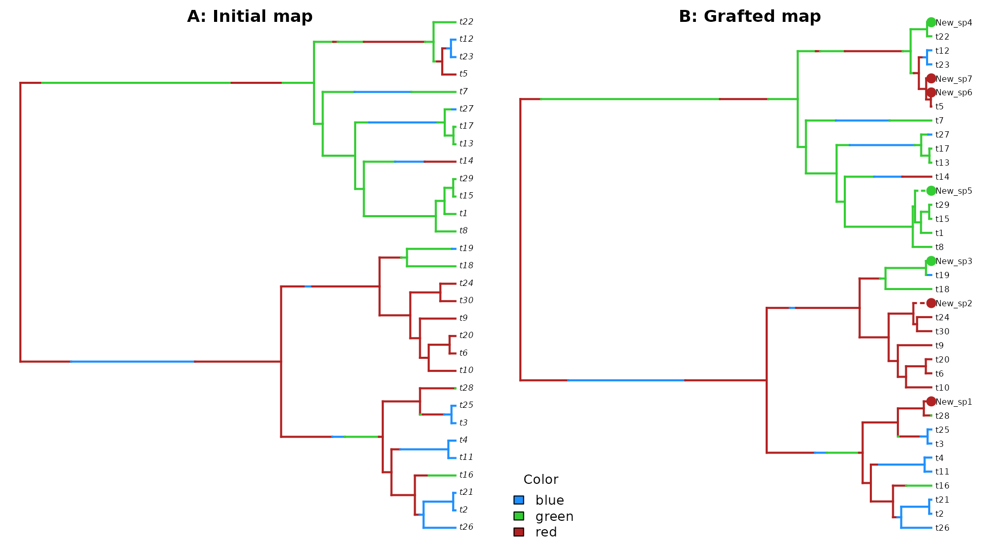
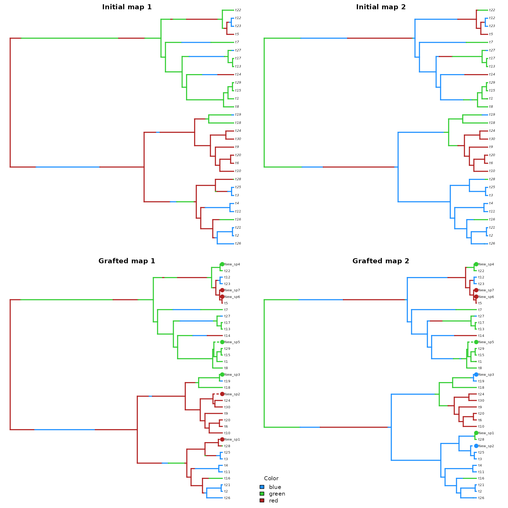
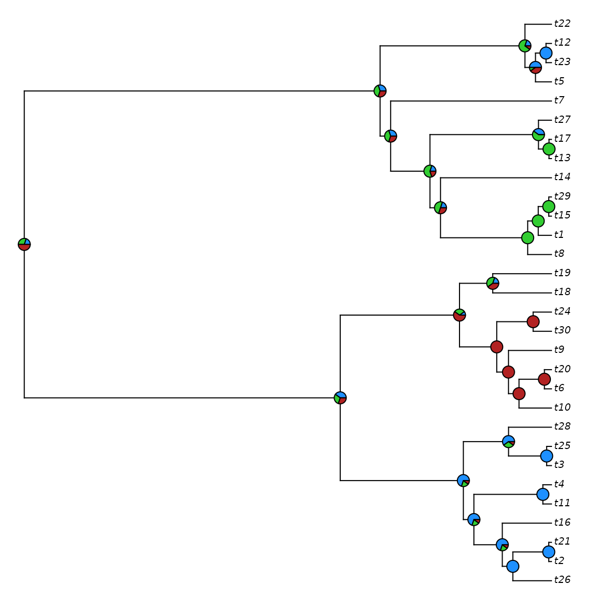
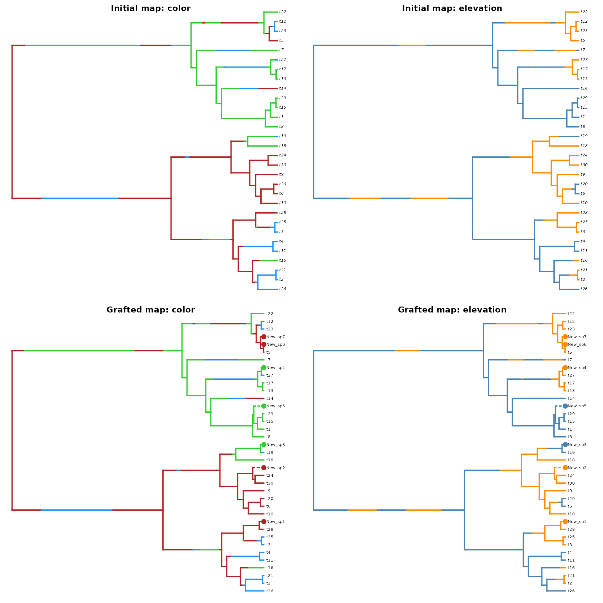
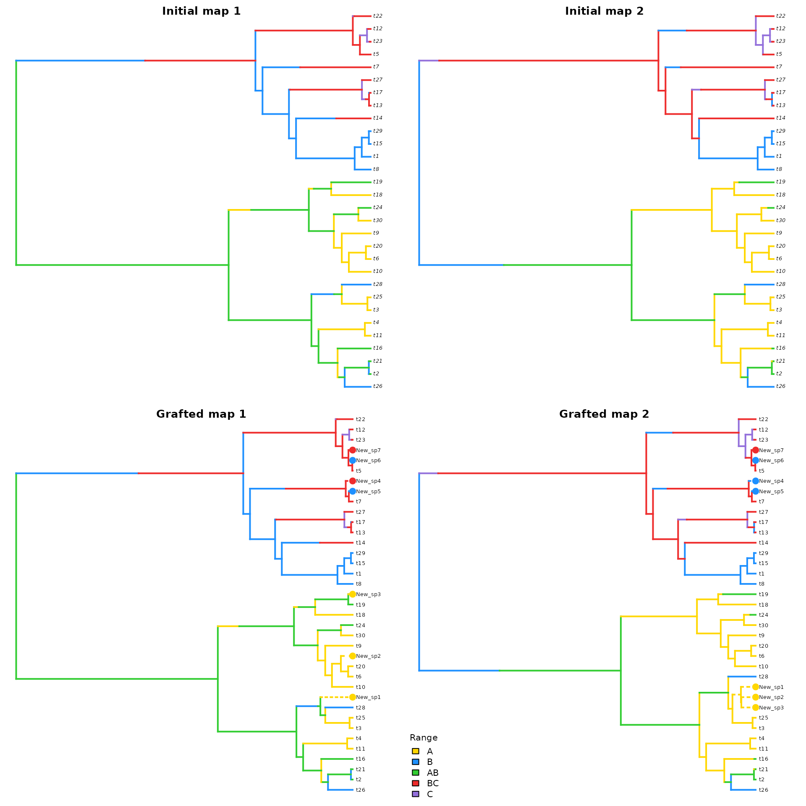
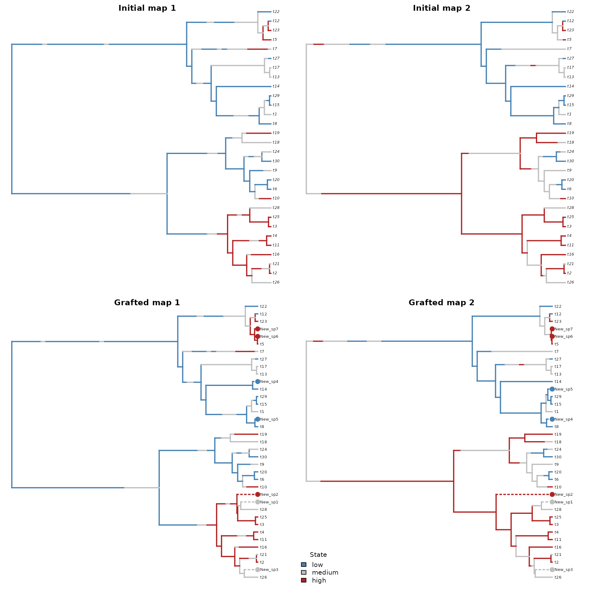

# Prepare stochastic maps from tip data

Grafting can be constrained by **species attributes** (e.g., a trait, a
biogeographic range) described by **stochastic character maps** of the
backbone phylogeny, called `simmap` in `phytools`. Each missing taxon
and/or clade is only grafted on branches where the trait was in one of
its `allowed_states`.

For instance, you can use biogeographic ranges to perform
**Geographically-Informed Grafting (GIG)** in a way that limit the
grafting of missing taxa/clades on branches that are inferred within the
ranges allowed for each of them (See *Section 5*). For more details on
how **species attributes** are used as constraints for grafting, please
refer to *Section 4* in
[`vignette("graft_missing_taxa")`](https://maeldore.github.io/phylograftR/articles/graft_missing_taxa.md),
and each vignette dedicated to handling a specific type of attributes
([`vignette("biogeographic_data")`](https://maeldore.github.io/phylograftR/articles/biogeographic_data.md);
[`vignette("continuous_data")`](https://maeldore.github.io/phylograftR/articles/continuous_data.md);
[`vignette("multiple_traits")`](https://maeldore.github.io/phylograftR/articles/multiple_traits.md)).

This tutorial explains how to **prepare stochastic character maps from
your own tip data**:

1.  Infer maps of a **categorical trait** with deepSTRAPP.

It advises on which object to provide to the grafting functions in each
case:

2.  **A single `simmap`**: one history of the attribute evolving along
    the branches of the backbone.
3.  **A `multiSimmap`**: a set of histories of the **same** attribute
    (e.g., 100 maps), which accounts for the **uncertainty** in the
    reconstruction of the ancestral states.
4.  **A list of `multiSimmap`s**: one set of maps **per attribute**, to
    combine several traits (or a trait and biogeographic ranges).

The tutorial covers the specific types of attributes handled by
phylograftR:

5.  Infer maps of **biogeographic ranges** using `BioGeoBEARS`.
6.  Produce **continuous stochastic maps** using `contsimmap`, and
    discretize them.

Finally, it covers:

7.  **Common pitfalls** in dealing with stochastic maps as inputs for
    phylograftR.

In each of the Sections 2 to 6, we **graft the 7 toy missing taxa with
the maps** to show how they are used as constraints. The figures show
the **initial maps** of the backbone and the **updated maps** of the
grafted phylogenies side by side. This is only meant to show **how the
maps are provided and used**: the options of the grafting functions are
explored in the vignettes dedicated to each type of attribute (see *Next
steps*).

## **Why `deepSTRAPP` rather than `phytools::make.simmap()` alone?**

To produce the stochastic maps, we use the R package
[`deepSTRAPP`](https://github.com/MaelDore/deepSTRAPP) and its dedicated
all-inclusive function: `deepSTRAPP::prepare_trait_data()`.

- **Model comparison and selection are automatic.**
  [`phytools::make.simmap()`](https://rdrr.io/pkg/phytools/man/make.simmap.html)
  fits the single model you ask for (e.g., `"ARD"`) and simulates the
  maps under it: choosing the model is up to you. `prepare_trait_data()`
  **fits all the candidate models, compares them with their AICc,
  selects the best one** and simulates the maps under it, and returns
  the table of model comparison, **all in one single call**.
- **One function for all the types of attributes**:
  `deepSTRAPP::prepare_trait_data()` can handle **categorical traits**
  (through `geiger` and `phytools`), **biogeographic ranges** (through
  `BioGeoBEARS`), and **continuous traits** (through `contsimmap`), with
  the same logic and suite of arguments.
- **For biogeographic ranges, it embeds the whole machinery of
  `BioGeoBEARS`**: preparation of the input files, fit and comparison of
  the models (`DEC`, `DIVALIKE`, `BAYAREALIKE`, with or without `+J`),
  best model selection, biogeographic stochastic mapping, and the
  conversion of the outputs of `BioGeoBEARS` (tables of cladogenetic and
  anagenetic events) into `simmap`s **ready-to-use for as constraints
  for grafting**.

Using `deepSTRAPP` is a recommendation, not a requirement: any `simmap`
or `multiSimmap` of the backbone can be used. For instance, you can
provide maps built directly with
[`phytools::make.simmap()`](https://rdrr.io/pkg/phytools/man/make.simmap.html)
when you have already chosen your model.

**The code that runs `deepSTRAPP` and `BioGeoBEARS` is shown but not run
here** (the runs can be long). The **results** are loaded from datasets
shipped with `phylograftR`: they were produced with this code.

| Attribute | `trait_data_type` | Models available | Output of `prepare_trait_data()` to use | Provide to the grafting functions |
|:---|:---|:---|:---|:---|
| Categorical trait | `"categorical"` | `"ER"`, `"SYM"`, `"ARD"` (default), `"meristic"`, `"matrix"` (custom) | `$simmaps` | `simmap` / `multiSimmap` |
| Biogeographic ranges | `"biogeographic"` | `"DEC"` (default), `"DEC+J"`, `"DIVALIKE"`, `"DIVALIKE+J"`, `"BAYAREALIKE"`, `"BAYAREALIKE+J"` | `$simmaps` | `simmap` / `multiSimmap` |
| Continuous trait | `"continuous"` | `"BM"` (default), `"OU"`, `"EB"`, `"rate_trend"`, `"lambda"`, `"kappa"`, `"delta"` | `$contMaps` | **discretize first**: see [`vignette("continuous_data")`](https://maeldore.github.io/phylograftR/articles/continuous_data.md) |

For more details and options, please refer to the tutorials of the R
package `deepSTRAPP` directly.

See the companion website (<https://maeldore.github.io/deepSTRAPP/>) and
its list of tutorials
(<https://maeldore.github.io/deepSTRAPP/articles/index.html>), in
particular the tutorials on how to model
[categorical](https://maeldore.github.io/deepSTRAPP/articles/model_categorical_trait_evolution.html),
[continuous](https://maeldore.github.io/deepSTRAPP/articles/model_continuous_trait_evolution.html)
and
[biogeographic](https://maeldore.github.io/deepSTRAPP/articles/model_biogeographic_range_evolution.html)
trait evolution.

The present tutorial gives the essential steps, and focuses on **how to
use the resulting maps with phylograftR**.

## 0/ Toy data

We use the toy backbone and the **tip data of three attributes**: a
color (three states), an elevation (two states) and a biogeographic
range (three areas that can be combined in multi-area ranges). The tip
data are held in a `data.frame` with one row per tip.

``` r

# ------ Toy data ------ #

data(toy_backbone)
data(toy_tip_data)
data(toy_multiSimmap)
data(toy_multiSimmap_elevation)
data(toy_multiSimmap_ranges)

# Tip data of the three attributes
head(toy_tip_data)
#>     color elevation range
#> t26  blue       low     B
#> t2   blue      high    AB
#> t21  blue      high    AB
#> t16 green      high    AB
#> t11  blue       low     A
#> t4   blue       low     A

# Inspect distribution of data across tips
lapply(toy_tip_data, table)
#> $color
#> 
#>  blue green   red 
#>    11    11     8 
#> 
#> $elevation
#> 
#> high  low 
#>   18   12 
#> 
#> $range
#> 
#>  A AB  B BC 
#> 10  5  6  9
```

`deepSTRAPP::prepare_trait_data()` needs the tip data of one attribute
as a **named vector**, with names that match the tip labels of the
phylogeny (`phylo$tip.label`):

``` r

# ------ Named vectors of tip data ------ #

# Prepare tip data as named vectors
tip_colors <- setNames(toy_tip_data$color, row.names(toy_tip_data))
tip_elevations <- setNames(toy_tip_data$elevation, row.names(toy_tip_data))
tip_ranges <- setNames(toy_tip_data$range, row.names(toy_tip_data))

# The names are the tip labels of the backbone
all(names(tip_colors) == toy_backbone$tip.label)
#> [1] TRUE
```

``` r

# ------ Colors of the states ------ #

# Colors of the three states of the color trait
color_states <- c(blue = "dodgerblue", green = "limegreen", red = "firebrick")

# Colors of the two states of the elevation
elevation_states <- c(high = "darkorange", low = "steelblue")

# Colors of the ranges: same color scheme as in vignette("biogeographic_data") (A, B, AB, BC),
# completed with the other ranges that can be found in the maps (C, AC, and the null range "_")
range_colors <- c(A = "gold", B = "dodgerblue", AB = "limegreen", BC = "firebrick2",
                  C = "mediumpurple", AC = "darkorange", "_" = "grey50")
```

To compare the **initial maps** of the backbone with the **updated
maps** of the grafted phylogenies, we define two helpers to plot them in
the same way. In the updated maps, the **grafted branches are dashed**,
and the **grafted tips are marked with a point** in the color of the
state they inherited (see
[`plot_grafted()`](https://maeldore.github.io/phylograftR/reference/plot_grafted.md)).

``` r

# ------ Helpers to plot the maps before and after grafting ------ #

# Plot an initial simmap of the backbone
plot_initial_map <- function (simmap, colors, main)
{
  phytools::plotSimmap(simmap, colors = colors, fsize = 0.5, ftype = "i", lwd = 2)
  title(main, cex.main = 1, line = -1) # Inside the plot region, as plotSimmap() resets the margins
}

# Plot the updated simmap of a grafted phylogeny
# 'trait' is the name (or position) of the trait to plot when the maps of several traits were used
plot_updated_map <- function (phy_grafted, colors, main, trait = 1)
{
  # Grafted branches are dashed
  plot_grafted(phy_grafted, which = "edges", trait = trait, simmap_colors = colors,
               fsize = 0.5, lwd = 2)
  title(main, cex.main = 1, line = -1)
  # Grafted tips are marked with a point in the color of the state they inherited
  simmap <- phy_grafted$simmap
  if (!inherits(simmap, "simmap")) { simmap <- simmap[[trait]] } # Maps of several traits
  grafted_tips <- which(phy_grafted$grafted_tips)
  tip_states <- phytools::getStates(simmap, type = "tips")[phy_grafted$tip.label[grafted_tips]]
  ape::tiplabels(tip = grafted_tips, pch = 19, cex = 1.2, col = colors[tip_states])
}
```

## 1/ Infer maps of a categorical trait with deepSTRAPP

The call below **fits three models of evolution of the color, compares
them, selects automatically the one with the lowest AICc**, and
simulates stochastic maps conditioned on the tip data and on the best
model.

``` r

# ------ Not run: build the maps of the color with deepSTRAPP ------ #

color_data <- deepSTRAPP::prepare_trait_data(tip_data = tip_colors, # Named vector of tip states
                                             trait_data_type = "categorical",
                                             phylo = toy_backbone, # Time-calibrated phylogeny
                                             evolutionary_models = c("ER", "SYM", "ARD"), # Models to compare. Default is "ARD"
                                             seed = 1234, # For reproducibility
                                             nb_simulations = 100, # Number of stochastic maps
                                             return_simmaps = TRUE, # Needed to get the maps
                                             return_model_selection_df = TRUE, # Needed to get the comparison of models
                                             plot_map = FALSE, plot_overlay = FALSE)

# Comparison of the models (ER is the best model here)
color_data$model_selection_df

# The stochastic maps: a multiSimmap of 100 maps
my_multiSimmap <- color_data$simmaps
```

The main arguments are:

- `evolutionary_models`: the models to compare (see the table above).
  The model with the lowest AICc is used to simulate the maps. A
  **custom matrix of transitions** (`Q_matrix`) can be used with the
  model `"matrix"`, for instance to forbid some transitions between
  states (e.g., an ordered trait).
- `nb_simulations`: the **number of maps**. `deepSTRAPP` recommends at
  least 100 maps, and warns if fewer are requested.
- `return_simmaps = TRUE`: **the maps are only returned in `$simmaps` if
  you ask for them**. By default, `prepare_trait_data()` only returns
  the summaries that `deepSTRAPP` needs for its own workflow (e.g.,
  `$densityMaps`).
- `seed`: to reproduce the maps.

The maps are **conditioned on the tip data**: the tips are always in the
states you provided, and the maps only differ in the internal branches.
The maps shipped with `phylograftR` are the **first 10 of 100 maps**
simulated with this script. 10 maps are enough for illustration, but
**actual analyses should use more (100 or more)**.

## 2/ Use a single map: `simmap`

A **single `simmap`** is one possible history of the trait: take **one
map** of the output. It is the simplest input to provide under the
argument `simmap` for the grafting functions, and it is enough to
explore the grafting with constraints.

``` r

# ------ One simmap ------ #

# Extract one map (with [[ ]]): an object of class "simmap"
my_simmap <- toy_multiSimmap[[1]]
class(my_simmap)
#> [1] "simmap" "phylo"

# Time spent in each state (sum on all branches)
round(colSums(my_simmap$mapped.edge) / sum(my_simmap$mapped.edge), 2)
#>  blue green   red 
#>  0.22  0.37  0.41

# The tips in the simmap are in the states of the tip data
all(phytools::getStates(my_simmap, type = "tips")[names(tip_colors)] == tip_colors)
#> [1] TRUE
```

We use this map to graft the 7 toy missing taxa. The **colors allowed
for each taxon** are provided in the item `allowed_states` of the list
of missing taxa (see
[`vignette("format_inputs")`](https://maeldore.github.io/phylograftR/articles/format_inputs.md)):
taxa with `NULL` can be grafted anywhere in their target clade. The map
is provided to the **argument `simmap`** of the grafting function.

``` r

# ------ Graft with a single simmap ------ #

# Missing taxa with their allowed colors
data(toy_missing_taxa_list_with_allowed_states)
taxa_colors <- toy_missing_taxa_list_with_allowed_states

# New_sp1 is only allowed in "red" in the current mising_taxa_list. We modify it to also allow "green", 
# so that a branch is available for it in each of the 10 maps used in Section 3 (see vignette("check_grafting"))
taxa_colors$allowed_states[[1]] <- c("red", "green")

# Graft the taxa using the map as constraint
grafted_single <- graft_missing_taxa(phy = toy_backbone, missing_taxa_list = taxa_colors,
                                     simmap = my_simmap, verbose = FALSE, seed = 1)

# The output includes the updated map of the grafted phylogeny
class(grafted_single$simmap)
#> [1] "simmap" "phylo"
```

The updated map includes the grafted branches, that are **entirely in
the state of the branch piece they were grafted on**, and so are the
grafted tips:

``` r

# ------ Compare the initial map and the updated map ------ #

par(mfrow = c(1, 2), mar = c(0.5, 0.5, 2, 0.5))
plot_initial_map(my_simmap, colors = color_states, main = "A: Initial map")
plot_updated_map(grafted_single, colors = color_states, main = "B: Grafted map")
legend("bottomleft", legend = names(color_states), fill = color_states, title = "Color", bty = "n", cex = 0.8)
```



``` r

par(mfrow = c(1, 1), mar = c(5.1, 4.1, 4.1, 2.1))
```

A single map is **one hypothesis among many** about where the states
changed along the branches. Grafting with it treats this history as
known, so the **uncertainty on the ancestral states is ignored**. It is
suitable if there is limited uncertainty in the inference, but in most
biological cases, you would like to account for this uncertainty in
ancestral states by using **several maps** (See *Section 3* below)

## 3/ Use several maps: `multiSimmap`

The `$simmaps` element of the output of `prepare_trait_data()` is a
`multiSimmap`: a set of maps of the same trait, used as **alternative
hypotheses** about its evolution. Provide it through the same `simmap`
argument to the grafting functions: each map is then used for the
grafting, and the uncertainty on the history of the trait is
**propagated to the grafted phylogenies**.

``` r

# ------ A multiSimmap ------ #

class(toy_multiSimmap)
#> [1] "multiSimmap" "multiPhylo"
length(toy_multiSimmap)
#> [1] 10

# All the maps are in the same states
unique(unlist(lapply(toy_multiSimmap, function (x) colnames(x$mapped.edge))))
#> [1] "blue"  "green" "red"
```

The maps share the same tip states, but differ in the **internal
branches**. We graft the taxa with **all the 10 maps**, with the default
parameters. The output is a list with **one grafted phylogeny per map**.

``` r

# ------ Graft with a multiSimmap ------ #

# Graft the taxa with each of the 10 maps (one simulation per map by default)
grafted_multi <- graft_missing_taxa(phy = toy_backbone, missing_taxa_list = taxa_colors,
                                    simmap = toy_multiSimmap, verbose = FALSE, seed = 1)
length(grafted_multi)
#> [1] 10
```

We plot two of the initial maps (upper line) and the updated maps of the
corresponding grafted phylogenies (lower line). Each grafted phylogeny
is built with a different history of the trait: the **uncertainty on the
trait history is propagated to the grafted phylogenies**.

``` r

# ------ Initial maps (upper line) and grafted maps (lower line) ------ #

par(mfrow = c(2, 2), mar = c(0.5, 0.5, 2, 0.5))
# Upper line: initial maps
for (i in 1:2) { plot_initial_map(toy_multiSimmap[[i]], colors = color_states, main = paste("Initial map", i)) }
# Lower line: grafted maps
for (i in 1:2) { plot_updated_map(grafted_multi[[i]], colors = color_states, main = paste("Grafted map", i)) }
legend("bottomleft", legend = names(color_states), fill = color_states, title = "Color", bty = "n", cex = 0.8)
```



``` r

par(mfrow = c(1, 1), mar = c(5.1, 4.1, 4.1, 2.1))
```

The **posterior probabilities of each state at the internal nodes**,
computed over the maps, summarize this uncertainty:

``` r

# ------ Posterior probability of the states at the nodes ------ #

node_probs <- phytools::describe.simmap(toy_multiSimmap, plot = FALSE)$ace

phytools::plotTree(toy_backbone, ftype = "i", fsize = 0.6, lwd = 1)
ape::nodelabels(pie = node_probs, piecol = color_states[colnames(node_probs)], cex = 0.5)
```



The more maps, the more precise the probabilities (i.e., the more
accurately our set of grafted phylogenies account for the uncertainty in
the evolution of the trait used as constraint). Note that the **number
of maps and the number of simulations multiply**: with `P` maps and `N`
simulations per map, `P x N` grafted phylogenies are produced (see
[`vignette("handle_uncertainty")`](https://maeldore.github.io/phylograftR/articles/handle_uncertainty.md)).

## 4/ Combine several traits: list of `multiSimmap`s

To use **several attributes at once** as constraints, prepare the maps
of **each attribute separately** (the attributes are modeled
independently), and combine them in a **list with one element per
attribute**. The grafting function will account **jointly** for all
constraints to ensure that grafted lineages **respect their allowed
states in all traits**.

Below, we prepare the maps of the elevation as for the color:

``` r

# ------ Not run: build the maps of the elevation with deepSTRAPP ------ #

elevation_data <- deepSTRAPP::prepare_trait_data(tip_data = tip_elevations,
                                                 trait_data_type = "categorical",
                                                 phylo = toy_backbone,
                                                 evolutionary_models = c("ER", "ARD"),
                                                 seed = 2345,
                                                 nb_simulations = 100, # The same number of maps as for the color
                                                 return_simmaps = TRUE,
                                                 plot_map = FALSE, plot_overlay = FALSE)

# Comparison of the models (ER is the best model here)
elevation_data$model_selection_df

# The stochastic maps: a multiSimmap of 100 maps
my_multiSimmap_elevation <- elevation_data$simmaps
```

The maps of the traits are combined in a **named list**, provided to the
argument `simmap`. We start with the simplest case: **a single map per
trait**, i.e., the map 1 of the color and the map 1 of the elevation.

``` r

# ------ List of simmaps: one element per trait ------ #

# Combine map 1 for color and map 1 for elevation in a list of two simmaps
maps_two_traits_single <- list(color = toy_multiSimmap[[1]], elevation = toy_multiSimmap_elevation[[1]])

# States of each trait
lapply(maps_two_traits_single, function (x) colnames(x$mapped.edge))
#> $color
#> [1] "blue"  "green" "red"  
#> 
#> $elevation
#> [1] "high" "low"
```

The **allowed states** are then given in the `missing_taxa_list` as a
list with one element per trait (in the order of the list of maps):
`list(color, elevation)`. We graft the 7 missing taxa that have allowed
colors and/or allowed elevations (`NULL` means that all the states of
this trait are allowed).

``` r

# ------ Graft with two traits ------ #

# Missing taxa with the allowed states of the color and of the elevation
data(toy_missing_taxa_list_with_two_traits)
taxa_two_traits <- toy_missing_taxa_list_with_two_traits

# New_sp1 is only allowed in "red" in the current mising_taxa_list. We modify it to also allow "green", 
# so that a branch is available for it in each of the 10 pairs of maps used here
taxa_two_traits$allowed_states[[1]] <- list(c("red", "green"), NULL)

# Graft the taxa using the map of each trait
grafted_two_traits <- graft_missing_taxa(phy = toy_backbone, missing_taxa_list = taxa_two_traits,
                                         simmap = maps_two_traits_single, verbose = FALSE, seed = 1)

# We obtain one grafted phylogeny, with one updated map per trait
names(grafted_two_traits$simmap)
#> [1] "color"     "elevation"
```

We plot the initial maps (upper line) and the updated maps (lower line)
of the color (left) and of the elevation (right). Each grafted taxon is
grafted on a branch piece in one of its allowed states for **each
trait**, and **inherits both states**.

``` r

# ------ Initial maps (upper line) and grafted maps (lower line) ------ #

par(mfrow = c(2, 2), mar = c(0.5, 0.5, 2, 0.5))
# Upper line: initial maps of the color and of the elevation
plot_initial_map(maps_two_traits_single$color, colors = color_states, main = "Initial map: color")
plot_initial_map(maps_two_traits_single$elevation, colors = elevation_states, main = "Initial map: elevation")
# Lower line: grafted maps
plot_updated_map(grafted_two_traits, colors = color_states, trait = "color", main = "Grafted map: color")
plot_updated_map(grafted_two_traits, colors = elevation_states, trait = "elevation", main = "Grafted map: elevation")
```



``` r

par(mfrow = c(1, 1), mar = c(5.1, 4.1, 4.1, 2.1))
```

The same works with **`multiSimmap`s**, to account for the uncertainty
in each trait. The list is then a list of `multiSimmap`s, and **all the
traits must have the same number of maps**: the maps are **paired** (map
1 of each trait is used together, then map 2 of each trait, and so on).
The output has one grafted phylogeny per pair of maps (times the number
of simulations requested).

``` r

# ------ List of multiSimmaps: one element per trait ------ #

# Combine all maps for color with all maps for elevation in a list of two multiSimmap
maps_two_traits <- list(color = toy_multiSimmap, elevation = toy_multiSimmap_elevation)

# Number of maps per trait: must be the same
sapply(maps_two_traits, length)
#>     color elevation 
#>        10        10

# Graft the taxa using the map of each trait
grafted_two_traits_multi <- graft_missing_taxa(phy = toy_backbone, missing_taxa_list = taxa_two_traits,
                                         simmap = maps_two_traits, verbose = FALSE, seed = 1)

# We obtain 10 grafted phylogeny, one per map of each trait. 
length(grafted_two_traits_multi)
#> [1] 10
# Each grafted phylogeny contains one updated map per trait
names(grafted_two_traits_multi[[1]]$simmap)
#> [1] "color"     "elevation"
```

A list of single `simmap`s and a list of `multiSimmap`s **cannot be
mixed**: **a trait with a single `simmap` and another with a
`multiSimmap` is refused**, but you can always duplicate a single
`simmap` in the list, so that it pairs with all the maps of the
`multiSimmap` of the second trait.

``` r

# ------ Pair a single simmap with a multiSimmap ------ #

# Duplicate the map 1 of the elevation 10 times (with [ ], the class multiSimmap is kept)
elevation_duplicated <- toy_multiSimmap_elevation[rep(1, length(toy_multiSimmap))]
sapply(list(color = toy_multiSimmap, elevation = elevation_duplicated), length)
#>     color elevation 
#>        10        10
```

The grafting with several traits is detailed in
[`vignette("multiple_traits")`](https://maeldore.github.io/phylograftR/articles/multiple_traits.md).

## 5/ Infer maps of biogeographic ranges with BioGeoBEARS

For **biogeographic ranges**, `deepSTRAPP::prepare_trait_data()` embeds
**the whole machinery of the
[`BioGeoBEARS`](https://github.com/nmatzke/BioGeoBEARS) framework** in a
single call:

1.  it prepares the **input files** of `BioGeoBEARS` from your phylogeny
    and your tip ranges;
2.  it **fits the models** you ask for, and **selects the best one** by
    AICc (the models with a `+J` parameter are fit starting from the
    estimates of the corresponding model without `J`);
3.  it runs the **biogeographic stochastic mapping** (BSM) under the
    best model, which simulates histories of the ranges as **tables of
    cladogenetic events** (at the nodes) and **anagenetic events**
    (along the branches);
4.  it **converts these tables of events into `simmap`s**, the format
    used by `phylograftR`.

The R package `BioGeoBEARS` is not on CRAN and must be installed
manually from the author’s repository
(`pak::pak("nmatzke/BioGeoBEARS")`).

The tip data are the ranges of the tips, **coded as in `BioGeoBEARS`**:
one capital letter per area, and the letters of a multi-area range in
alphabetical order (e.g., `"A"`, `"AB"`). Alternatively, they can be
provided as a `matrix` or `data.frame` of presence (1) / absence (0),
with one column per area and one row per taxon.

``` r

# ------ Not run: build the maps of the ranges with deepSTRAPP and BioGeoBEARS ------ #

range_data <- deepSTRAPP::prepare_trait_data(tip_data = tip_ranges, # Named vector of ranges (or binary matrix)
                                             trait_data_type = "biogeographic",
                                             phylo = toy_backbone,
                                             evolutionary_models = "DEC", # Models to compare, e.g., c("DEC", "DEC+J", "DIVALIKE", "DIVALIKE+J")
                                             max_range_size = 2, # Maximum number of areas in a range
                                             BioGeoBEARS_directory_path = "./BioGeoBEARS_files/", # Directory for input/output files
                                             keep_BioGeoBEARS_files = FALSE,
                                             nb_cores = 1,
                                             seed = 3456,
                                             nb_simulations = 100,
                                             return_simmaps = TRUE,
                                             return_model_selection_df = TRUE,
                                             return_BSM = FALSE, # TRUE to also get the tables of events
                                             plot_map = FALSE, plot_overlay = FALSE)

# Comparison of the models (Here, we fit only a DEC model)
range_data$model_selection_df

# The stochastic maps of ranges, converted from the BSM events: a multiSimmap of 100 maps
my_multiSimmap_ranges <- range_data$simmaps
```

The main arguments specific to ranges are:

- `evolutionary_models`: the `BioGeoBEARS` models to compare, **fit and
  selected automatically**. The `+J` models add jump dispersal
  (founder-event speciation).
- `return_BSM = TRUE`: also returns the **tables of cladogenetic and
  anagenetic events** of each simulation, from which the maps are built
  (`$BSM_output`).
- `max_range_size`: the **maximum number of areas** in a range. It
  limits the number of ranges considered, so the computation time, but
  also restrict inferences to realistic ranges.
- `BioGeoBEARS_directory_path`: the directory where the input and output
  files of `BioGeoBEARS` are written (and kept if
  `keep_BioGeoBEARS_files = TRUE`).
- `nb_cores`: the number of cores used for the runs of `BioGeoBEARS`.

The output `$simmaps` is a `multiSimmap`, as for a categorical trait, in
which the **states are the ranges**.

``` r

# ------ Maps of ranges ------ #

class(toy_multiSimmap_ranges)
#> [1] "multiSimmap" "multiPhylo"
length(toy_multiSimmap_ranges)
#> [1] 10

# Ranges of the tips
sort(unique(tip_ranges))
#> [1] "A"  "AB" "B"  "BC"

# Ranges visited in the maps, i.e., with a positive residence time on the branches
# (the columns of 'mapped.edge' list all the ranges of the model, including those never visited)
visited_ranges <- sort(unique(unlist(lapply(toy_multiSimmap_ranges, function (x) {
  colnames(x$mapped.edge)[colSums(x$mapped.edge) > 0] }))))
visited_ranges
#> [1] "A"  "AB" "B"  "BC" "C"
```

The ranges of the maps include the ranges of the tips, and may include
**ranges that are only found along internal branches**, as ancestors can
have ranges that no tip has. Keep it in mind when you choose the
**allowed ranges** of the missing taxa: they must be ranges found in the
maps. With `treat_states_as_ranges = TRUE` ranges that are contained in
the mapped ranges can also be used (i.e., `"C"` when only `"BC"` appears
in the maps; see
[`vignette("biogeographic_data")`](https://maeldore.github.io/phylograftR/articles/biogeographic_data.md)).

We graft the 7 toy missing taxa with the maps of ranges. The taxa are
allowed in the ranges `"A"` or `"B"` only, and **any range that includes
these areas** is accepted (e.g., `"AB"`), as the states are treated as
**ranges** (`treat_states_as_ranges = TRUE`). As in *Section 3*, we use
the **first two maps** for illustration.

``` r

# ------ Graft with a multiSimmap of ranges ------ #

# Missing taxa with their allowed ranges
data(toy_missing_taxa_list_with_allowed_ranges)

# Graft the taxa using the first two maps of ranges
grafted_ranges <- graft_missing_taxa(phy = toy_backbone,
                                     missing_taxa_list = toy_missing_taxa_list_with_allowed_ranges,
                                     simmap = toy_multiSimmap_ranges[1:2],
                                     allowed_states = c("A", "B"), treat_states_as_ranges = TRUE,
                                     nb_simulations = 1, verbose = FALSE, seed = 1)
length(grafted_ranges)
#> [1] 2
```

We plot the two initial maps (upper line) and the updated maps of the
grafted phylogenies (lower line). The grafted tips inherit one of their
allowed ranges that is contained in the **range of the branch piece they
were grafted on**.

``` r

# ------ Initial maps (upper line) and grafted maps (lower line) ------ #

par(mfrow = c(2, 2), mar = c(0.5, 0.5, 2, 0.5))
# Upper line: initial maps of ranges
for (i in 1:2) { plot_initial_map(toy_multiSimmap_ranges[[i]], colors = range_colors, main = paste("Initial map", i)) }
# Lower line: grafted maps
for (i in 1:2) { plot_updated_map(grafted_ranges[[i]], colors = range_colors, main = paste("Grafted map", i)) }
legend("bottomleft", legend = names(range_colors)[names(range_colors) %in% visited_ranges],
       fill = range_colors[names(range_colors) %in% visited_ranges], title = "Range", bty = "n", cex = 0.8)
```



``` r

par(mfrow = c(1, 1), mar = c(5.1, 4.1, 4.1, 2.1))
```

In the maps, the **changes of range happen along the branches**
(anagenetic changes: dispersal or local extinction) and **at the nodes**
(cladogenetic events, e.g., vicariance), where a descendant branch
starts in a range different from the one of its parent.

The grafting with ranges offers more options than shown here: **exact
matching of the ranges** (`treat_states_as_ranges = FALSE`)
vs. **matching of the areas** (`treat_states_as_ranges = TRUE`), and the
**combination of ranges with another trait**. Options are all explored
in
[`vignette("biogeographic_data")`](https://maeldore.github.io/phylograftR/articles/biogeographic_data.md).

## 6/ Continuous traits

For a **continuous trait**,
`deepSTRAPP::prepare_trait_data(trait_data_type = "continuous")` returns
a `contMap` (`$contMap`) and, with `run_stochastic_maps = TRUE`, a
**list of `contMap`s** (`$contMaps`), which are **not** stochastic
character maps:

- `$contMap` is a **point-estimate** of ancestral trait values based on
  the interpolation of ML estimates at nodes (see
  [`phytools::contMap()`](https://rdrr.io/pkg/phytools/man/contMap.html)).
- `$contMaps` are **continuous stochastic maps** that describe multiple
  evolutionary histories of the trait on the phylogeny, simulated
  conditionally on the tip data and an evolutionary model with
  `contsimmap`.

phylograftR **does not handle directly continuous data**. The maps must
be **discretized into states** with
[`phylograftR::convert_contMap_to_simmap()`](https://maeldore.github.io/phylograftR/reference/convert_contMap_to_simmap.md)
before they can constrain the grafting. Do **not** discretize the tip
values before the reconstruction: the discretization is applied on the
continuous reconstruction (see *Section 4* in
[`vignette("continuous_data")`](https://maeldore.github.io/phylograftR/articles/continuous_data.md)).

The R package `contsimmap` is not on CRAN and must be installed manually
from the authors’ repository (`pak::pak("bstaggmartin/contsimmap")`).

The tip data are a **named vector of numeric values**. The maps are
simulated under a model of evolution (here, a Brownian Motion, `"BM"`)
conditioned on the tip values:

``` r

# ------ Not run: build the continuous stochastic maps with deepSTRAPP ------ #

data(toy_tip_values) # Named vector of continuous values
my_trait_data <- deepSTRAPP::prepare_trait_data(tip_data = toy_tip_values,
                                                trait_data_type = "continuous",
                                                phylo = toy_backbone,
                                                evolutionary_models = "BM", # Models to compare, e.g., c("BM", "OU", "EB")
                                                run_stochastic_maps = TRUE, # Simulate the continuous stochastic maps
                                                nb_simulations = 100,
                                                seed = 1234,
                                                plot_map = FALSE)

# Point estimate (interpolated ML estimates of the ancestral values)
my_contMap <- my_trait_data$contMap

# List of 100 contMaps: the stochastic maps of the continuous trait
my_contMaps_list <- my_trait_data$contMaps
```

The main arguments specific to continuous traits are:

- `evolutionary_models`: the models of continuous trait evolution to
  **fit and compare** (models of
  [`geiger::fitContinuous()`](https://rdrr.io/pkg/geiger/man/fitContinuous.html)):
  `"BM"` (Brownian Motion, the default), `"OU"` (Ornstein-Uhlenbeck),
  `"EB"` (Early-Burst), `"rate_trend"`, and the models with a
  transformation of the tree: `"lambda"`, `"kappa"` and `"delta"`
  (Pagel’s models). The best model is selected by AICc and used to
  simulate the maps.
- `run_stochastic_maps = TRUE`: simulates the **continuous stochastic
  maps** (`$contMaps`). Otherwise, only the point estimate `$contMap` is
  returned.

We use here the shipped list `toy_contMaps` (10 maps, to keep the
package light), built with the same procedure. The maps are discretized
into **three states with the terciles of the tip values** as cut points
(`probs = c(1/3, 2/3)`). The output is a `multiSimmap`, used exactly as
in *Section 3*.

``` r

# ------ Discretize the contMaps into a multiSimmap ------ #

data(toy_tip_values)
data(toy_contMaps)

state_names <- c("low", "medium", "high") # From the lowest to the highest values
state_colors <- c(low = "steelblue", medium = "grey75", high = "firebrick")

multiSimmap_continuous <- convert_contMap_to_simmap(contMap = toy_contMaps,
                                                    probs = c(1/3, 2/3), # Terciles of the tip values
                                                    states = state_names,
                                                    tip_values = toy_tip_values,
                                                    verbose = FALSE)
class(multiSimmap_continuous)
#> [1] "multiSimmap" "multiPhylo"
length(multiSimmap_continuous)
#> [1] 10
```

The missing taxa are described by a **continuous value** (e.g., from the
literature). The values are **converted into states** with the same cut
points, and used as the allowed states of the taxa.

``` r

# ------ Graft with the discretized maps ------ #

data(toy_missing_taxa_list)

# Continuous values of the 7 missing taxa
missing_values <- c(New_sp1 = 0.5, New_sp2 = 2.5, New_sp3 = 1.4, New_sp4 = -3,
                    New_sp5 = -1, New_sp6 = 3.5, New_sp7 = 1.6)

# Convert into allowed states: provide the multiSimmap itself, as it holds the cut points
taxa_continuous <- toy_missing_taxa_list
taxa_continuous$allowed_states <- convert_values_to_states(values = missing_values,
                                                           simmap = multiSimmap_continuous)

# Graft the taxa using the first two maps
grafted_continuous <- graft_missing_taxa(phy = toy_backbone, missing_taxa_list = taxa_continuous,
                                         simmap = multiSimmap_continuous[1:2],
                                         nb_simulations = 1, verbose = FALSE, seed = 1)
```

We plot the two initial discretized maps (upper line) and the updated
maps of the grafted phylogenies (lower line).

``` r

# ------ Initial maps (upper line) and grafted maps (lower line) ------ #

par(mfrow = c(2, 2), mar = c(0.5, 0.5, 2, 0.5))
# Upper line: initial discretized maps
for (i in 1:2) { plot_initial_map(multiSimmap_continuous[[i]], colors = state_colors, main = paste("Initial map", i)) }
# Lower line: grafted maps
for (i in 1:2) { plot_updated_map(grafted_continuous[[i]], colors = state_colors, main = paste("Grafted map", i)) }
legend("bottomleft", legend = names(state_colors), fill = state_colors, title = "State", bty = "n", cex = 0.8)
```



``` r

par(mfrow = c(1, 1), mar = c(5.1, 4.1, 4.1, 2.1))
```

The choice of the **cut points and the number of states**, the
**robustness of the grafting to these discretization choices** (e.g.,
with a tolerance on the converted values), and other tools available for
grafting using continuous traits are explored in-depth in the dedicated
[`vignette("continuous_data")`](https://maeldore.github.io/phylograftR/articles/continuous_data.md).

## 7/ Common pitfalls

### Input formating conflicts

An object of class `multiSimmap` is read as a **set of maps of one
trait**. On the other hand, a list of `simmap`s is considered as **one
map per trait**.

Therefore, if the `multiSimmap` class of an object is lost, like when
using [`lapply()`](https://rdrr.io/r/base/lapply.html), the maps may be
erroneously read as **one map per trait**.

In our example, the grafting function will **stop** and tells you that
maps of 10 traits are used, while your `allowed_states` to use as
constraints do not account for 10 traits:

``` r

# ------ Error with allowed states ------ #

# Load missing taxa list
data(toy_missing_taxa_list)

# A set of maps for a unique trait is a "multiSimmap", "multiPhylo" object
class(toy_multiSimmap)
#> [1] "multiSimmap" "multiPhylo"

# Convert multiSimmap into a plain list: class lost
plain_list <- lapply(toy_multiSimmap, identity)

# It becomes a list of simmaps with both classes: "phylo" and "simmap".
class(plain_list)
#> [1] "list"
table(unlist(lapply(plain_list, FUN = class)))
#> 
#>  phylo simmap 
#>     10     10

# Check the grafting plan using a list of 10 simmaps, but allowed_states for a unique trait (color)
check_grafting_plan(phy = toy_backbone, missing_taxa_list = toy_missing_taxa_list,
                    simmap = plain_list, allowed_states = c("blue", "green"), verbose = FALSE)
#> Error in `normalize_trait_states()`:
#> ! The maps of 10 traits are used, so the allowed states of the global 'allowed_states' argument must be given for each trait: a list with one element per trait in the order of the traits (trait_1, trait_2, trait_3, trait_4, trait_5, trait_6, trait_7, trait_8, trait_9, trait_10), e.g., list(c('state_1', 'state_2'), NULL, 'state_3') ('NULL': no restriction on the trait), or a text such as 'state_1,state_2;;state_3'.
```

To restore the class, set it back, and check the number of maps with
[`check_grafting_plan()`](https://maeldore.github.io/phylograftR/reference/check_grafting_plan.md):

``` r

# ------ Restore the class ------ #

class(plain_list) <- c("multiSimmap", "multiPhylo")
plan_fixed <- check_grafting_plan(phy = toy_backbone, missing_taxa_list = toy_missing_taxa_list,
                                  simmap = plain_list, verbose = FALSE)
attr(plan_fixed, "n_maps")
#> [1] 10
```

### Maps pairing for multiple traits

When aiming to use multiple traits as constraints, thus provide the
grafting function with a list of (multi)simmap(s), you need to ensure
that **all the traits have the same number of maps**. During grafting,
**maps are paired** across traits to become joint constraints for a
given grafted phylogeny. The output will contains as many grafted
phylogenies as there are maps in each trait, times the number of
simulations requested (`nb_simulations`) (see
[`vignette("handle_uncertainty")`](https://maeldore.github.io/phylograftR/articles/handle_uncertainty.md)).

We illustrate this error below: we provide a `multiSimmap` with 10 maps
for colors, and a `multiSimmap` with 5 maps for elevation.

``` r

# ------ Different numbers of maps among traits ------ #

check_grafting_plan(phy = toy_backbone, missing_taxa_list = toy_missing_taxa_list,
                    simmap = list(color = toy_multiSimmap, elevation = toy_multiSimmap_elevation[1:5]),
                    verbose = FALSE)
#> Error in `check_trait_maps()`:
#> ! All the traits must have the same number of maps, since the maps are paired (map 1 of every trait, then map 2, ...). Number of maps per trait: 'color' = 10, 'elevation' = 5.
```

### Other potential pitfalls

Other points to keep in mind:

- **All the maps must have the same tips, topology and branch lengths as
  the backbone** used for grafting. If you prune or rescale the
  phylogeny after building the maps, **rebuild the maps** on the final
  phylogeny to ensure all trees are matching.
- The **allowed states** of the missing taxa must be states found in the
  maps (or areas contained in the ranges of the maps, with
  `treat_states_as_ranges = TRUE`). Before running any long run, it is
  recommended to **check the feasibility of the grafting plan** across
  all the stochastic maps, as some may not present branches in any
  allowed_states among the branches available for a taxa, given its
  taxonomic constraints (i.e., target clade and excluded subclades). See
  [`vignette("check_grafting")`](https://maeldore.github.io/phylograftR/articles/check_grafting.md)
  for details on **grafting plans** and *Section 6* in
  [`vignette("format_inputs")`](https://maeldore.github.io/phylograftR/articles/format_inputs.md)
  for the formatting of allowed states.
- The maps are **hypotheses conditioned on the tip data you provide**:
  the quality of the grafting constraint depends on the quality of the
  tip data and on the fit of the evolutionary model.

## Next steps

- Use the maps to constrain the grafting: see
  [`vignette("main_workflow")`](https://maeldore.github.io/phylograftR/articles/main_workflow.md)
  for a full example with **one trait**, and
  [`vignette("multiple_traits")`](https://maeldore.github.io/phylograftR/articles/multiple_traits.md)
  for **several traits**.
- Explore all the options for grafting with **biogeographic ranges**,
  including the matching of the ranges (exact
  vs. `treat_states_as_ranges = TRUE`) and the combination with another
  trait: see
  [`vignette("biogeographic_data")`](https://maeldore.github.io/phylograftR/articles/biogeographic_data.md).
- Explore the discretization of a **continuous trait**, its robustness,
  and the other tools available: see
  [`vignette("continuous_data")`](https://maeldore.github.io/phylograftR/articles/continuous_data.md).
- For a thorough presentation of the models and of the options of
  `prepare_trait_data()`, see the vignettes of the `deepSTRAPP` package
  (<https://maeldore.github.io/deepSTRAPP/>).
